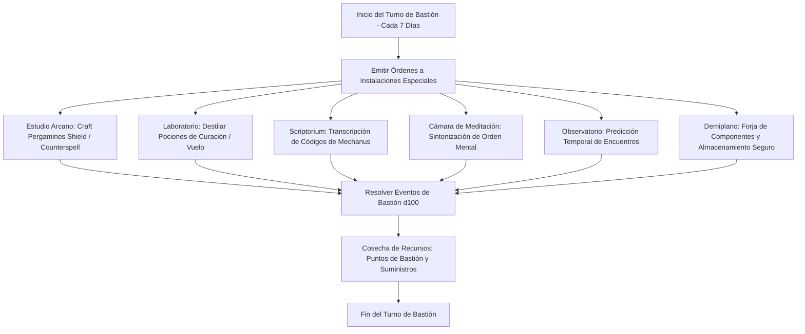

# 🏰 Bastión y Tiempo Muerto — Clocklock

## 🏰 Sistema de Bastiones (Reglas Oficiales DMG 2024 / D&D 5.5e)

* **Nombre del Bastión:** La Aguja del Horologio Mecánico (The Clockwork Spire)
* **Nivel de Bastión:** 20 (Capacidad Máxima)
* **Puntos de Bastión (BP):** 100
* **Puntuación de Mando y Defensas (Defender Stats):**
  * STR 8 (-1), DEX 14 (+2), CON 16 (+3), INT 8 (-1), WIS 10 (+0), CHA 20 (+5)
  * **Bonificador de Defensa de Bastión:** $\mathbf{+11}$ (+6 Competencia + 5 Carisma)

---

## 🏛️ Registro de Instalaciones del Bastión (Nivel 20: 4 Roomy + 2 Vast)

### Instalaciones Básicas (Basic Facilities - Gratuitas e Ilimitadas)
1. **Dormitorio del Cronometrista (Bedchambers):** Aposento geométrico con péndulo de sincronización resonante.
2. **Comedor Simétrico (Dining Hall):** Capacidad para 16 personas, con autómatas sirvientes que dosifican alimentos con exactitud calórica.
3. **Sala de Engranajes Común (Common Room):** Espacio de reunión para artesanos y eruditos planares.
4. **Almacén Sellado al Vacío (Storage):** Conservación perfecta de pergaminos, polvos alquímicos y componentes de transmutación.

---

### Instalaciones Especiales (Special Facilities: Exactamente 6 al Nivel 20)

| Instalación | Tamaño (DMG 2024) | Nivel Mínimo | Estado | Orden Activa | Sinergia con el Build |
| :--- | :---: | :---: | :---: | :--- | :---: |
| **Estudio Arcano (Arcane Study)** | **Roomy** | Nivel 5 | Activa (Maintain) | *Craft:* Pergaminos de Reacción (*Shield*, *Absorb Elements*, *Counterspell*). | 🔵 **Roto** |
| **Laboratorio (Laboratory)** | **Roomy** | Nivel 5 | Activa (Maintain) | *Research:* Pociones de Resistencia y Elixires de Velocidad acelerada. | 🟢 **Excelente** |
| **Scriptorium** | **Roomy** | Nivel 9 | Activa (Maintain) | *Transcribe:* Copiado de tratados de Mechanus y duplicación de mapas planares. | 🟢 **Excelente** |
| **Cámara de Meditación (Meditation Chamber)** | **Roomy** | Nivel 13 | Activa (Maintain) | *Empower:* Otorga ventaja en dos tiradas de salvación mental al salir de descanso. | 🔵 **Roto** |
| **Observatorio Temporal (Observatory)** | **Vast** | Nivel 13 | Activa (Maintain) | *Forecast:* Calcula anomalías temporales; otorga ventaja en tiradas de iniciativa. | 🔵 **Roto** |
| **Demiplano de Engranajes (Demiplane)** | **Vast** | Nivel 17 | Activa (Maintain) | *Sanctuary:* Retiro extrapolar seguro; suministra componentes sin coste y 100 THP de reposo. | 🔵 **Roto** |

---

## 👥 Guarnición y Personal de Mando (Staff & Garrison)

* **Mayordomo Mayor (Major Domo):** Mecanismo 10-Theta (Mente lógica autómata programada para contabilidad sin errores).
* **Guarnición Activa:**
  * 12 Defensores Autómatas Blindados (Constructos de latón, CA 18, ataque de alabarda rítmica).
  * 4 Francotiradores de Ballesta Pesada con miras de Mechanus.
* **Personal Especialista:**
  * 1 Maestro Escribano de la Gran Biblioteca de Axis.
  * 1 Alquimista Especialista en destilados volátiles.
  * 2 Artífices Menores para mantenimiento del Horologio.

---

## ⏳ Actividades de Tiempo Muerto (Downtime Priorities)

### Prioridad 1: Fabricación Industrial de Pergaminos de Reacción
* **Objetivo:** Acumular pergaminos de *Shield*, *Absorb Elements* y *Misty Step*.
* **Mecánica:** Utilizando el *Estudio Arcano* y la herramienta de caligrafía, se elaboran pergaminos de nivel 1 en 1 día a un coste de 25 po.
* **Ventaja Táctica:** Evita consumir ranuras de Hechicero en defensa pasiva durante aventuras, reservando los espacios de nivel 1-4 para alimentar Puntos de Hechicería (*Font of Magic*).

### Prioridad 2: Ciclo de Bucle de Ranuras Cortas (Coffeelock Regulado)
* **Objetivo:** Generar Puntos de Sorcería excedentes antes de misiones prolongadas.
* **Mecánica:** Durante descansos cortos consecutivos de tiempo muerto, quemar las 2 ranuras de Warlock de nivel 1 en 2 Puntos de Hechicería y recargarlas inmediatamente en 1 hora de descanso corto.

### Prioridad 3: Cartografía y Escaneo Planar
* **Objetivo:** Detección de portales caóticos o aberraciones que vulneren las leyes de la física.
* **Mecánica:** Investigación mediante el *Observatorio Temporal* para prever encuentros y ganar ventajas de sorpresa táctica.