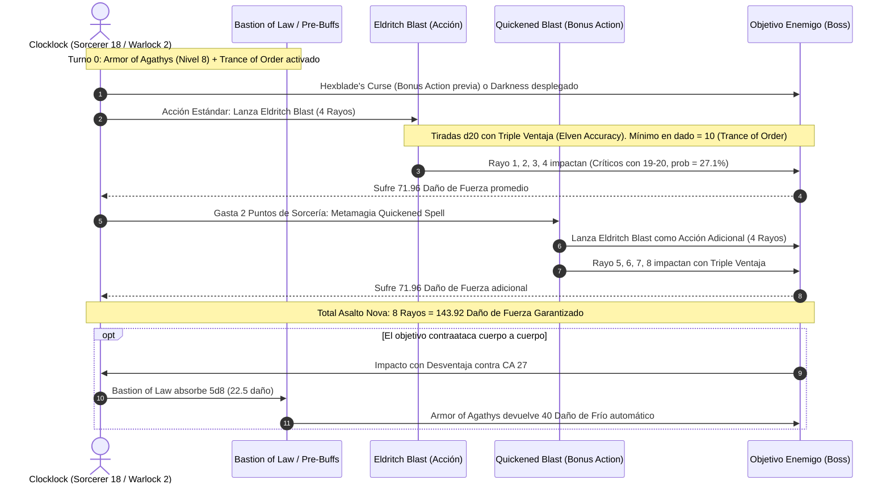

# 🌟 Lista de Conjuros Optimizada — Clocklock (Sorcerer 18 / Warlock 2)

**Arquetipo:** Alma de Relojería (*Clockwork Soul*) & El Filo Maldito (*Hexblade*)  
**CD de Salvación:** $8 + 6 \text{ (Prof)} + 5 \text{ (CAR)} = \mathbf{19}$ (Base) / $\mathbf{22}$ (Con *Bloodwell Vial +3*)  
**Modificador de Ataque de Conjuro:** $+11$ (Base) / $\mathbf{+14}$ (Con *Bloodwell Vial +3*)  

---

## 🔮 Trucos (Cantrips)

### 🧙‍♂️ Sorcerer (6 Conocidos)
1. **Guidance 🔵 [Excelente]:** $+1\text{d}4$ a cualquier prueba de habilidad.
2. **Mending 🔵 [Utilidad / Temático]:** Reparación instantánea de constructos y mecanismos.
3. **Shocking Grasp 🟢 [Defensivo]:** Cancela reacciones enemigas en caso de apuro cuerpo a cuerpo.
4. **Minor Illusion 🟢 [Control Visual]:** Cobertura táctica y distracción de líneas de visión.
5. **Prestidigitation 🟡 [Utilidad]:** Efectos utilitarios y sensoriales.
6. **Light 🟡 [Utilidad]:** Fuente de luz sin coste en objetos portados.

### 💀 Warlock (2 Conocidos)
1. **Eldritch Blast 🔵 [Pilar Ofensivo]:** Ametralladora mágica. Escala a 4 rayos a nivel 20, infligiendo $1\text{d}10 + 5$ por rayo gracias a *Agonizing Blast*.
2. **Friends 🟡 [Social]:** Ventaja situacional en tiradas de Carisma a corta distancia.

---

## ⚙️ Tabla de Reemplazos de Magia de Relojería (Clockwork Magic Swaps)

*Regla Oficial Tasha / 2024:* Al ganar o subir de nivel de Hechicero, se puede cambiar un conjuro de la lista de Relojería por cualquier conjuro de **Abjuración** o **Transmutación** de las listas de **Sorcerer**, **Warlock** o **Wizard**.

| Nivel de Conjuro | Conjuro Original de Subclase | Sustitución Óptima | Escuela | Justificación Táctica |
| :---: | :--- | :--- | :---: | :--- |
| **1.º** | *Alarm* | **Armor of Agathys** 🔵 | Abjuración (Warlock) | Barrera escalable de THP con contragolpe de daño de frío masivo. |
| **1.º** | *Protection from Evil and Good* | **Shield** 🔵 | Abjuración (Wizard) | $+5$ reactivo a la CA frente a ataques críticos o concentrados. |
| **2.º** | *Aid* | **Aid** 🔵 *(Mantenido)* | Abjuración | Aumenta la vida máxima de 3 criaturas sin concentración; curación masiva. |
| **2.º** | *Lesser Restoration* | **Absorb Elements** 🔵 | Abjuración (Wizard) | Reacción de resistencia inmediata ante daño elemental masivo. |
| **3.º** | *Dispel Magic* | **Counterspell** 🔵 | Abjuración (Wizard) | Negación reactiva inmediata de conjuros enemigos en 60 pies. |
| **3.º** | *Protection from Energy* | **Tiny Servant** 🟢 | Transmutación (Wizard) | Servidores mecánicos que activan objetos mágicos o pociones en combate. |
| **4.º** | *Compulsion* | **Banishment** 🔵 | Abjuración | Retira amenazas singulares a otro plano (salvación de CAR con CD 22). |
| **4.º** | *Freedom of Movement* | **Death Ward** 🔵 | Abjuración | Seguro de vida contra muerte instantánea o caída a 0 HP sin concentración. |
| **5.º** | *Wall of Force* | **Wall of Force** 🔵 *(Mantenido)* | Evocación/Abjuración | Confinamiento indestructible de objetivos sin tirada de salvación. |
| **5.º** | *Greater Restoration* | **Transmute Rock** 🟢 | Transmutación (Wizard) | Control masivo del terreno sin concentración que reduce movimiento a 1/4. |

---

## 🎒 Matriz de Conjuros de Sorcerer (15 Conocidos)

### 9.º Nivel (1 Ranura)
* **Wish 🔵 [Roto / Omnipotencia]:** Duplica cualquier conjuro de nivel 1-8 de cualquier lista sin coste de componentes ni tiempo de lanzamiento.

### 8.º Nivel (1 Ranura)
* **Demiplane 🟢 [Utilidad / Refugio]:** Acceso a una cámara dimensional inexpugnable para almacenar tropas o descansar.

### 7.º Nivel (1 Ranura)
* **Reverse Gravity 🔵 [Control de Campo Absoluto]:** Cilindro de 50 pies sin salvación para criaturas que no puedan anclarse o volar.

### 6.º Nivel (1 Ranura)
* **Globe of Invulnerability 🔵 [Defensa Definitiva]:** Inmunidad absoluta contra todos los conjuros de nivel 5 o inferior dirigidos al interior de la esfera.

### 5.º Nivel (2 Ranuras)
* **Synaptic Static 🟢 [Daño Mental y Debuff]:** $8\text{d}6$ de daño psíquico en área de 20 pies; resta $1\text{d}6$ a ataques y salvaciones enemigas durante 1 minuto sin concentración.
* **Hold Monster 🟢 [Control Táctico]:** Paraliza a un jefe enemigo para conceder golpes críticos automáticos a corta distancia.

### 4.º Nivel (3 Ranuras)
* **Dimension Door 🟢 [Movilidad Táctica]:** Teletransporte de 400 pies con un aliado sin requerir línea de visión directa.
* **Polymorph 🟢 [Versatilidad Táctica]:** Transforma a un aliado herido en T-Rex o incapacita a un objetivo hostil.

### 3.ᵉʳ Nivel (3 Ranuras)
* **Haste 🟢 [Buff de Aceleración]:** Duplica velocidad, $+2$ CA y acción de ataque adicional para el artillero o aliado marcial.
* **Fireball / Hypnotic Pattern 🔵 [Control / Limpieza]:** Incapacitación masiva de grupos de enemigos o limpieza rápida.
* **Fly 🟢 [Movilidad Tridimensional]:** Vuelo táctico para mantener superioridad aérea frente a amenazas terrestres.

### 2.º Nivel (3 Ranuras)
* **Darkness 🔵 [Pilar del Combo]:** Esfera de oscuridad mágica. Al combinarse con *Devil's Sight*, proporciona ventaja triple permanente y desventaja a todos los enemigos.
* **Misty Step 🔵 [Movilidad Rápida]:** Teletransporte de 30 pies como acción adicional para romper presas o sortear obstáculos.
* **Web 🟢 [Control de Masas]:** Restricción y terreno difícil en área que genera ventaja adicional.

### 1.ᵉʳ Nivel (4 Ranuras)
* **Silvery Barbs 🔵 [Manipulación Reactiva]:** Obliga a un enemigo a relanzar un dado exitoso y otorga ventaja inmediata a un aliado.
* **Feather Fall 🟡 [Emergencia]:** Salvavidas reactivo contra daño de caída para todo el grupo.

---

## 🎒 Conjuros de Warlock (Hexblade — 2 Ranuras de Nivel 1 en Descanso Corto)

* **Hex 🟢 [Daño Adicional]:** $+1\text{d}6$ de daño necrótico por impacto de rayo cuando no se requiere la concentración en *Darkness*.
* **Hellish Rebuke 🟡 [Respuesta Reactiva]:** Daño de fuego reactivo cuando te golpean a distancia.

---

## ⚡ Diagrama de Secuencia del Asalto Nova (Nova Damage Sequence)

---

## 🩺 Curación en Segundo Plano y Mitigación de Daño (Background Healing)

El Clocklock no necesita malgastar turnos lanzando curaciones reactivas gracias a su arquitectura de protección pasiva y reservas de absorción:

1. **Barrera de Amortiguación (*Armor of Agathys* Upcast Nivel 8):**
   * Otorga **40 Puntos de Golpe Temporales (THP)** al inicio de la jornada.
   * Cualquier enemigo que conecte un ataque cuerpo a cuerpo sufre **40 puntos de daño de frío instantáneo**, sin tirada de salvación.
2. **Escudo de Engranajes (*Bastion of Law*):**
   * Se cargan 5 dados de $1\text{d}8$ gastando 5 Puntos de Hechicería.
   * Al recibir daño, los dados reducen el daño entrante en una media de $\mathbf{22.5 \text{ puntos}}$. Debido a que el daño se reduce antes de descontar los THP de *Armor of Agathys*, la barrera de frío permanece activa durante múltiples asaltos de combate.
3. **Buffer de Vida Máxima (*Aid* Upcast Nivel 7):**
   * Otorga $+30$ HP máximos a 3 aliados durante 8 horas sin requerir concentración.
   * Si se lanza en combate como acción, levanta instantáneamente a 3 aliados inconscientes a 0 HP sin gastar turnos en curaciones individuales.
4. **Cabalgata de Relojería (*Clockwork Cavalcade* — Nivel 18 de Hechicero):**
   * Acción para invocar espíritus modrones en un cubo de 30 pies.
   * **Restaura hasta 100 Puntos de Golpe** distribuidos libremente entre criaturas a elección en el área.
   * Repara instantáneamente cualquier objeto o estructura dañada.
   * Disipa automáticamente cualquier conjuro o maldición de nivel 6 o menor en el área.
5. **Reciclaje de Ranuras Cortas:**
   * En descansos cortos, las ranuras de Warlock de nivel 1 se reconvierten en Puntos de Sorcería para regenerar los dados de *Bastion of Law* de todo el pelotón sin gastar recursos de descanso largo.