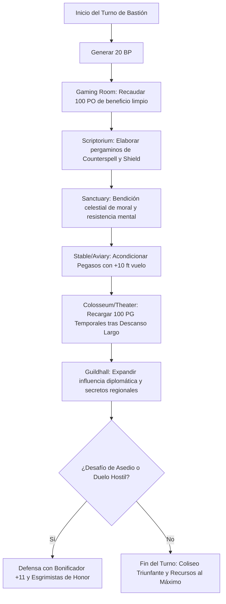

# 🏰 Bastión y Tiempo Muerto — Wrathful Whisperer

**Build:** Wrathful Whisperer (El Espadachín de la Cólera Sagrada)  
**Sistema:** D&D 2024 / 5.5e DMG Bastion Rules  
**Nivel de Bastión:** 20  
**Nombre del Bastión:** *The Colosseum of the Singing Blade* (El Coliseo de la Espada Cantante)  
**Documentos Relacionados:**
* [Guía de Personaje](file:///d:/repo-vault/Proyectos/Rol/DnDbuilds/builds/Wrathful%20Whisperer/character%20guide.md)
* [Guía 2024](file:///d:/repo-vault/Proyectos/Rol/DnDbuilds/builds/Wrathful%20Whisperer/character%20guide%202024.md)
* [Lista de Conjuros](file:///d:/repo-vault/Proyectos/Rol/DnDbuilds/builds/Wrathful%20Whisperer/spell%20list.md)
* [Objetos a Obtener](file:///d:/repo-vault/Proyectos/Rol/DnDbuilds/builds/Wrathful%20Whisperer/item%20list%20to%20obtain.md)
* [Hoja de Ruta](file:///d:/repo-vault/Proyectos/Rol/DnDbuilds/builds/Wrathful%20Whisperer/roadmap.md)
* [Inventario Equipado](file:///d:/repo-vault/Proyectos/Rol/DnDbuilds/builds/Wrathful%20Whisperer/actual%20inventory%20list.md)

---

## 🏛️ Estadísticas Defensivas del Bastión

* **Bonificador de Mando y Defensa:** $\mathbf{+11}$ ($\text{PB } +6 + \text{CHA } +5$).
* **Puntos de Bastión (BP):** 20 BP por Turno de Bastión (regeneración según nivel 20).
* **Guarnición Activa:**
  * 16 Esgrimistas de Honor con armaduras doradas y estoques de parada.
  * 6 Acólitos de la Lira Sagrada (bardos y clérigos de coro).
  * 2 Pegasos Celestiales acuartelados en las caballerizas aéreas.

---

## 🏗️ Instalaciones Básicas (Basic Facilities)

1. **Dormitorio Señorial (Bedchambers):** Suite aristocrática tapizada en sedas rojas y doradas, con una colección de liras y laúdes de marfil.
2. **Salón de Banquetes y Corte (Dining Hall):** Mesa imperial de caoba con cubertería de plata maciza; acoge recepciones diplomáticas para reyes y archimagos.
3. **Plaza de los Trovadores (Common Room):** Claustro porticado donde poetas, esgrimistas y diplomáticos debaten y entrenan.
4. **Cámara Acorazada de Joyas y Monedas (Storage):** Bóveda sellada con runas de abjuración donde se almacenan las 18 monedas de plata sagradas y gemas de *Simulacrum*.

---

## 🧪 Instalaciones Especiales (Special Facilities: 4 Roomy + 2 Vast)

Conforme a las reglas del DMG 2024 a nivel 20, la fortaleza dispone exactamente de 6 Instalaciones Especiales (4 Roomy y 2 Vast):

### 1. [Roomy] Gaming Room (El Club de los Tahúres de Gala)
* **Función:** Salón aristocrático de juegos de ingenio, cartas y azar de altas apuestas.
* **Orden de Bastión:** *Gamble / Harvest*. Genera $100\text{ PO}$ de beneficio neto semanal y atrae nobles que revelan secretos de corte.

### 2. [Roomy] Sanctuary / Reliquary (El Sagrario del Coro Divino)
* **Función:** Altar consagrado a deidades de la gloria y el ingenio dracónico (Hlal / Bahamut).
* **Orden de Bastión:** *Blessing*. Concede a los defensores del Bastión y al personaje una bendición que otorga ventaja en tiradas de salvación contra encanto y miedo durante 7 días.

### 3. [Roomy] Scriptorium (Scriptorium de Partituras Arcanas)
* **Función:** Mesa de copiado para transcripción de pergaminos de alto nivel (*Counterspell*, *Dispel Magic*, *Shield*).
* **Orden de Bastión:** *Scribe*. Elabora pergaminos arcanos y divinos al 50% de coste en oro.

### 4. [Roomy] Stable / Aviary (Caballerizas Celestiales Aéreas)
* **Función:** Plataforma abierta en la muralla con nidos para Pegasos y Grifos invocados mediante *Find Greater Steed*.
* **Orden de Bastión:** *Train / Breed*. Otorga a las monturas del Bastión un bonificador de $+10\text{ pies}$ a la velocidad de vuelo y $+10\text{ PG}$ temporales.

### 5. [Vast] Grand Theater / Colosseum (El Gran Coliseo del Acero Cantante)
* **Función:** Anfiteatro monumental con capacidad para 2,000 espectadores donde se celebran torneos de esgrima y óperas mágicas.
* **Orden de Bastión:** *Sanctuary / Performance*. Otorga al personaje $100\text{ PG}$ temporales tras descansar en sus aposentos y genera una reputación inquebrantable en todo el plano.

### 6. [Vast] Guildhall (Gremio de la Lira y la Espada)
* **Función:** Red de embajadas y academias de bardos que operan en los reinos colindantes como diplomáticos y espías.
* **Orden de Bastión:** *Influence*. Otorga inmunidad diplomática en las capitales aliadas y acceso prioritario a contratos mercenarios.

---

## 🔄 Flujograma de Turno de Bastión (Weekly Bastion Turn)

---

## ⏳ Actividades de Tiempo Muerto (Downtime Priorities)

### Prioridad 1: Creación del Simulacro de Oro y Nieve
* **Acción:** Emplear el ritual de *Simulacrum* (1,500 PO en polvo de rubí) para forjar un duplicado permanente del Wrathful Whisperer en el Bastión.
* **Resultado:** Duplicación absoluta de la potencia de fuego mágica en incursiones bélicas.

### Prioridad 2: Elaboración de Pergaminos de Protección
* **Acción:** Transcribir pergaminos de *Counterspell* y *Shield* en el *Scriptorium* para garantizar defensa reactiva inagotable.
