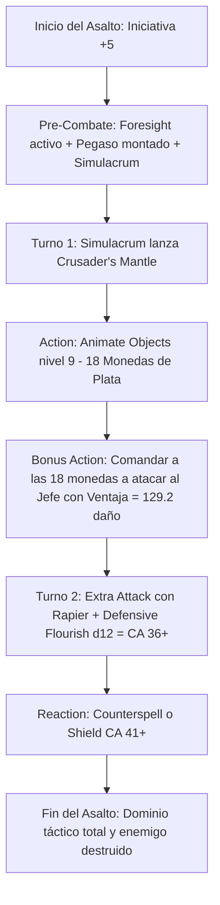

# ⚡ Guía de Personaje — Wrathful Whisperer (Edición 2024 / 5.5e)

**Arquetipo:** Frontline Gish Striker & Holy Blade Dancer  
**Clase:** Paladin 2 / Bard (College of Swords) 18  
**Especie:** Dragonborn (Copper — Reglas 2024)  
**Trasfondo:** Noble / Entertainer (Dote de Origen: *Alert*)  
**Sistema:** D&D 5th Edition (Reglas 2024 / 5.5e)  
**Documentos Relacionados:**
* [Guía Principal](file:///d:/repo-vault/Proyectos/Rol/DnDbuilds/builds/Wrathful%20Whisperer/character%20guide.md)
* [Bastión y Tiempo Muerto](file:///d:/repo-vault/Proyectos/Rol/DnDbuilds/builds/Wrathful%20Whisperer/bastion%20and%20downtime.md)
* [Lista de Conjuros](file:///d:/repo-vault/Proyectos/Rol/DnDbuilds/builds/Wrathful%20Whisperer/spell%20list.md)
* [Objetos a Obtener](file:///d:/repo-vault/Proyectos/Rol/DnDbuilds/builds/Wrathful%20Whisperer/item%20list%20to%20obtain.md)
* [Hoja de Ruta](file:///d:/repo-vault/Proyectos/Rol/DnDbuilds/builds/Wrathful%20Whisperer/roadmap.md)
* [Inventario Equipado](file:///d:/repo-vault/Proyectos/Rol/DnDbuilds/builds/Wrathful%20Whisperer/actual%20inventory%20list.md)

---

## 📊 Atributos y Estadísticas (Nivel 20)

| Atributo | Puntuación | Modificador | Salvación Base | Notas Defensivas |
| :--- | :---: | :---: | :---: | :--- |
| **Fuerza (STR)** | 16 | +3 | +3 | Requisito de Armadura de Placas |
| **Destreza (DEX)** | 10 | 0 | 0 | Atributo neutral |
| **Constitución (CON)** | 16 (con Cinturón) | +3 | +9 (Competente vía Resilient) | Concentración inquebrantable |
| **Inteligencia (INT)** | 8 | -1 | -1 | Atributo de descarte |
| **Sabiduría (WIS)** | 10 | 0 | +6 (Competente) | Salvación base de Paladin |
| **Carisma (CHA)** | 20 | +5 | +11 (Competente) | Estadística de conjuros, CD 19 y dados de floreo |

* **Puntos de Golpe (PG):** 164 ($2\text{d}10 + 18\text{d}8 + 60 \text{ CON}$).
* **Clase de Armadura (CA):** 29 pasiva (Placas +3, Escudo +3, Defense, Capa/Anillo).
  * Con *Defensive Flourish* ($+1\text{d}12$ a la CA): $\mathbf{30 \text{ a } 41 \text{ de CA}}$.
  * Con Reacción (*Shield*): $\mathbf{35 \text{ a } 46 \text{ de CA}}$.
* **Iniciativa 2024:** $0 (\text{DEX}) + 5 (\text{Alert}) = \mathbf{+5}$.

---

## 🏷️ Matriz de Evaluación Táctica

| Categoría | Nivel | Justificación Mecánica |
| :--- | :---: | :--- |
| **Burst Damage (Nova)** | 🔵 S | Ráfaga masiva: 2 ataques con *Extra Attack* combinando *Divine Smite* escalado a ranuras altas ($5\text{d}8$) $+ 1\text{d}12$ de *Blade Flourish* en cada impacto. |
| **Supervivencia y CA Absoluta** | 🔵 S | CA pasiva 29; escala a $35-41$ con *Defensive Flourish* y hasta $46$ con *Shield*. Ningún atacante ordinario puede impactar sin un 20 natural. |
| **Poder Arcano y Control** | 🔵 S | Conjuros de Nivel 9 (*Wish*, *True Polymorph*, *Foresight*) y *Magical Secrets 2024* (*Counterspell*, *Find Greater Steed*, *Simulacrum*). |
| **Economía de Acciones** | 🔵 S | *Scimitar of Speed* otorga un ataque y Smite en Bonus Action; *Animate Objects* a nivel 9 descarga 18 ataques de plata por asalto. |
| **Movilidad Aérea** | 🟢 A | *Find Greater Steed* proporciona un Pegaso celestial (vuelo 90 pies) que comparte todos tus buffs personales. |
| **Daño Sostenido (DPR)** | 🔵 S | La "Tempestad de Plata" genera $129.2$ DPR neto en Bonus Action con el *Simulacrum* manteniendo *Crusader's Mantle*. |

---

## 🧮 Motor Matemático (2024 Ruleset)

### 1. Paladin 2024 Smite & Flourish Synergy
En las reglas 2024, *Divine Smite* se lanza como Bonus Action inmediatamente tras impactar con un ataque cuerpo a cuerpo:
$$\text{Ataque 1 (Acción)} = 1\text{d}8 + 3 (\text{Estoque}) + 1\text{d}12 (\text{Defensive Flourish}) = 4.5 + 3 + 6.5 = \mathbf{14.0 \text{ daño}} + (+1\text{d}12 \text{ CA})$$
$$\text{Smite en Bonus Action} = 5\text{d}8 (\text{Ranura Nivel 4}) = \mathbf{22.5 \text{ daño radiante}}$$
$$\text{Ataque 2 (Acción)} = 1\text{d}8 + 3 = \mathbf{7.5 \text{ daño}}$$
$$\text{DPR Total del Asalto de Ataque} = 14.0 + 22.5 + 7.5 = \mathbf{44.0 \text{ daño neto}}$$
Si se utiliza la Tempestad de Plata (*Animate Objects* Nivel 9 comanda 18 monedas con la Bonus Action):
$$\text{DPR con Tempestad de Plata} = 14.0 + 7.5 + 18 \times 9.0 \times 0.7975 = 21.5 + 129.195 = \mathbf{150.695 \text{ DPR neto}}$$

### 2. Inviolabilidad de la Clase de Armadura
Frente a una criatura de CR 20 con $+14$ a la tirada de ataque contra tu CA media de 36 ($29 \text{ base} + 7 \text{ Flourish}$):
Probabilidad base de impacto:
$$P = \frac{21 - (36 - 14)}{20} = \frac{-1}{20} \implies P = \mathbf{0.05} \quad (\text{Solo impacto con 20 natural})$$
Bajo el efecto de *Foresight* (desventaja obligatoria en todos los ataques hostiles recibidos):
$$P_{\text{desventaja}} = (0.05)^2 = \mathbf{0.0025} \quad (\mathbf{0.25\%} \text{ de probabilidad de acierto})$$
$$\text{EHP Efectivo} = \frac{164 + 100 (\text{Colosseum THP})}{0.0025} = \frac{264}{0.0025} = \mathbf{105{,}600 \text{ EHP frente a ataques directos}}$$

---

## 🔄 Bucle Táctico de Combate (Action Loop)

---

## ⚔️ Integración de Weapon Masteries 2024

* **Rapier (Vex):** Al impactar con el estoque, concede **Ventaja** en tu siguiente tirada de ataque contra el mismo objetivo.
* **Scimitar (Nick):** Permite ejecutar un corte secundario dentro de la Acción de Ataque sin consumir la Bonus Action.
* **Longsword (Sap):** Impone desventaja en el siguiente ataque del enemigo, reduciendo aún más la probabilidad infinitesimal de que logre impactarte.
