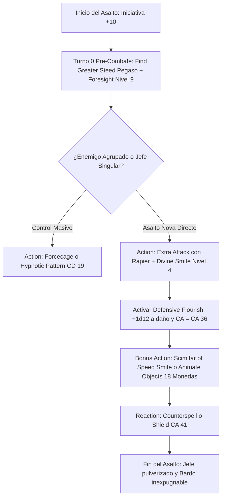

# ⚔️ Guía de Personaje — Wrathful Whisperer

**Build:** Wrathful Whisperer (El Espadachín de la Cólera Sagrada)  
**Clase:** Paladin 2 / Bard (College of Swords) 18  
**Especie:** Dragonborn (Copper / Ravenite)  
**Trasfondo:** Noble / Entertainer (Dote de Origen: *Alert*)  
**Sistema:** D&D 5th Edition (Reglas 2024 / 5.5e & 2014)  
**Rol:** Frontline Gish Striker / Defensive Flourish Tank / High-Level Controller / Full Caster Smiter  
**Documentos Relacionados:**
* [Guía 2024](file:///d:/repo-vault/Proyectos/Rol/DnDbuilds/builds/Wrathful%20Whisperer/character%20guide%202024.md)
* [Bastión y Tiempo Muerto](file:///d:/repo-vault/Proyectos/Rol/DnDbuilds/builds/Wrathful%20Whisperer/bastion%20and%20downtime.md)
* [Lista de Conjuros](file:///d:/repo-vault/Proyectos/Rol/DnDbuilds/builds/Wrathful%20Whisperer/spell%20list.md)
* [Objetos a Obtener](file:///d:/repo-vault/Proyectos/Rol/DnDbuilds/builds/Wrathful%20Whisperer/item%20list%20to%20obtain.md)
* [Hoja de Ruta](file:///d:/repo-vault/Proyectos/Rol/DnDbuilds/builds/Wrathful%20Whisperer/roadmap.md)
* [Inventario Equipado](file:///d:/repo-vault/Proyectos/Rol/DnDbuilds/builds/Wrathful%20Whisperer/actual%20inventory%20list.md)

---

## 📊 Atributos y Estadísticas (Nivel 20)

| Atributo | Puntuación | Modificador | Salvación Base | Notas Defensivas |
| :--- | :---: | :---: | :---: | :--- |
| **Fuerza (STR)** | 16 | +3 | +3 | Requisito de Armadura de Placas |
| **Destreza (DEX)** | 10 | 0 | 0 | Atributo neutral |
| **Constitución (CON)** | 16 (con Cinturón) | +3 | +9 (Competente vía Resilient) | Concentración inquebrantable |
| **Inteligencia (INT)** | 8 | -1 | -1 | Atributo de descarte |
| **Sabiduría (WIS)** | 10 | 0 | +6 (Competente) | Salvación base de Paladin |
| **Carisma (CHA)** | 20 | +5 | +11 (Competente) | Estadística de conjuros, CD 19 y dados de floreo |

* **Puntos de Golpe (PG):** 164 ($2\text{d}10 + 18\text{d}8 + 60 \text{ CON}$).
* **Clase de Armadura (CA):**
  * Full Plate +3: CA base 21.
  * Shield +3: $+5$ a la CA.
  * Estilo de Combate Defense: $+1$ a la CA.
  * Cloak / Ring of Protection: $+2$ a la CA.
  * **CA Pasiva Base:** $\mathbf{29}$.
  * Con *Defensive Flourish* ($+1\text{d}12$ a la CA): $\mathbf{30 \text{ a } 41 \text{ de CA}}$.
  * Con Reacción (*Shield* vía Magical Secrets): $\mathbf{35 \text{ a } 46 \text{ de CA}}$.
* **Nivel de Lanzador Combinado:** Nivel 19 (Espacios de conjuro hasta Nivel 9).

---

## 🏷️ Matriz de Evaluación Táctica

| Categoría | Nivel | Justificación Mecánica |
| :--- | :---: | :--- |
| **Burst Damage (Nova)** | 🔵 S | Ráfaga devastadora: 2 ataques con *Extra Attack* canalizando *Divine Smite* de nivel 4/5 ($5\text{d}8$) $+ 1\text{d}12$ de *Blade Flourish* en cada impacto. |
| **Supervivencia y CA Absoluta** | 🔵 S | CA pasiva 29; se eleva a $35-41$ con *Defensive Flourish* y hasta $46$ con *Shield*. Virtualmente imposible de impactar en combate físico. |
| **Poder Arcano y Control** | 🔵 S | Acceso completo a conjuros de Nivel 9 (*Wish*, *True Polymorph*, *Foresight*) y *Magical Secrets* (*Counterspell*, *Find Greater Steed*, *Simulacrum*). |
| **Economía de Acciones** | 🔵 S | *Scimitar of Speed* concede un ataque cuerpo a cuerpo (y Smite) como Bonus Action; *Animate Objects* a nivel 9 comanda 18 monedas en Bonus Action. |
| **Movilidad y Montura** | 🟢 A | *Find Greater Steed* invoca un Pegaso o Grifo que comparte todos los conjuros que te lances a ti mismo. |
| **Daño Sostenido (DPR)** | 🔵 S | La "Tempestad de Plata" (*Animate Objects* nivel 9 + *Crusader's Mantle* mantenido por el *Simulacrum*) genera $129.2$ DPR en Bonus Action. |

---

## 🧮 Motor Matemático (2024 / 2014 Ruleset)

### 1. Daño de Golpe Singular (Nova Smite Flourish)
Al impactar con un Estoque o Espada Larga a una mano:
$$\text{Daño Físico Base} = 1\text{d}8 + 3 (\text{STR}) = \mathbf{7.5 \text{ perforante}}$$
$$\text{Divine Smite (Ranura Nivel 4)} = 5\text{d}8 = \mathbf{22.5 \text{ radiante}}$$
$$\text{Defensive Flourish (Swords Bard 18)} = 1\text{d}12 = \mathbf{6.5 \text{ daño extra}}$$
$$\text{Daño Total de 1 Impacto} = 7.5 + 22.5 + 6.5 = \mathbf{36.5 \text{ daño medio}}$$
Con el segundo ataque de *Extra Attack* aplicando otro *Divine Smite* de nivel 4:
$$\text{Daño Total de Acción} = 36.5 + (7.5 + 22.5) = \mathbf{66.5 \text{ de daño en 1 turno}}$$
Si se porta la *Scimitar of Speed* para un tercer ataque en Bonus Action con Smite de nivel 3 ($4\text{d}8 = 18$):
$$\text{Nova Turno 1 (3 Ataques)} = 66.5 + (1\text{d}6 + 3 + 18) = 66.5 + 24.5 = \mathbf{91.0 \text{ daño en Turno 1}}$$

### 2. El Combo de la Tempestad de Plata (Animate Objects 9 + Crusader's Mantle)
* *Animate Objects* lanzado con ranura de Nivel 9 anima **18 monedas de plata** (tamaño *Tiny*).
* El duplicado de *Simulacrum* mantiene la concentración en ***Crusader's Mantle*** (+1d4 radiante a cada ataque amigo en 30 ft).
$$\text{Daño por Moneda} = 1\text{d}4 + 4 (\text{Slam contundente}) + 1\text{d}4 (\text{Crusader's Mantle}) = 6.5 + 2.5 = \mathbf{9.0 \text{ daño por impacto}}$$
Frente a un enemigo con CA 18 (probabilidad de impacto $P = 0.55$):
$$\text{DPR Promedio (18 Monedas en Bonus Action)} = 18 \times 9.0 \times 0.55 = \mathbf{89.1 \text{ daño neto}}$$
Con Ventaja (*Foresight* o *Faerie Fire*, $P = 0.7975$):
$$\text{DPR con Ventaja} = 18 \times 9.0 \times 0.7975 = \mathbf{129.195 \text{ daño por asalto en Bonus Action}}$$

### 3. Matriz de CA Inviolable
$$\text{CA Base Pasiva} = 18 (\text{Placas}) + 3 (\text{Mágico}) + 2 (\text{Escudo}) + 3 (\text{Mágico}) + 1 (\text{Defense}) + 2 (\text{Capa/Anillo}) = \mathbf{29}$$
Con *Defensive Flourish* ($+1\text{d}12$, media $+6.5$):
$$\text{CA Media Activa} = 29 + 6.5 = \mathbf{35.5 \text{ CA}} \quad (\text{Máximo } 41 \text{ CA})$$
Con reacción de *Shield*:
$$\mathbf{\text{CA Total Pico} = 35.5 + 5 = 40.5 \text{ CA}} \quad (\mathbf{\text{Pico Absoluto } 46 \text{ CA}})$$
*Frente al monstruo más poderoso del multiverso (+19 al impacto), requiere un 20 natural obligado para rozarte.*

---

## 🔄 Bucle Táctico de Combate (Action Loop)

### Turno 0 (Preparación)
* Montar sobre el Pegaso invocado con *Find Greater Steed* (velocidad de vuelo 90 pies).
* Lanzar *Foresight* (Nivel 9, 8 horas sin concentración): Concede Ventaja en todos los ataques, pruebas y salvaciones, e impone Desventaja en todos los ataques hostiles contra ti.

### Turno 1 (Enganche de Cólera)
1. **Action:** Desplazarse volando y ejecutar 2 ataques de estoque con *Extra Attack*. Canalizar *Divine Smite* de nivel 4 ($5\text{d}8$) en ambos y activar *Defensive Flourish* ($+1\text{d}12$ a la CA).
2. **Bonus Action:** Atacar con la *Scimitar of Speed* canalizando un tercer Smite, o bien ordenar a las 18 monedas de plata atacar ($89.1$ DPR).
3. **CA resultante:** $36$ a $41$.
4. **Reaction:** Mantener *Counterspell* listo para abortar conjuros de nivel 9 del enemigo.
