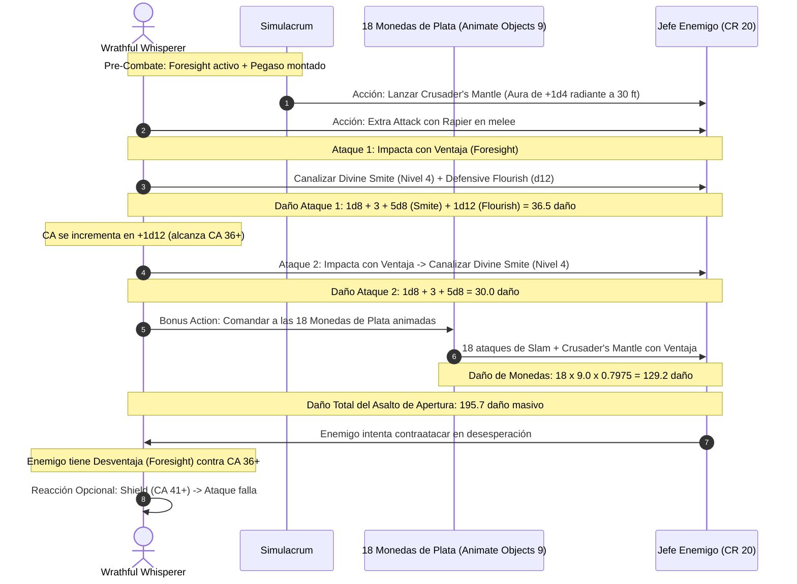

# 📜 Lista de Conjuros y Secretos Mágicos — Wrathful Whisperer

**Build:** Wrathful Whisperer (El Espadachín de la Cólera Sagrada)  
**Clase:** Paladin 2 / Bard (College of Swords) 18  
**Nivel de Lanzador:** Nivel 19 Caster (Ranuras completas hasta Nivel 9)  
**Atributo de Conjuración:** Carisma (CD $8 + 6 \text{ PB} + 5 \text{ CHA} = \mathbf{19}$)  
**Bonificador de Ataque de Conjuros:** $+6 (\text{PB}) + 5 (\text{CHA}) = \mathbf{+11}$  
**Documentos Relacionados:**
* [Guía de Personaje](file:///d:/repo-vault/Proyectos/Rol/DnDbuilds/builds/Wrathful%20Whisperer/character%20guide.md)
* [Guía 2024](file:///d:/repo-vault/Proyectos/Rol/DnDbuilds/builds/Wrathful%20Whisperer/character%20guide%202024.md)
* [Bastión y Tiempo Muerto](file:///d:/repo-vault/Proyectos/Rol/DnDbuilds/builds/Wrathful%20Whisperer/bastion%20and%20downtime.md)
* [Objetos a Obtener](file:///d:/repo-vault/Proyectos/Rol/DnDbuilds/builds/Wrathful%20Whisperer/item%20list%20to%20obtain.md)
* [Hoja de Ruta](file:///d:/repo-vault/Proyectos/Rol/DnDbuilds/builds/Wrathful%20Whisperer/roadmap.md)
* [Inventario Equipado](file:///d:/repo-vault/Proyectos/Rol/DnDbuilds/builds/Wrathful%20Whisperer/actual%20inventory%20list.md)

---

## ⚡ Efectos Activos y Buffs Previos (Turn 0)

| Efecto / Conjuro | Duración | Concentración | Beneficio Mecánico |
| :--- | :---: | :---: | :--- |
| **Foresight (Nivel 9)** | 8 horas | **No** | Ventaja permanente en todos tus ataques, pruebas y salvaciones; desventaja obligatoria en todos los ataques hostiles contra ti. |
| **Find Greater Steed** | Permanente | No | Pegaso celestial activo (velocidad de vuelo 90 pies); duplica todos los conjuros que te lances sobre él. |
| **Simulacrum** | Permanente | No | Duplicado idéntico con la mitad de tus PG que puede mantener concentración en *Crusader's Mantle* o lanzar *Counterspell*. |
| **Heroes' Feast (Vía Bastión)** | 24 horas | No | $+2\text{d}10\text{ PG}$ máximos, inmunidad a veneno y miedo, ventaja en salvaciones de Sabiduría. |
| **Aid (Ranura Nivel 5)** | 8 horas | No | $+20\text{ PG}$ máximos y actuales al bardo, a su montura y al simulacro. |

---

## 📊 Matriz de Secretos Mágicos (Magical Secrets — Bard 10, 14, 18)

* **Wish (Nivel 9):** 🔵 S. Versatilidad absoluta; duplica cualquier conjuro de nivel 1 a 8 de cualquier lista sin coste de componentes ni tiempo de lanzamiento.
* **Simulacrum (Nivel 7):** 🔵 S. Duplica la presencia en combate; habilita la doble concentración para la Tempestad de Plata.
* **Find Greater Steed (Nivel 4):** 🔵 S. Montura aérea legendaria que convierte al bardo en una unidad de caballería divina intocable.
* **Counterspell (Nivel 3):** 🔵 S. Con *Jack of All Trades* ($+3$ al test de Carisma), neutraliza conjuros de nivel alto sin gastar ranuras superiores.
* **Shield (Nivel 1):** 🔵 S. Reacción fundamental para elevar la CA activa a picos de hasta $46$.
* **Crusader's Mantle (Nivel 3):** 🔵 S. Añade $+1\text{d}4$ de daño radiante a cada uno de los 18 ataques de la Tempestad de Plata.

---

## 🗡️ Matriz de Conjuros de Bardo y Paladín por Nivel

### Trucos (Cantrips)
* **Vicious Mockery:** 🟢 A. Impone desventaja en el siguiente ataque del enemigo a distancia.
* **Minor Illusion:** 🟢 A. Distracción táctica y cobertura ilusoria.
* **Mage Hand:** 🟢 A. Manipulación remota de objetos.
* **Prestidigitation:** 🟡 B. Efectos sensoriales de gala.

### Niveles 1 y 2
* **Divine Smite (Paladin):** 🔵 S. El motor de castigo; escala con ranuras de bardo hasta $5\text{d}8$ radiante por impacto ($+1\text{d}8$ extra contra infernales o no-muertos).
* **Healing Word (Bard):** 🔵 S. Curación de emergencia en Bonus Action a 60 pies.
* **Command (Paladin):** 🟢 A. Control de un solo objetivo (Grovel para derribarlo y ganar ventaja en melee).
* **Silvery Barbs (Bard):** 🔵 S. Fuerza repetición de d20 enemigo y concede ventaja a un aliado.
* **Mirror Image (Bard):** 🟢 A. Duplicados defensivos sin concentración.

### Niveles 3, 4 y 5
* **Hypnotic Pattern (Bard):** 🔵 S. Incapacitación masiva de salas enteras de enemigos en un cubo de 30 pies.
* **Dispel Magic (Bard):** 🟢 A. Supresión de efectos mágicos hostiles.
* **Dimension Door (Bard):** 🟢 A. Reubicación dimensional instantánea a 500 pies con un aliado.
* **Animate Objects (Bard):** 🔵 S. **Pieza Central**. Anima 10 a 18 objetos ligeros de plata que pulverizan defensas físicas.
* **Synaptic Static (Bard):** 🟢 A. Explosión psíquica ($8\text{d}6$) que resta $1\text{d}6$ a ataques y pruebas enemigas por 1 minuto sin concentración.

### Niveles 6 a 9
* **Forcecage (Bard Nivel 7):** 🔵 S. Encierro absoluto de jefes sin tirada de salvación ni concentración.
* **Otto's Irresistible Dance (Bard Nivel 6):** 🟢 A. Fuerza al enemigo a bailar sin tirada de salvación en el primer turno.
* **Power Word Heal / True Polymorph (Bard Nivel 9):** 🔵 S. Curación total instantánea o transformación permanente en Dragón Dorado Antiguo.

---

## 🔄 Diagrama de Secuencia: Nova Smite & Tempestad de Plata

---

## 💖 Curación en Segundo Plano (Background Healing)

1. **Aura of Vitality (Secretos Mágicos / Bardo):** Fuera de combate, 1 lanzamiento restaura $20\text{d}6 = \mathbf{70 \text{ PG}}$ distribuidos libremente entre aliados en 1 minuto.
2. **Lay on Hands (Paladín):** 10 PG de imposición de manos para curar enfermedades o revivir a 2 aliados caídos a 0 PG.
3. **Healing Word en Bonus Action:** Ranuras de nivel 1 dedicadas exclusivamente a estabilizar compañeros inconscientes a distancia.
4. **Power Word Heal (Nivel 9):** Cura todos los PG del objetivo instantáneamente y remueve todas las condiciones de ceguera, sordera, parálisis y aturdimiento.
