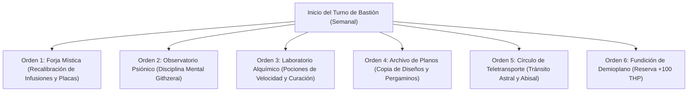

# 🏰 Bastión y Tiempo Muerto — Armorlock: The Iron Mind

## 🏰 Sistema de Bastiones (Reglas Oficiales DMG 2024 / 5.5e)

* **Nombre del Bastión:** La Ciudadela del Abismo y la Forja (*The Fortress of Deep Forge*)
* **Ubicación:** Una estructura submarina fortificada anclada a una fosa abisal, conectada psiónicamente con un monolito de laja astral Githzerai.
* **Nivel de Bastión (Bastion Level):** Nivel 20
* **Puntos de Bastión (Bastion Points - BP):** 510 BP acumulados
* **Bonificador de Defensa de Bastión:** **+11** ($5_{\text{INT}} + 6_{\text{PB}}$)

---

### 🏛️ Instalaciones Básicas (Basic Facilities)

1. **Aposentos de Aislamiento Psiónico (Bedchambers):** Celda hermética presurizada para meditación trascendental Githzerai.
2. **Refectorio Mecanizado (Dining Hall):** Comedor con autómatas sirvientes que dosifican raciones optimizadas para 30 residentes.
3. **Foso de Ensayo Tecnológico (Common Room):** Zona de pruebas para armas de choque, calibración de servomotores y placas.
4. **Almacén de Metales Raros (Storage):** Reserva de adamantina, mitral, y lingotes de hierro abisal.

---

### 🔮 Instalaciones Especiales (Special Facilities — 6 Slots Nivel 20: 4 Roomy + 2 Vast)

1. **Forja Mística de Armero (Roomy — Nivel 5):**
   * *Orden de Bastión:* **Craft / Maintain.**
   * *Efecto Mecánico:* Permite modificar piezas de armadura pesada, infundir placas de adamantina y reparar equipo de los 20 defensores pesados del bastión.
2. **Observatorio Psiónico Githzerai (Roomy — Nivel 5):**
   * *Orden de Bastión:* **Empower.**
   * *Efecto Mecánico:* Entrena las disciplinas mentales del linaje Githzerai. Concede Inspiración Heroica automática al Armorlock y Ventaja adicional en salvaciones contra encantamiento y miedo por 7 días.
3. **Laboratorio Alquímico y Botica (Roomy — Nivel 9):**
   * *Orden de Bastión:* **Harvest / Craft.**
   * *Efecto Mecánico:* Elabora suministros de *Potions of Supreme Healing* y *Potions of Speed* con un descuento del 50% de coste y tiempo.
4. **Archivo de Diseños y Scriptorium (Roomy — Nivel 9):**
   * *Orden de Bastión:* **Research.**
   * *Efecto Mecánico:* Permite transcribir esquemas arcanos y recargar el *Spell-Storing Item* con patrones de conjuro alternativos (*Vortex Warp*, *Shatter*, *Web*).
5. **Círculo de Teletransporte Permanente (Vast — Nivel 13):**
   * *Orden de Bastión:* **Maintain.**
   * *Efecto Mecánico:* Enlace planar que conecta la fosa abisal con los monasterios de Limbo y el plano material.
6. **Fundición de Demioplano / Sanctum Arcantrópico (Vast — Nivel 17):**
   * *Orden de Bastión:* **Empower.**
   * *Efecto Mecánico:* Tras completar un descanso largo en el Sanctum, la armadura del Armorlock absorbe un pulso de blindaje reactivo que concede una reserva de **+100 Puntos de Golpe Temporales** y resistencia al daño de Frío y Fuerza.

---

## ⏳ Actividades de Tiempo Muerto (Downtime Activities)

### Prioridad 1: Recarga y Fabricación de Objetos Infundidos y Spell-Storing Items

* **Mecánica Base:** DMG 2024 / Xanathar's / Tasha's Cauldron of Everything.
* **Tiradas y Especialización:** Herramientas de Herrero (+17 con *Tool Expertise*), Herramientas de Hojalatero (+17).
* **Objetivo de Optimización:** Crear una rotación continua de anillos y armas imbuidas con 10 cargas de *Web* o *Vortex Warp* para dotar a los aliados de versatilidad de transporte táctico.

### Prioridad 2: Fabricación de Varitas y Pergaminos Arcanos

* Elaboración de *Pipes of Haunting* adicionales y pergaminos de *Shield* y *Absorb Elements*.

---

## 🏃‍♂️ Modos de Movimiento, Logística y Viaje

### Velocidades de Movimiento Base

* **Caminar (Walk):** **30 ft/turno** (Armadura pesada de placas sin penalización de Fuerza gracias a *Arcane Armor*).
* **Nadar (Swim):** **40 ft/turno** (*Gift of the Sea* de Fathomless Warlock — otorga respiración acuática permanente).
* **Trepar (Climb):** 30 ft/turno.
* **Volar (Fly):** 30 ft/turno cuando activa *Winged Boots* o *Fly*.

### Modificadores y Sentidos de Exploración

* **Visión en la Oscuridad:** 60 ft (mediante *Goggles of Night* infundidas o visor de armadura).
* **Percepción Pasiva:** 10 (10 + 0 WIS).
* **Investigación Pasiva:** 21 (10 + 5 INT + 6 PB).
