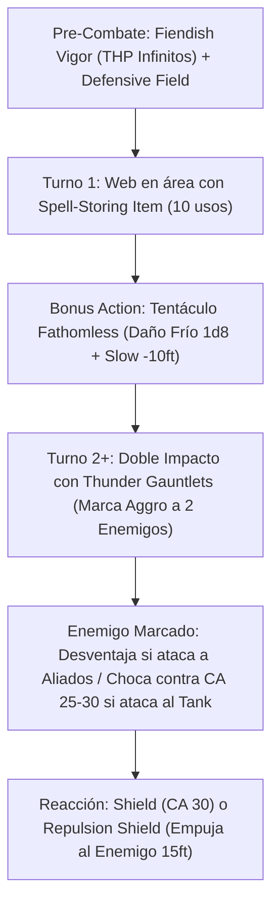

# Resumen General del Personaje: Armorlock (The Iron Mind)

## Datos Generales

* **System Standard:** D&D 5th Edition (2014 Ruleset / 2024 Compatible)
* **Character Level:** 20 (Artificer [Armorer] 17 / Warlock [Fathomless] 3)
* **Species:** Githzerai (*Githzerai Mental Discipline*, *Githzerai Psionics* -> *Shield* gratis)
* **Background:** Sage / Guild Artisan (Dote: *Fey Touched* / *Telekinetic*)
* **Stats (Point Buy + Racial + ASIs):**
  * **STR:** 8 (-1) *(¡DUMPED! Ignorado por el Modelo de Armadura Guardian)*
  * **DEX:** 8 (-1) *(¡DUMPED! Ignorado gracias a la Armadura Pesada)*
  * **CON:** 16 (+3) *(15 Base + 1 ASI — Puntos de Golpe y Concentración)*
  * **INT:** 20 (+5) *(15 Base + 2 Racial + 1 Fey Touched + 2 ASI)*
  * **WIS:** 10 (+0)
  * **CHA:** 14 (+2) *(Requisito de Multiclaseo de Brujo)*

* **Enlaces de Documentación:**
  * [Bastión y Tiempo Muerto](file:///d:/repo-vault/Proyectos/Rol/DnDbuilds/builds/a%20tank%20that%20dumps%20strength%20and%20dex%20the%20armorlock%20%20dd%205e%20character%20build/bastion%20and%20downtime.md)
  * [Lista de Conjuros y Recursos](file:///d:/repo-vault/Proyectos/Rol/DnDbuilds/builds/a%20tank%20that%20dumps%20strength%20and%20dex%20the%20armorlock%20%20dd%205e%20character%20build/spell%20list.md)
  * [Objetos a Obtener](file:///d:/repo-vault/Proyectos/Rol/DnDbuilds/builds/a%20tank%20that%20dumps%20strength%20and%20dex%20the%20armorlock%20%20dd%205e%20character%20build/item%20list%20to%20obtain.md)
  * [Hoja de Ruta 1-20](file:///d:/repo-vault/Proyectos/Rol/DnDbuilds/builds/a%20tank%20that%20dumps%20strength%20and%20dex%20the%20armorlock%20%20dd%205e%20character%20build/roadmap.md)
  * [Inventario Actual](file:///d:/repo-vault/Proyectos/Rol/DnDbuilds/builds/a%20tank%20that%20dumps%20strength%20and%20dex%20the%20armorlock%20%20dd%205e%20character%20build/actual%20inventory%20list.md)

---

## Combat Role: Frontline Heavy Tank, Aggro Taunter & Speed Controller

El **Armorlock** subvierte las normas clásicas del combate cuerpo a cuerpo descartando completamente la Fuerza y Destreza (puntuaciones de 8) para concentrar su poder en una **Inteligencia omnipotente (+5)**. Equipado con armadura completa de placas mágica gracias a la tecnología del Artífice Armero (*Guardian Model*), anula penalizaciones de movimiento, ataca con ondas de choque eléctricas usando Inteligencia, e impone una **Marca de Provocación (Aggro Taunt)** sobre dos enemigos por turno: si intentan golpear a cualquier aliado que no sea él, sufren Desventaja automática. Mientras tanto, su dip en *Fathomless Warlock* ralentiza a los enemigos en 10 pies cada asalto mediante un tentáculo abisal convocado en Acción Adicional.

---

## 1. Gestión de Recursos y Reglas de Inventario

* **Dump Total de Fuerza y Destreza:** El rasgo *Arcane Armor* elimina por completo el requisito de Fuerza mínima de las armaduras pesadas (Placas). No sufres la penalización de -10 ft de velocidad. Además, los *Thunder Gauntlets* utilizan tu modificador de **Inteligencia (+5)** para las tiradas de ataque y daño ($1\text{d}8 + 5$).
* **Mecánica de Provocación (Thunder Gauntlets Taunt):** Cada impacto marca a la criatura hasta el inicio de tu siguiente turno. La criatura tiene **Desventaja en cualquier tirada de ataque que no te tenga como objetivo**. Si ataca al Armorlock, debe superar una CA de 25-30. Si ataca a los aliados, ataca con Desventaja.
* **Concentración Inquebrantable:** Sinergia de *Eldritch Mind* (Ventaja permanente en salvaciones de concentración) + competencia en CON (+3) + *Flash of Genius* (+5 como Reacción). Para perder la concentración, el Armorlock debe fallar una tirada con +8 y Ventaja (probabilidad de fallo ante CD 10 inferior al 0.25%).
* **Sintonización Extendida (5 Slots):** Con *Magic Item Savant* (Artificer 14), sintoniza hasta 5 objetos mágicos e ignora todos los requisitos de raza, clase y conjuro.

---

## 2. Action Economy & Combat Loop

* **Pre-Combate (Turno 0):** Activar *Fiendish Vigor* (fija PG temporales) y preparar *Defensive Field* (17 THP adicionales).
* **Turno 1 — Anclaje y Control de Masas:**
  * **Action:** Lanzar *Web* o utilizar el *Spell-Storing Item* (que contiene 10 cargas de *Web* o *Vortex Warp*).
  * **Bonus Action:** Convocar el *Tentacle of the Deeps* a 60 ft: inflige $1\text{d}8$ de daño de frío y reduce la velocidad del objetivo en 10 pies.
* **Turno 2+ — Ciclo de Provocación y Bloqueo:**
  * **Action:** Extra Attack con *Thunder Gauntlets*: golpea a 2 enemigos distintos, marcando a ambos con Desventaja contra el resto del grupo.
  * **Bonus Action:** Atacar con el Tentáculo (otro slow de -10 ft) o reponer 17 THP con *Defensive Field*.
  * **Reaction:**
    * *Shield:* Eleva la CA a **30** ante ataques enemigos.
    * *Repulsion Shield:* Empuja a un enemigo 15 pies hacia atrás tras ser golpeado.
    * *Flash of Genius:* Suma +5 a cualquier salvación crítica tuya o de un aliado a 30 pies.

---

## 3. Mathematical Engine (D&D 5e / 2024 Compatible)

### 🛡️ Clase de Armadura y Defensa Absoluta

$$\text{CA Pasiva Base} = 18_{\text{Placas}} + 2_{\text{Escudo}} + 2_{\text{Enhanced Defense}} + 1_{\text{Repulsion Shield}} + 2_{\text{Staff of Power}} = \mathbf{25 \text{ CA Pasiva}}$$

$$\text{CA con Conjuro Shield} = 25_{\text{Pasiva}} + 5_{\text{Shield (Githzerai)}} = \mathbf{30 \text{ CA Efectiva}}$$

* **Probabilidad de Impacto Enemigo (CR 20 Boss con +14 al Ataque):**
  $$\text{Impacto contra CA 30} = P(\text{Roll } \ge 16) = \frac{5}{20} = 0.25 \quad (25\%)$$
* Si el enemigo intenta esquivar al Armorlock para golpear a un mago o pícaro aliado:
  $$\text{Impacto contra Aliado con Desventaja por Thunder Gauntlets} = (0.65)^2 \approx 0.4225 \implies \text{Reducción del 35\% del DPS enemigo}$$

### 🧮 Daño por Asalto Sostenido (DPR a Nivel 20)

Con Inteligencia 20 (+5), *Enhanced Weapon / Gauntlets +2*, y Tentáculo Abisal:

$$\text{DPR Guanteletes} = 2 \times [P(\text{Hit}) \times (1\text{d}8 + 5_{\text{INT}} + 2_{\text{Item}}) + P(\text{Crit}) \times 1\text{d}8] = 2 \times [0.75 \times 11.5 + 0.05 \times 4.5] = 2 \times 8.85 = 17.7$$

$$\text{DPR Tentáculo Fathomless (Bonus Action)} = 0.75 \times (1\text{d}8 + 2_{\text{CHA}}) + 0.05 \times 4.5 = 0.75 \times 6.5 + 0.225 = 5.1$$

$$\text{DPR Sostenido} = 17.7 + 5.1 = \mathbf{22.8 \text{ DPR Base}} \quad (\text{Más 10 Objetos con Animate Objects = +65 DPR})$$

### 🩸 Supervivencia y EHP

$$\text{EHP Físico} = \frac{\text{HP Real } (163) + \text{Defensive Field } (17) + \text{Sanctum Ward } (100)}{1 - \text{Armor of Invulnerability Resistencia } (0.50)} = \frac{280}{0.50} = \mathbf{560 \text{ EHP}}$$

---

## 4. Tabla de Rendimiento Táctico

| Criterio | Valoración | Justificación Mecánica |
| :--- | :---: | :--- |
| **Daño Monobjetivo** | 🟡 | Daño moderado de guanteletes (22.8 DPR), ampliable a 85+ DPR cuando activa *Animate Objects* de 5.º nivel. |
| **Control de Masas (CC)** | 🔵 | *Thunder Gauntlets* (marca doble de aggro), *Web* x10 en *Spell-Storing Item*, lentitud de tentáculo (-10ft) y empujes con *Repulsion Shield*. |
| **Supervivencia (EHP)** | 🔵 | CA 25 pasiva / CA 30 con *Shield*, 560 EHP efectivo con *Armor of Invulnerability*, ventaja en salvaciones mentales (*Githzerai Mental Discipline*). |
| **Economía de Acciones** | 🔵 | Acción de ataque / control, Acción Adicional permanente con el tentáculo abisal, y Reacciones estelares (*Shield*, *Absorb Elements*, *Flash of Genius*). |
| **Sustentabilidad** | 🔵 | Descarte total de Fuerza y Destreza sin penalización. PG temporales a voluntad con *Fiendish Vigor* y *Defensive Field* recargable. |

---

## 5. Home Rules (Reglas de la Mesa)

1. **Foco Universal Único:** La armadura de placas mística actúa como foco de lanzamiento para todos los conjuros de Artífice y Brujo.
2. **Progresión Full Caster Integrada:** Los espacios de Pact Magic de Brujo se recargan en descansos cortos y pueden usarse indistintamente para conjuros de Artífice (*Shield*, *Absorb Elements*).
