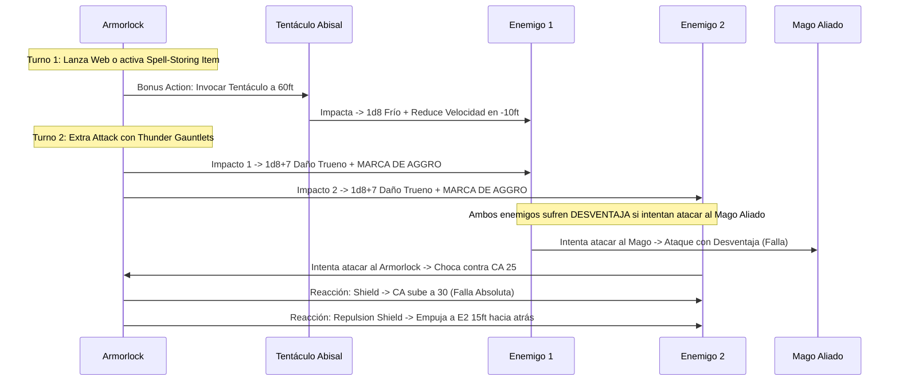

# 🌟 Lista de Conjuros y Recursos — Armorlock: The Iron Mind

Esta lista detalla la selección de conjuros y recursos para **Armorlock** (Artificer Armorer 17 / Warlock Fathomless 3), optimizada bajo reglas de D&D 5e (2014 & 2024).

---

## ⚡ Conjuros Activos y Pre-Buffs (Turno 0 / Fuera de Combate)

| Conjuro / Recurso | Duración | Concentración | Efecto Táctico Clave |
| :--- | :---: | :---: | :--- |
| **Fiendish Vigor (Invocación)** | Instantáneo | No | Concede $1\text{d}4 + 4 = 8$ Puntos de Golpe Temporales renovables a voluntad sin coste de ranura. |
| **Defensive Field (Armorer)** | Hasta agotarse | No | Concede **17 Puntos de Golpe Temporales** utilizables PB veces por descanso largo como Acción Adicional. |
| **Sanctum Ward (Bastión)** | 24 horas | No | Reserva de **+100 Puntos de Golpe Temporales** obtenida en la Fundición de Demioplano. |
| **Fire Shield (Nivel 4)** | 10 minutos | No | Resistencia a daño de fuego o frío y $+2\text{d}8$ de daño de espinas a quien te golpee cuerpo a cuerpo. |

---

## 🔮 Trucos (Cantrips)

### Artífice (4 conocidos) + Brujo (2 conocidos)

1. **Fire Bolt 🟢 [Excelente - Daño a Distancia]:** $4\text{d}10$ de daño de fuego a 120 ft usando Inteligencia (+5).
2. **Booming Blade 🔵 [Roto - Control Melé]:** Si el objetivo intenta moverse tras ser golpeado, sufre $3\text{d}8$ de daño de trueno adicional.
3. **Eldritch Blast 🟢 [Excelente]:** 4 rayos de fuerza ($1\text{d}10$ cada uno) a 120 ft usando Carisma.
4. **Mending 🔵 [Utilidad Técnica]:** Reparación de armaduras, piezas mecánicas y sellado de grietas.
5. **Shocking Grasp 🟢 [Escape Táctico]:** Ataque de toque con Inteligencia; anula las reacciones del enemigo si impacta.
6. **Light 🟡 [Utilidad]:** Iluminación táctica en entornos oscuros.

---

## 🎒 Conjuros Preparados de Artífice (17.º Nivel — Mitad de Lanzador: 5.º Nivel)

*CD de Salvación de Artífice:* $8 + 6_{\text{PB}} + 5_{\text{INT}} = \mathbf{19}$ (o **21** con *Staff of Power*). Modificador de Ataque: $\mathbf{+11}$ (+13 con Staff).

### 5.º Nivel (1 Ranura)

1. **Animate Objects 🔵 [Roto - Enjambre de Daño]:** Anima 10 objetos pequeños que atacan de forma coordinada infligiendo $10 \times (1\text{d}4 + 4) \approx 65\text{ DPR}$ adicional como Acción Adicional.
2. **Greater Restoration 🟢 [Soporte Vital]:** Elimina petrificación, maldiciones, reducciones de puntuación de características o agotamiento.

### 4.º Nivel (2 Ranuras)

3. **Fire Shield 🔵 [Indispensable - Espinas]:** No requiere concentración. Inflige $2\text{d}8$ de daño de fuego/frío a cualquier atacante en melé.
4. **Otiluke's Resilient Sphere 🟢 [Protección / Encierro]:** Esfera de fuerza impenetrable que aísla a un aliado en peligro crítico o neutraliza a un jefe sin salvación reiterada.

### 3.ᵉʳ Nivel (3 Ranuras)

5. **Hypnotic Pattern 🔵 [Control Masivo]:** Incapacita a salas enteras de esbirros con una sola salvación de Sabiduría.
6. **Dispel Magic 🟢 [Utilidad]:** Anula efectos mágicos hostiles con chequeo de Inteligencia (+5 + Flash of Genius = +10 a la prueba).
7. **Revivify 🟢 [Seguridad]:** Reanima a un aliado caído en combate en menos de 1 minuto.

### 2.º Nivel (3 Ranuras)

8. **Web 🔵 [Control Táctico]:** Retiene y restringe a criaturas en un cubo de 20 pies, imponiendo Ventaja para todos los ataques aliados.
9. **Vortex Warp 🟢 [Reposicionamiento]:** Teletransporta a un aliado a 90 ft fuera del peligro o coloca a un enemigo en medio de una trampa.
10. **Blur 🟡 [Defensivo]:** Todos los ataques contra ti sufren Desventaja mientras mantienes concentración.

### 1.ᵉʳ Nivel (4 Ranuras)

11. **Shield 🔵 [Indispensable - Reacción]:** +5 a la CA hasta el inicio de tu siguiente turno (concede CA 30).
12. **Absorb Elements 🔵 [Defensa Elemental]:** Resistencia como Reacción ante daño elemental de área.
13. **Cure Wounds 🟢 [Soporte]:** Cura $1\text{d}8 + 5$ a un aliado adyacente.

---

## 🐙 Conjuros y Rasgos de Pact Magic (Warlock Fathomless — 2 Ranuras de Nivel 2)

* **Tentacle of the Deeps:** Acción Adicional a 60 ft. Ataque que inflige $1\text{d}8$ de daño de frío y reduce la velocidad del objetivo en 10 pies.
* **Armor of Agathys (Nivel 2):** 10 THP y 10 de daño de frío reflejado por golpe.
* **Misty Step (Nivel 2):** Teletransporte de 30 ft como Acción Adicional.

---

## 📦 Objeto de Almacenamiento de Conjuros (Spell-Storing Item — 10 Usos Diarios)

* **Conjuro Almacenado:** **Web (Nivel 2)** o **Vortex Warp (Nivel 2)**.
* **Mecánica:** Permite a ti o a un sirviente autómata (*Homunculus Servant*) activar el conjuro seleccionado **10 veces al día** sin gastar espacios de conjuro propios ni consumir tus acciones de ataque principales.

---

## 💥 Secuencia Táctica de Bloqueo y Provocación (Hard Taunt Lock)

---

## 💚 Curación en Segundo Plano y Sostenibilidad

* **Defensive Field Recargable:** Repone 17 THP como Acción Adicional tantas veces como tu bonificador por competencia (6 veces al día).
* **Fiendish Vigor Ilimitado:** Entre encuentros, lanza *False Life* de forma indefinida para comenzar cada combate con el máximo de vida temporal básica.
* **Flash of Genius Defensivo:** Suma +5 a tiradas de salvación de concentración de aliados o propias (5 usos diarios).
* **Pociones en Acción Adicional:** Consumo rápido de *Potion of Supreme Healing* ($10\text{d}4 + 20 \approx 45\text{ PG}$) bajo reglas oficiales 2024.
