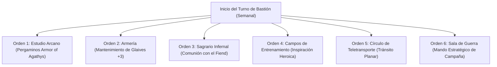

# 🏰 Bastión y Tiempo Muerto — Barbarian from Hell

## 🏰 Sistema de Bastiones (Reglas Oficiales DMG 2024 / 5.5e)

* **Nombre del Bastión:** La Grieta del Averno (*The Rift of Avernus*)
* **Ubicación:** Cañón volcánico en el borde de un páramo desolado, con acceso subterráneo a fisuras de fuego primordial.
* **Nivel de Bastión (Bastion Level):** Nivel 20
* **Puntos de Bastión (Bastion Points - BP):** 450 BP acumulados
* **Bonificador de Defensa de Bastión:** **+11** ($5_{\text{STR}} + 6_{\text{PB}}$)

---

### 🏛️ Instalaciones Básicas (Basic Facilities)

1. **Aposentos del Señor de la Furia (Bedchambers):** Cámara tallada en basalto negro decorada con estandartes del infierno.
2. **Refectorio de la Sangre (Dining Hall):** Banquete comunal para los veteranos de la guarnición; asados al carbón y brebajes infernales.
3. **Foso Común de Combate (Common Room):** Foso de arena y lava seca donde los siervos y guardias resuelven disputas mediante duelos de honor.
4. **Almacén de Pertrechos (Storage):** Depósito blindado de lingotes de hierro del Averno, brea y repuestos de combate.

---

### 🔮 Instalaciones Especiales (Special Facilities — 6 Slots Nivel 20: 4 Roomy + 2 Vast)

1. **Estudio Arcano (Arcane Study — Roomy, Nivel 5):**
   * *Orden de Bastión:* **Craft.**
   * *Efecto Mecánico:* Permite transcribir pergaminos de conjuro de Warlock (*Scroll of Armor of Agathys* de Nivel 5) sin gastar ranuras personales, acumulando un suministro táctico para combates de alta exigencia.
2. **Armería Pesada (Armory — Roomy, Nivel 5):**
   * *Orden de Bastión:* **Maintain.**
   * *Efecto Mecánico:* Los herreros mantienen las alabardas y armaduras de placas medias de la guarnición con filo y temple superior, otorgando a los 20 defensores bonificador de +1 a impacto.
3. **Sagrario Infernal (Sacrarium — Roomy, Nivel 9):**
   * *Orden de Bastión:* **Empower.**
   * *Efecto Mecánico:* Comunión directa con los señores de los Nueve Infiernos. Confiere el *Charm of the Fiend* (otorga 25 HP temporales al salir del bastión y permite recuperar 1 espacio de pacto de nivel 5).
4. **Campos de Entrenamiento (Training Grounds — Roomy, Nivel 9):**
   * *Orden de Bastión:* **Train.**
   * *Efecto Mecánico:* Concede Inspiración Heroica automática al Bárbaro y entrena a la tropa pesada en maniobras de contención y absorción de daño.
5. **Círculo de Teletransporte Permanente (Vast, Nivel 13):**
   * *Orden de Bastión:* **Maintain.**
   * *Efecto Mecánico:* Enlace planar bidireccional entre la Grieta del Averno, las fortalezas de la Ciudadela de Bronce y las grandes capitales del plano material.
6. **Sala de Guerra del Caudillo (War Room — Vast, Nivel 17):**
   * *Orden de Bastión:* **Mobilize / Strategize.**
   * *Efecto Mecánico:* Centro de operaciones tácticas. Otorga Ventaja en tiradas de iniciativa durante las siguientes 48 horas tras planificar una incursión y permite desplegar una compañía de choque de 20 veteranos infernales.

---

## ⏳ Actividades de Tiempo Muerto (Downtime Activities)

### Prioridad 1: Fabricación de Pergaminos de Armor of Agathys y Pociones

* **Mecánica Base:** DMG 2024 / Xanathar's Guide to Everything.
* **Tiradas y Recursos:** Herramientas de Calígrafo Arcano (+8) y Scriptorium. Coste: 250 po y 3 días por pergamino de 5.º nivel.
* **Objetivo de Optimización:** Crear una reserva de pergaminos para activar *Armor of Agathys* sin consumir las 3 ranuras de pacto antes de encuentros cruciales.

### Prioridad 2: Entrenamiento Físico y Forja de Armas de Furia

* **Herrería Infernal:** Elaboración de Glaives reforzadas con aleación de hierro meteórico con afinidad de fuego.

---

## 🏃‍♂️ Modos de Movimiento, Logística y Viaje

### Velocidades de Movimiento Base

* **Caminar (Walk):** **40 ft/turno** (30 ft Base + 10 ft *Fast Movement* de Bárbaro).
* **Trepar (Climb):** 30 ft/turno.
* **Nadar (Swim):** 30 ft/turno.
* **Volar (Fly):** 90 ft/turno cuando monta su corcel infernal (Pesadilla).

### Logística y Montura Infernal

* **Montura Activa:** Pesadilla de Fuego (*Nightmare* pactada con el Fiend): Velocidad de 60 ft por tierra y 90 ft de vuelo, con inmunidad compartida al fuego y paso etéreo.
* **Sentidos y Exploración:** Visión en la Oscuridad de 120 pies (*Devil's Sight* — ve a través de oscuridad mágica y natural).
* **Percepción Pasiva:** 9 (10 - 1 WIS).
