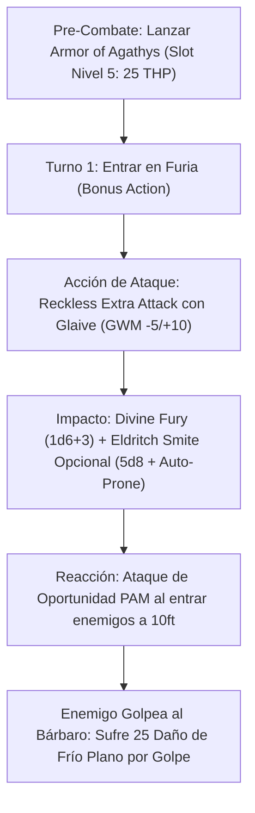

# Resumen General del Personaje: Barbarian from Hell

## Datos Generales

* **System Standard:** D&D 5th Edition (2014 Ruleset / 5.5e Compatible)
* **Character Level:** 20 (Total)
* **Class Split:** Barbarian (Zealot) 6 / Warlock (Fiend) 14
* **Species:** Custom Lineage (Dote de Nivel 1: *Polearm Master*)
* **Stats (Point Buy + Dotes + ASIs):**
  * **FUER (STR):** 20 (+5) *(15 Base + 2 Racial + 1 ASI Nivel 10 + 2 ASI Nivel 14)*
  * **DES (DEX):** 14 (+2) *(Para maximizar la CA con Armadura Media)*
  * **CON:** 14 (+2) *(Reserva de vida duplicada en efectividad por Furia)*
  * **INT:** 8 (-1)
  * **SAB:** 8 (-1)
  * **CAR (CHA):** 14 (+2) *(13 Base + 1 ASI Nivel 14 — Escala CD y rasgos de Warlock)*

* **Enlaces de Documentación:**
  * [Bastión y Tiempo Muerto](file:///d:/repo-vault/Proyectos/Rol/DnDbuilds/builds/barbarian%20from%20hell/bastion%20and%20downtime.md)
  * [Lista de Conjuros y Recursos](file:///d:/repo-vault/Proyectos/Rol/DnDbuilds/builds/barbarian%20from%20hell/spell%20list.md)
  * [Objetos a Obtener](file:///d:/repo-vault/Proyectos/Rol/DnDbuilds/builds/barbarian%20from%20hell/item%20list%20to%20obtain.md)
  * [Hoja de Ruta 1-20](file:///d:/repo-vault/Proyectos/Rol/DnDbuilds/builds/barbarian%20from%20hell/roadmap.md)
  * [Inventario Actual](file:///d:/repo-vault/Proyectos/Rol/DnDbuilds/builds/barbarian%20from%20hell/actual%20inventory%20list.md)

---

## Combat Role: Frontline Thorns Tank / Heavy Striker / Hellish Executioner

El **Barbarian from Hell** es un tanque de represalia física y elemental implacable. Su premisa fundamental es el **Motor de Espinas Infernales (Hellish Thorns)**: castiga a los enemigos cuerpo a cuerpo mediante el daño reflejado automático de *Armor of Agathys* (Nivel 5 = 25 de daño de frío por golpe) mientras reduce todo el daño físico recibido a la mitad mediante *Rage*, duplicando la durabilidad efectiva de sus puntos de golpe temporales. Ofensivamente, desata ataques masivos con alabarda (*Glaive*) combinando *Polearm Master*, *Great Weapon Master*, *Reckless Attack*, *Divine Fury* y descargas nucleares de *Eldritch Smite* y *Hurl Through Hell*.

---

## 1. Gestión de Recursos y Reglas de Inventario

* **Furia y Lanzamiento de Conjuros:** No se pueden lanzar ni concentrar conjuros durante *Rage*. Sin embargo, cualquier conjuro **sin concentración lanzado antes de entrar en Furia** (como *Armor of Agathys* o *Mirror Image*) permanece 100% activo y funcional.
* **Eldritch Smite en Furia:** *Eldritch Smite* no es un conjuro, sino un rasgo de clase que gasta una ranura de pacto al impactar con un arma para infligir $+5\text{d}8$ de daño de fuerza y derribar al objetivo automáticamente sin tirada de salvación. **Es plenamente legal usarlo durante Furia**.
* **Gestión de Armadura:** Viste *Half-Plate* (CA 15 + 2 DEX = 17 base; CA 20 con Half-Plate +3). No porta escudo para blandir el Glaive a dos manos y aprovechar el alcance de 10 pies de *Polearm Master*.

---

## 2. Action Economy & Combat Loop

* **Pre-Combate (Turno 0):** Lanzar *Armor of Agathys* de 5.º nivel (25 THP). Si hay tiempo adicional, lanzar *Mirror Image*.
* **Turno 1 — Despliegue de Furia:**
  * **Bonus Action:** Entrar en *Rage* (resistencia a daño cortante, perforante y contundente).
  * **Action:** Ataque Extra con Glaive mediante *Reckless Attack* (Ventaja permanente). Aplica *Great Weapon Master* (+10 daño por impacto).
  * **Impacto 1:** Añade *Divine Fury* del Zealot ($1\text{d}6 + 3$ de daño radiante o necrótico).
  * **Opcional:** Gasta ranura de nivel 5 en *Eldritch Smite* ($+5\text{d}8$ de daño de fuerza y derriba al objetivo).
* **Turnos Subsiguientes — Rutina de Daño Continuo:**
  * **Action:** 2 Ataques con Glaive con Ventaja temeraria y GWM.
  * **Bonus Action:** Ataque con el extremo del asta (*Polearm Master*): $1\text{d}4 + \text{Fuerza} + \text{Furia} + 10_{\text{GWM}}$.
  * **Reaction:** Ataque de oportunidad cuando una criatura entra a tu alcance de 10 pies (*Polearm Master*).

---

## 3. Mathematical Engine (D&D 5e / 2014 & 2024 Compatible)

### 🧮 Daño por Asalto Sostenido (DPR a Nivel 20)

Con Fuerza 20 (+5), *Ascendant Dragon's Wrath Glaive +3*, *Great Weapon Master* (+10 daño), bonificador de Furia (+2), y *Reckless Attack* contra CA 18:

$$\text{Tirada de Ataque con Ventaja } P(\text{Hit}) = 1 - (1 - 0.65)^2 = 0.8775 \quad (87.75\%)$$

$$\text{Probabilidad de Crítico con Ventaja } P(\text{Crit}) = 1 - (1 - 0.05)^2 = 0.0975 \quad (9.75\%)$$

* **Ataque 1 (Glaive + Divine Fury):**
  $$\text{Dmg}_1 = 1\text{d}10 + 5_{\text{STR}} + 3_{\text{Item}} + 2_{\text{Rage}} + 10_{\text{GWM}} + 1\text{d}6 + 3_{\text{Zealot}} = 5.5 + 20 + 3.5 + 3 = 32.0$$
* **Ataque 2 (Glaive):**
  $$\text{Dmg}_2 = 1\text{d}10 + 5_{\text{STR}} + 3_{\text{Item}} + 2_{\text{Rage}} + 10_{\text{GWM}} = 5.5 + 20 = 25.5$$
* **Ataque 3 (PAM Bonus Action):**
  $$\text{Dmg}_3 = 1\text{d}4 + 5_{\text{STR}} + 3_{\text{Item}} + 2_{\text{Rage}} + 10_{\text{GWM}} = 2.5 + 20 = 22.5$$

$$\text{DPR Golpes} = 0.8775 \times (32.0 + 25.5 + 22.5) + 0.0975 \times (5.5 + 3.5 + 5.5 + 2.5) = 70.20 + 1.66 = \mathbf{71.86 \text{ DPR Sostenido}}$$

$$\text{Daño de Espinas Reflejado} = 2 \text{ impactos recibidos} \times 25_{\text{Frío Plano}} = \mathbf{50.0 \text{ Daño Pasivo sin Salvación}}$$

$$\text{DPR Efectivo Total} = 71.86 + 50.0 = \mathbf{121.86 \text{ DPR}}$$

### 🛡️ Motor de Espinas y EHP

$$\text{EHP Base} = \frac{\text{HP Real } (185) + \text{Armor of Agathys } (25)}{1 - \text{Resistencia Furia } (0.50)} = \frac{210}{0.50} = \mathbf{420 \text{ EHP Físico}}$$

* Con *Fiendish Resilience* (Warlock 10), el personaje añade resistencia a un tipo de daño elemental adicional (fuego, frío, ácido, etc.) a voluntad tras cada descanso.
* Cada 25 THP de *Armor of Agathys* absorbe **50 de daño físico**. Si un enemigo impacta 3 veces por 15 de daño físico (reducido a 7 cada uno), el bárbaro recibe 21 de daño en sus THP (aún le sobran 4) y el atacante sufre **75 de daño de frío automático**.

---

## 4. Tabla de Rendimiento Táctico

| Criterio | Valoración | Justificación Mecánica |
| :--- | :---: | :--- |
| **Daño Monobjetivo** | 🔵 | 120+ DPR combinando 3 ataques con GWM, ventaja temeraria, daño pasivo de espinas, y picos nucleares con *Eldritch Smite* (+5d8) y *Hurl Through Hell* (+10d10). |
| **Control de Masas (CC)** | 🟢 | Derribo automático sin salvación (*Prone*) mediante *Eldritch Smite*, amenaza de 10 pies con PAM y control de área con *Scatter* o *Forcecage*. |
| **Supervivencia (EHP)** | 🔵 | Resistencia a daño físico por Furia + resistencia elemental por *Fiendish Resilience*, 420+ EHP efectivo, ventaja en salvaciones de Destreza, reroll de salvación con *Fanatical Focus* y *Dark One's Own Luck* (+1d10). |
| **Economía de Acciones** | 🟢 | Pre-buff antes de combate, entrada en Furia en Turno 1, ataque PAM constante en Acción Adicional, y ataque de oportunidad de PAM en Reacción. |
| **Sustentabilidad** | 🔵 | *Warrior of the Gods* elimina el coste de componentes para revivirte (0 po de diamantes). Las 3 ranuras de 5.º nivel se recuperan en descansos cortos. |

---

## 5. Home Rules (Reglas de la Mesa)

1. **Eldritch Smite en Furia:** Se confirma el uso de *Eldritch Smite* durante Furia, ya que es un rasgo de clase de Warlock y no un lanzamiento de conjuros.
2. **Foco Universal Único:** No se requieren componentes materiales sin coste para conjuros de Warlock mientras porte su amuleto o foco rúnico infernal.
3. **Progresión Full Caster Integrada:** Si adquiere niveles en otras clases lanzadoras, las ranuras de Pact Magic se mantienen independientes y recuperables en descanso corto.
