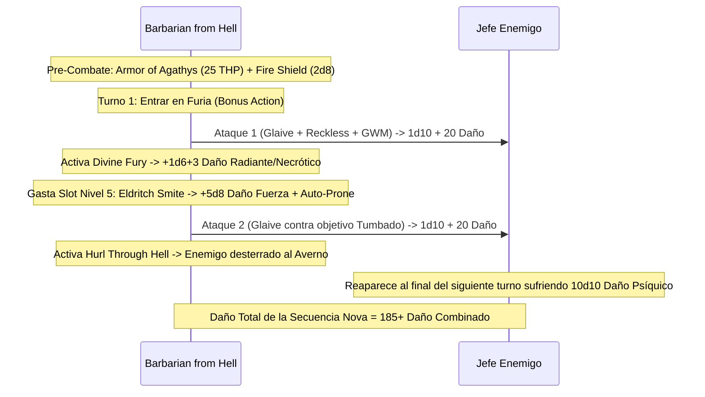

# 🌟 Lista de Conjuros y Recursos — Barbarian from Hell

Esta lista detalla la selección de conjuros y recursos para el **Barbarian from Hell** (Barbarian Zealot 6 / Warlock Fiend 14), optimizada bajo reglas de D&D 5e (2014 & 2024).

> **Aviso Táctico:** No puedes lanzar ni concentrarte en conjuros mientras estás en *Furia (Rage)*. Por tanto, tu repertorio prioriza conjuros de pre-combate **sin concentración**, efectos de área previos a la Furia, y canalizaciones instantáneas como *Eldritch Smite*.

---

## ⚡ Conjuros Activos y Pre-Buffs (Turno 0 / Fuera de Combate)

| Conjuro / Recurso | Duración | Concentración | Efecto Táctico Clave |
| :--- | :---: | :---: | :--- |
| **Armor of Agathys (Nivel 5)** | 1 hora | No | Otorga **25 THP**. Cualquier enemigo que te golpee en cuerpo a cuerpo sufre **25 de daño de frío plano** por cada golpe recibido. |
| **Mirror Image (Nivel 2)** | 1 minuto | No | Crea 3 duplicados ilusorios que absorben ataques enemigos sin requerir concentración. |
| **Charm of the Fiend (Bastión)** | 24 horas | No | Otorga 25 HP temporales iniciales o recarga 1 ranura de pacto de nivel 5. |

---

## 🔮 Trucos (Cantrips — Warlock)

1. **Mending 🔵 [Utilidad]:** Mantenimiento y reparación mágica de astas, armaduras y cadenas.
2. **Minor Illusion 🟢 [Utilidad]:** Creación de distracciones visuales o acústicas fuera de combate.
3. **Lightning Lure 🟢 [Control]:** Fuerza una salvación de Fuerza para arrastrar a un objetivo a 10 ft directo hacia tu alcance de amenaza con Glaive.
4. **Create Bonfire 🟡 [Control de Área]:** Obstáculo de fuego utilizable antes de activar la furia.

---

## 🎒 Conjuros de Pact Magic (3 Ranuras de Nivel 5 — Recarga en Descanso Corto)

*CD de Salvación de Conjuros:* $8 + 6_{\text{PB}} + 2_{\text{CHA}} = \mathbf{16}$ (o **19** con *Rod of the Pact Keeper +3*).

### 5.º Nivel

1. **Armor of Agathys 🔵 [Roto / Núcleo del Build]:** 25 HP temporales que infligen 25 de daño de frío automático al atacante. Con la resistencia de Furia, absorbe 50 de daño físico efectivo mientras castiga al agresor.
2. **Synaptic Static 🔵 [Excelente - Sin Concentración]:** Gran detonación psíquica en 20 ft de radio a 120 ft. Inflige $8\text{d}6$ de daño psíquico y resta $1\text{d}6$ a todos los ataques y salvaciones enemigas por 1 minuto sin concentración. Se lanza en Turno 1 antes de entrar en Furia.
3. **Hold Monster 🟢 [Control Absoluto]:** Paraliza a cualquier monstruo (aberraciones, dragones, gigantes) garantizando críticos automáticos cuerpo a cuerpo (usar fuera de Furia).

### 4.º Nivel

4. **Dimension Door 🟢 [Movilidad]:** Teletransporte de emergencia de 500 pies para ti y un acompañante sin línea de visión requerida.
5. **Fire Shield 🔵 [Defensa de Espinas Secundaria]:** 10 minutos de duración sin concentración. Confiere resistencia a frío o fuego y añade $2\text{d}8$ de daño de fuego/frío a quien te golpee cuerpo a cuerpo (apila con *Armor of Agathys* para $25 + 2\text{d}8 \approx 34$ de daño reflejado por golpe).

### 3.ᵉʳ Nivel

6. **Thunderstep 🟢 [Escape y Daño]:** Te teletransportas a 90 ft infligiendo $3\text{d}10$ de daño de trueno a todos los adyacentes al punto de partida.
7. **Fly 🟡 [Movilidad]:** Vuelo táctico para perseguir enemigos alados antes de entrar en melé.

### 2.º Nivel

8. **Mirror Image 🔵 [Defensa Ilusoria]:** 3 duplicados sin concentración que desvían ataques enemigos.
9. **Darkness 🟢 [Sinergia con Devil's Sight]:** Oscuridad de 15 ft de radio. Te otorga Ventaja en todos los ataques y Desventaja a los atacantes cuando combates sin Furia.

### 1.ᵉʳ Nivel

10. **Hellish Rebuke 🟢 [Reacción]:** Reacción tras recibir daño. Inflige $5\text{d}10$ de daño de fuego al atacante (usar cuando la Furia ha concluido).

---

## 🔮 Arcanos Místicos (Mystic Arcanum — 1 Uso por Descanso Largo)

* **6.º Nivel: Scatter 🔵 [Control Táctico]:** Teletransporta a hasta 5 criaturas en un radio de 120 ft. Arrastra a varios objetivos vulnerables directo a tu foso de combate o rescata a aliados en peligro.
* **7.º Nivel: Forcecage 🔵 [Encierro Absoluto]:** Jaula de fuerza impenetrable de 20 ft sin tirada de salvación inicial. Atrapa a jefes o ejércitos durante 1 hora completa.

---

## 💥 Secuencia de Daño Nova (The Hellfire Guillotine)

---

## 💚 Curación en Segundo Plano y Sostenibilidad

* **Dark One's Blessing:** Al reducir a cualquier enemigo a 0 PG, el Bárbaro recibe de forma pasiva **16 Puntos de Golpe Temporales** ($14_{\text{Warlock}} + 2_{\text{CHA}}$), renovando su colchón defensivo sin coste de acción.
* **Pociones en Acción Adicional:** Consumo de *Potion of Supreme Healing* ($10\text{d}4 + 20 \approx 45\text{ PG}$) en momentos de retirada o transición.
* **Warrior of the Gods (Zealot):** Cualquier conjuro de resurrección (*Revivify*, *Raise Dead*, *Resurrection*) lanzado sobre el personaje **no consume componentes materiales**. Si cae en batalla, regresar a la vida cuesta 0 po al grupo.
