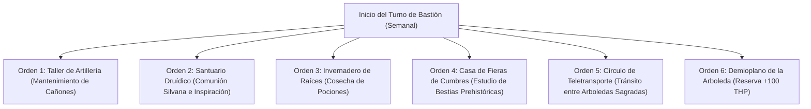

# 🏰 Bastión y Tiempo Muerto — Bear with a Flamethrower

## 🏰 Sistema de Bastiones (Reglas Oficiales DMG 2024 / 5.5e)

* **Nombre del Bastión:** La Arboleda del Engranaje (*The Clockwork Grove*)
* **Ubicación:** Un bosque milenario donde árboles titánicos de corteza de hierro conviven con cascadas geotermales y engranajes de latón místico.
* **Nivel de Bastión (Bastion Level):** Nivel 20
* **Puntos de Bastión (Bastion Points - BP):** 510 BP acumulados
* **Bonificador de Defensa de Bastión:** **+11** ($5_{\text{SAB}} + 6_{\text{PB}}$)

---

### 🏛️ Instalaciones Básicas (Basic Facilities)

1. **Aposentos del Gran Árbol de Hierro (Bedchambers):** Invernadero de cristal templado integrado en el tronco de un roble mecánico gigante.
2. **Refectorio Silvano de Caldera (Dining Hall):** Hogar comunal alrededor de un manantial termal con mesas de piedra viva para 30 comensales.
3. **Plaza de Confraternización Animal (Common Room):** Claro natural donde bestias del bosque, autómatas y guardianes druídicos conviven.
4. **Almacén de Resinas y Engranajes (Storage):** Depósito estanco con reservas de savia de hierro, carbón vegetal y madera fósil.

---

### 🔮 Instalaciones Especiales (Special Facilities — 6 Slots Nivel 20: 4 Roomy + 2 Vast)

1. **Taller de Artillería y Mecatrónica (Workshop — Roomy, Nivel 5):**
   * *Orden de Bastión:* **Craft / Maintain.**
   * *Efecto Mecánico:* Fabricación y calibración de Cañones Eldritch Diminutos y arneses de combate para Formas Salvajes. Permite reparar equipo mecánico a mitad de tiempo.
2. **Santuario Druídico de la Luna (Sanctuary — Roomy, Nivel 5):**
   * *Orden de Bastión:* **Empower.**
   * *Efecto Mecánico:* Comunión directa con los espíritus primordiales. Concede Inspiración Heroica automática al Druida al salir del bastión y otorga bonificador de +1 a salvaciones a los 16 defensores silvanos.
3. **Invernadero de Raíces de Hierro (Greenhouse — Roomy, Nivel 9):**
   * *Orden de Bastión:* **Harvest.**
   * *Efecto Mecánico:* Cosecha de flora mágica y raíces ricas en minerales. Suministra ingredientes para elaborar *Potions of Supreme Healing* a mitad de coste en oro.
4. **Casa de Fieras de Cumbres y Fósiles (Menagerie — Roomy, Nivel 9):**
   * *Orden de Bastión:* **Train / Study.**
   * *Efecto Mecánico:* Hábitat reservado para mamuts, osos de las cavernas y bestias prehistóricas. Permite al Druida estudiar su anatomía para perfeccionar sus transformaciones de *Combat Wild Shape*.
5. **Círculo de Teletransporte Permanente (Vast — Nivel 13):**
   * *Orden de Bastión:* **Maintain.**
   * *Efecto Mecánico:* Enlace planar que conecta la Arboleda del Engranaje con las grandes arboledas druídicas del Plano Material y las fronteras de las Tierras Salvajes de las Hadas (*Feywild*).
6. **Demioplano de la Arboleda / Sanctum Primordial (Sanctum — Vast, Nivel 17):**
   * *Orden de Bastión:* **Empower.**
   * *Efecto Mecánico:* Tras completar un descanso largo en el Sanctum, el Druida absorbe una reserva de energía de la naturaleza que le otorga **+100 Puntos de Golpe Temporales** y resistencia total al daño de Fuego y Rayo.

---

## ⏳ Actividades de Tiempo Muerto (Downtime Activities)

### Prioridad 1: Elaboración de Pociones de Curación y Aceites de Fuego

* **Mecánica Base:** DMG 2024 / Xanathar's Guide to Everything.
* **Tiradas y Recursos:** Herramientas de Herborista (+11 con Sabiduría) y Alquimia (+8 con Inteligencia).
* **Objetivo de Optimización:** Producir un suministro constante de *Potions of Supreme Healing* y lubricantes ignífugos para el Cañón Eldritch.

### Prioridad 2: Adaptación de Arneses de Asedio

* Calibración de arneses de sujeción para montar torretas sobre osos, mamuts y elementales.

---

## 🏃‍♂️ Modos de Movimiento, Logística y Viaje

### Velocidades de Movimiento Base

* **Caminar (Forma Humanoide):** 30 ft/turno.
* **Caminar (Forma de Mamut):** **40 ft/turno** (con capacidad de carga titánica de 1,440 lbs).
* **Caminar (Forma de Oso Cavernario):** **40 ft/turno** (trepar 30 ft, nadar 30 ft).
* **Volar (Forma Elemental de Aire):** **90 ft/turno** (flotación).

### Modificadores y Sentidos de Exploración

* **Visión en la Oscuridad:** 60 ft nativa en forma de Oso/Warforged.
* **Olfato Agudo:** Ventaja en pruebas de Sabiduría (Percepción) basadas en el olfato.
* **Percepción Pasiva:** 21 (10 + 5 SAB + 6 PB).
* **Resiliencia de Forjado:** Inmune a enfermedades, veneno y sueño mágico en cualquier forma.
