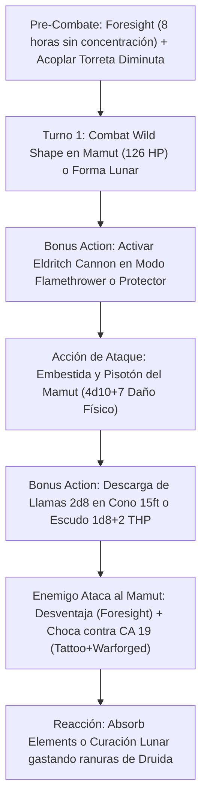

# Resumen General del Personaje: Bear with a Flamethrower

## Datos Generales

* **System Standard:** D&D 5th Edition (2024 / 5.5e Update)
* **Character Level:** 20 (Total)
* **Class Split:** Druid (Circle of the Moon) 17 / Artificer (Artillerist) 3
* **Species:** Warforged (Forjado) + Dote de Origen: *Tough*
* **Stats (Point Buy + Dotes + ASIs):**
  * **FUER (STR):** 10 (+0) *(Reemplazado por los atributos físicos de la Forma Salvaje)*
  * **DES (DEX):** 14 (+2) *(Iniciativa y CA base humanoide)*
  * **CON:** 14 (+2) *(Puntos de golpe base y salvaciones de concentración nativas por Artificer)*
  * **INT:** 14 (+2) *(Requisito de Artífice y CD del Cañón Eldritch)*
  * **SAB (WIS):** 20 (+5) *(15 Base + 1 Fey Touched + 2 ASI Nivel 9 + 2 ASI Nivel 18)*
  * **CAR (CHA):** 8 (-1)

* **Enlaces de Documentación:**
  * [Bastión y Tiempo Muerto](file:///d:/repo-vault/Proyectos/Rol/DnDbuilds/builds/bear%20with%20a%20flamethrower/bastion%20and%20downtime.md)
  * [Lista de Conjuros y Recursos](file:///d:/repo-vault/Proyectos/Rol/DnDbuilds/builds/bear%20with%20a%20flamethrower/spell%20list.md)
  * [Objetos a Obtener](file:///d:/repo-vault/Proyectos/Rol/DnDbuilds/builds/bear%20with%20a%20flamethrower/item%20list%20to%20obtain.md)
  * [Hoja de Ruta 1-20](file:///d:/repo-vault/Proyectos/Rol/DnDbuilds/builds/bear%20with%20a%20flamethrower/roadmap.md)
  * [Inventario Actual](file:///d:/repo-vault/Proyectos/Rol/DnDbuilds/builds/bear%20with%20a%20flamethrower/actual%20inventory%20list.md)

---

## Combat Role: Frontline Colossus Tank / Mounted Flamethrower Turret / Self-Repairing Beast

El **Bear with a Flamethrower** combina la brutal reserva de vida y daño en combate cuerpo a cuerpo del Druida de la Luna con la tecnología de asedio del Artífice Artillero. El personaje acopla su **Cañón Eldritch Diminuto (*Tiny*)** en un arnés mecánico sobre el lomo o hombro de su Forma Salvaje (Mamut, Oso de las Cavernas o Elemental de Fuego). Esto le permite ejecutar una rotación táctica devastadora: mientras su acción principal desata ataques marciales gigantescos (como el pisotón y cornada de un Mamut de 126 PG), su Acción Adicional activa una torreta lanzallamas en cono de 15 ft ($2\text{d}8$ de fuego) o un generador de escudos temporales (*Protector*) que renueva los PG de la bestia en cada turno. Todo esto blindado bajo la omnisciencia de *Foresight* (Nivel 9, 8 horas sin concentración).

---

## 1. Gestión de Recursos y Reglas de Inventario

* **Torreta Diminuta en Arnés de Bestia:** Al invocar el *Eldritch Cannon* (Artificer 3), se crea de tamaño Diminuto (*Tiny*) con patas mecánicas articuladas. Puede fijarse magnéticamente al arnés del Warforged, permaneciendo en su espalda o cabeza al transformarse con *Wild Shape*. Se dispara como **Acción Adicional** a 15 pies en cono (*Flamethrower*) o a 120 ft (*Force Ballista*).
* **Protección Integrada del Warforged en Wild Shape:** El chasis de acero vivo del Warforged se fusiona armónicamente con la Forma Salvaje adoptada, otorgando **+1 a la CA pasiva** de cualquier bestia o elemental. Al equipar un *Barrier Tattoo (Rare)*, la CA de la bestia se fija en **18 Base + 1 Warforged = 19 CA**.
* **Progresión de Lanzador Integrada (Nivel 19):** Druid 17 + Artificer 3 (Caster 2) = Nivel 19 de lanzador de conjuros. Cuenta con ranuras de conjuro completas hasta **Nivel 9** (*Foresight*, *Shapechange*).
* **Foresight Sin Concentración:** *Foresight* dura 8 horas completas **sin requerir concentración**. Otorga Ventaja permanente a todos tus ataques en Forma Salvaje y Desventaja a todos los ataques enemigos en tu contra.

---

## 2. Action Economy & Combat Loop

* **Pre-Combate (Turno 0):** Lanzar *Foresight* (8h sin concentración) y crear el Cañón Eldritch Diminuto acoplado al arnés.
* **Turno 1 — Despliegue del Coloso de Asedio:**
  * **Bonus Action:** Entrar en *Combat Wild Shape* adoptando la forma de un **Mamut** (126 PG, Fuerza 24) o Oso Gigante.
  * **Action:** Embestida y Pisotón de Mamut: $+10$ al impacto con Ventaja permanente por *Foresight*. Inflige $4\text{d}10 + 7$ de daño contundente ($29.0$ de media) y derriba al objetivo.
* **Turno 2+ — Ciclo de Pisotón y Lanzallamas:**
  * **Action:** 2 Ataques de Forma Salvaje con Ventaja contra enemigos derribados.
  * **Bonus Action:**
    * *Modo Ofensivo:* Disparar el *Flamethrower* en cono de 15 ft infligiendo $2\text{d}8$ de fuego (CD 16 Destreza).
    * *Modo Defensivo:* Activar *Protector* otorgando $1\text{d}8 + 2$ de Puntos de Golpe Temporales renovables cada turno a ti mismo y aliados a 10 ft.
  * **Reaction:** *Absorb Elements* para reducir daño elemental a la mitad.

---

## 3. Mathematical Engine (D&D 5.5e / 2024 Compatible)

### 🛡️ Clase de Armadura y Mitigación en Forma Salvaje

$$\text{CA Base en Forma de Mamut/Oso} = 18_{\text{Barrier Tattoo (Rare)}} + 1_{\text{Warforged Integrated Protection}} = \mathbf{19 \text{ CA Pasiva}}$$

Con *Foresight* activo, cualquier enemigo realiza sus tiradas de ataque con **Desventaja permanente**:

$$\text{Impacto Enemigo (CR 20 Boss con +14 al Ataque)} = P(\text{Tirada } \ge 5) = 0.80 \implies \text{Con Desventaja} = (0.80)^2 = \mathbf{0.64 \quad (64\%)}$$

Contra esbirros con +8 a +10 al ataque:

$$\text{Impacto contra CA 19 con Desventaja} = (0.50)^2 = \mathbf{0.25 \quad (25\%)}$$

### 🧮 Daño por Asalto Sostenido (DPR a Nivel 20 en Forma Mamut)

Con Fuerza 24 (+7), *Insignia of Claws* (+1 a impacto y daño natural), y Ventaja permanente de *Foresight*:

$$\text{Probabilidad de Impacto con Ventaja } P(\text{Hit}) = 1 - (1 - 0.75)^2 = 0.9375 \quad (93.75\%)$$

* **Ataque de Pisotón (Trample):**
  $$\text{Dmg}_{\text{Pisotón}} = 4\text{d}10 + 7_{\text{STR}} + 1_{\text{Insignia}} = 22.0 + 8 = \mathbf{30.0 \text{ Daño Físico}}$$

* **Cañón Eldritch (Bonus Action - Flamethrower en Cono 15ft contra 2 objetivos):**
  $$\text{Daño Fuego Cono} = 2 \times [0.65 \times 2\text{d}8 (9.0) + 0.35 \times 4.5] = 2 \times [5.85 + 1.575] = \mathbf{14.85 \text{ Daño de Fuego}}$$

$$\text{DPR Total Sostenido} = (0.9375 \times 30.0 + 0.0975 \times 22.0) + 14.85 = 28.12 + 2.14 + 14.85 = \mathbf{45.11 \text{ DPR Mixto}}$$

### 🩸 Supervivencia y EHP Extremo

$$\text{Puntos de Golpe del Mamut} = 126 \text{ PG}$$

$$\text{Regeneración Protector de Torreta (5 asaltos)} = 5 \times (1\text{d}8 + 2) \approx 32.5 \text{ THP}$$

$$\text{EHP Forma Salvaje 1} = 126 + 32.5 = \mathbf{158.5 \text{ EHP}}$$

Al destruirse el Mamut, el personaje puede usar otra carga de *Wild Shape* para transformarse en otro Mamut (**+158.5 EHP adicionales**) antes de que los enemigos toquen sus **173 PG reales** de forma humanoide.

$$\text{EHP Total del Personaje en Combate Mayor} = 158.5 \times 2 + 173 + 100_{\text{Sanctum Ward}} = \mathbf{590 \text{ EHP Total}}$$

---

## 4. Tabla de Rendimiento Táctico

| Criterio | Valoración | Justificación Mecánica |
| :--- | :---: | :--- |
| **Daño Monobjetivo** | 🟢 | 45+ DPR sostenido en área y melé combinando pisotón de Mamut y cono de fuego de la torreta en Acción Adicional. |
| **Control de Masas (CC)** | 🔵 | *Spike Growth*, *Sunbeam*, *Sleet Storm*, *Force Ballista* (empuje de 5 ft) y derribo (*Knock Prone*) automático de Mamut. |
| **Supervivencia (EHP)** | 🔵 | 590 EHP efectivo, CA 19 en forma animal con *Barrier Tattoo* + Warforged, *Foresight* (desventaja enemiga), y torreta generadora de THP. |
| **Economía de Acciones** | 🔵 | Acción de ataque de bestia, Acción Adicional permanente disparando el Cañón Eldritch del hombro, y Reacciones defensivas (*Absorb Elements*). |
| **Sustentabilidad** | 🔵 | *Wild Shape* se recarga en descanso corto. Ranuras de nivel 1 a 9 completas con *Heal* de 70 PG y versatilidad druídica total. |

---

## 5. Home Rules (Reglas de la Mesa)

1. **Protección Warforged en Wild Shape:** El chasis de acero integrado del Warforged se fusiona con la Forma Salvaje, otorgando +1 a la CA pasiva de cualquier bestia o elemental adoptado.
2. **Cañón Montado en Arnés:** Se ratifica el montaje del Cañón Eldritch Diminuto en el hombro o lomo de la Forma Salvaje, disparándolo como Acción Adicional sin manos libres.
