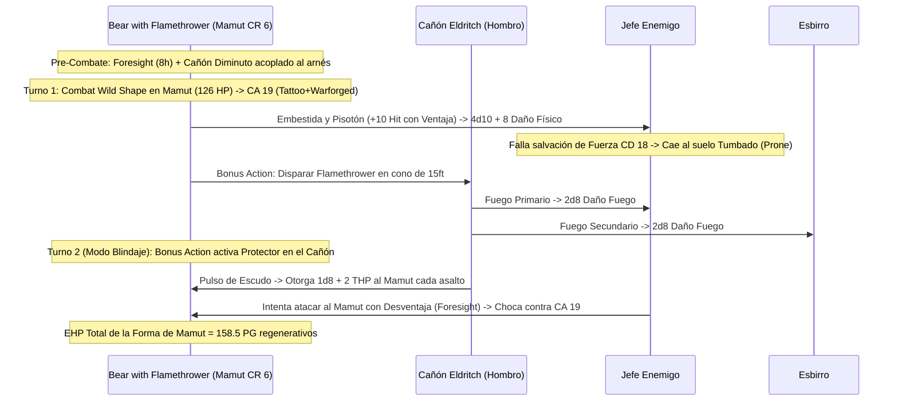

# 🌟 Lista de Conjuros y Recursos — Bear with a Flamethrower

Esta lista detalla la selección de conjuros y recursos para **Bear with a Flamethrower** (Druid Circle of the Moon 17 / Artificer Artillerist 3), optimizada bajo reglas de D&D 5e (2014 & 2024).

> **Nivel de Lanzador Multiclase:** $17_{\text{Druid}} + 3/2_{\text{Artificer (Caster 2)}} = \mathbf{19.^{\circ} \text{ Nivel de Lanzador}}$.  
> Dispone de la tabla completa de espacios de conjuro de nivel 1 a 9, permitiendo lanzar conjuros de noveno nivel de la lista de Druida (*Foresight*, *Shapechange*).

---

## ⚡ Conjuros Activos y Pre-Buffs (Turno 0 / Fuera de Combate)

| Conjuro / Recurso | Duración | Concentración | Efecto Táctico Clave |
| :--- | :---: | :---: | :--- |
| **Foresight (Nivel 9)** | 8 horas | No | **Ventaja en todas tus tiradas de ataque, salvación y pruebas**; **Desventaja a todos los ataques enemigos en tu contra**. No requiere concentración y opera al 100% en Forma Salvaje. |
| **Freedom of Movement (Nivel 4)** | 1 hora | No | Inmunidad absoluta a la parálisis, apresamiento y terreno difícil en forma animal. |
| **Sanctum Ward (Bastión)** | 24 horas | No | Reserva de **+100 Puntos de Golpe Temporales** obtenida en el Demioplano de la Arboleda. |
| **Pass without Trace (Nivel 2)** | 1 hora | Sí | +10 a tiradas de Sigilo para todo el grupo en emboscadas colosales. |

---

## 🔮 Trucos (Cantrips)

### Druida (3) + Artífice (2)

1. **Guidance 🔵 [Indispensable]:** +1d4 a pruebas de habilidad de aliados fuera de combate.
2. **Mending 🔵 [Utilidad Técnica]:** Reparación y mantenimiento rúnico del Cañón Eldritch y arneses de combate.
3. **Primal Savagery 🟢 [Ataque Ácido]:** Ataque cuerpo a cuerpo con $4\text{d}10$ de daño ácido usando Sabiduría.
4. **Fire Bolt 🟢 [Daño a Distancia]:** $4\text{d}10$ de fuego a 120 ft usando Inteligencia.
5. **Shocking Grasp 🟡 [Escape]:** Ataque de toque eléctrico que anula las reacciones enemigas.

---

## 🎒 Conjuros Preparados de Druida (17.º Nivel — 22 Conjuros Preparados)

*CD de Salvación de Druida (WIS):* $8 + 6_{\text{PB}} + 5_{\text{SAB}} = \mathbf{19}$. Modificador de Ataque de Conjuro: $\mathbf{+11}$.

### 9.º Nivel (1 Ranura)

1. **Foresight 🔵 [Dios del Combate]:** 8 horas sin concentración. Confiere omnisciencia táctica en Forma Salvaje.
2. **Shapechange 🔵 [Metamorfosis Extrema]:** Permite adoptar formas de Dragón, Beholder o Planetar manteniendo la torreta acoplada.

### 8.º Nivel (1 Ranura)

3. **Feeblemind 🔵 [Incapacitador]:** Reduce la Inteligencia y Carisma de un enemigo a 1 si falla su salvación.
4. **Sunburst 🟢 [Detonación Solar]:** $12\text{d}6$ radiante en esfera de 60 ft y ceguera permanente a los objetivos.

### 7.º Nivel (2 Ranuras)

5. **Fire Storm 🟢 [Tormenta Ígnea]:** 10 cubos de fuego de 10 ft que infligen $7\text{d}10$ de daño de fuego en área.
6. **Plane Shift 🟢 [Utilidad]:** Tránsito planar para todo el grupo o destierro ofensivo.

### 6.º Nivel (2 Ranuras)

7. **Heal 🔵 [Curación Suprema]:** Restaura **70 Puntos de Golpe** instantáneos sin tirada de dados y limpia ceguera/sordera.
8. **Sunbeam 🔵 [Daño Continuo]:** Haz de luz solar de $6\text{d}8$ radiante que ciega a los enemigos en línea recta cada asalto.

### 5.º Nivel (3 Ranuras)

9. **Reincarnate 🟢 [Resurrección Druídica]:** Trae de vuelta a la vida a un aliado caído en un cuerpo biológico nuevo.
10. **Greater Restoration 🟢 [Soporte Vital]:** Elimina petrificación, maldiciones o reducciones de características.
11. **Wall of Stone 🟡 [Control de Campo]:** Bloqueo geológico para reestructurar el mapa de batalla.

### 4.º Nivel (3 Ranuras)

12. **Polymorph 🔵 [Salvavidas]:** Transforma a un aliado moribundo en un T-Rex o Mamut con 130+ PG temporales.
13. **Freedom of Movement 🟢 [Movilidad]:** Libertad de movimiento por 1 hora sin concentración.

### 3.ᵉʳ Nivel (3 Ranuras)

14. **Revivify 🔵 [Seguridad]:** Reanima aliados caídos en el último minuto.
15. **Dispel Magic 🟢 [Utilidad]:** Cancela magia enemiga hostil.
16. **Sleet Storm 🟢 [Control Masivo]:** Ciega y derriba enemigos en área, rompiendo concentraciones.
17. **Plant Growth 🟢 [Ralentización Extrema]:** El movimiento cuesta 4 pies por cada pie avanzado en un radio de 100 ft sin concentración.

### 2.º Nivel (3 Ranuras)

18. **Spike Growth 🔵 [Rallador de Queso]:** Inflige $2\text{d}4$ perforante por cada 5 pies de movimiento forzado.
19. **Mirror Image 🔵 [Defensa Ilusoria]:** 3 duplicados sin concentración lanzables antes de entrar en *Wild Shape*.
20. **Pass without Trace 🔵 [Sigilo Masivo]:** +10 a Sigilo para todo el grupo.

### 1.ᵉʳ Nivel (4 Ranuras)

21. **Healing Word 🔵 [Soporte Rápido]:** Levanta aliados caídos a 60 ft como Acción Adicional.
22. **Absorb Elements 🔵 [Defensa Elemental]:** Reacción ante daño elemental masivo.

---

## 🎒 Conjuros Preparados de Artífice (3.er Nivel — 5 Conjuros Preparados)

*CD de Salvación de Artífice (INT):* $8 + 6_{\text{PB}} + 2_{\text{INT}} = \mathbf{16}$.

1. **Shield 🔵 [Reacción Defensiva]:** +5 a la CA como Reacción (utilizable en forma humanoide).
2. **Cure Wounds 🟢 [Curación]:** $1\text{d}8 + 2$ de curación directa.
3. **Faerie Fire 🟢 [Ventaja de Grupo]:** Resalta a enemigos otorgando Ventaja a todos los ataques.
4. **Catapult 🟡 [Daño]:** Lanza proyectiles pesados a 90 ft ($3\text{d}8$ contundente).
5. **Longstrider 🟢 [Movilidad]:** +10 ft a la velocidad de movimiento por 1 hora sin concentración.

---

## 💥 Secuencia Táctica del Coloso de Fuego (The Flamethrower Mammoth Trample)

---

## 💚 Curación en Segundo Plano y Sostenibilidad

* **Protector Cannon Infinito:** El Cañón Eldritch en modo *Protector* genera $1\text{d}8 + 2 \approx 6.5\text{ THP}$ cada asalto como Acción Adicional, blindando la barra de vida de la bestia de forma gratuita e ilimitada durante 1 hora.
* **Curación Lunar con Ranuras:** El Druida de la Luna puede gastar ranuras de conjuro de nivel bajo en combate para recuperar $1\text{d}8$ PG por nivel de ranura sin salir de la Forma Salvaje.
* **Heal de 70 PG Instantáneos:** Conjuro de 6.º nivel que restaura 70 PG planos para curar al Mamut o a un aliado al borde del colapso.
* **Pociones en Acción Adicional:** Consumo rápido de *Potion of Supreme Healing* ($10\text{d}4 + 20 \approx 45\text{ PG}$) bajo reglas oficiales 2024.
