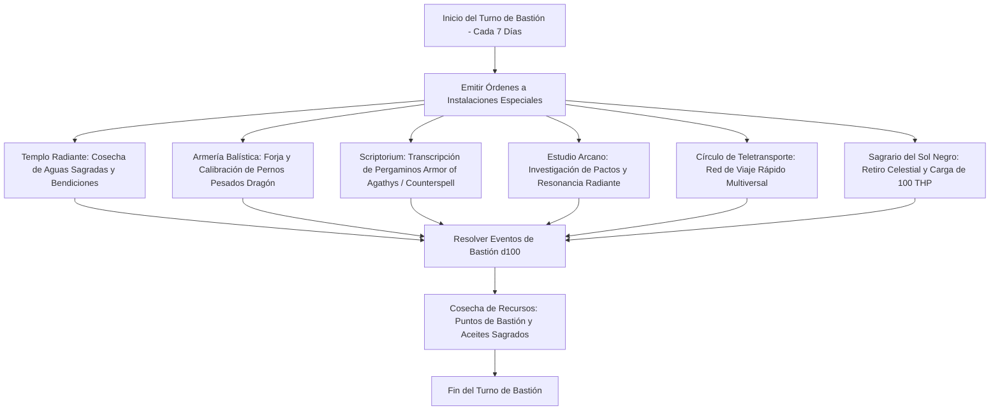

# 🏰 Bastión y Tiempo Muerto — Beelzebub's Ballista

## 🏰 Sistema de Bastiones (Reglas Oficiales DMG 2024 / D&D 5.5e)

* **Nombre del Bastión:** La Catedral del Sol Negro (The Cathedral of the Black Sun)
* **Nivel de Bastión:** 20 (Capacidad Máxima)
* **Puntos de Bastión (BP):** 115
* **Puntuación de Mando y Defensas (Defender Stats):**
  * STR 8 (-1), DEX 14 (+2), CON 14 (+2), INT 10 (+0), WIS 10 (+0), CHA 20 (+5)
  * **Bonificador de Defensa de Bastión:** $\mathbf{+11}$ (+6 Competencia + 5 Carisma)

---

## 🏛️ Registro de Instalaciones del Bastión (Nivel 20: 4 Roomy + 2 Vast)

### Instalaciones Básicas (Basic Facilities - Gratuitas e Ilimitadas)
1. **Dormitorio de la Aguja Celestial (Bedchambers):** Alcoba sobria con tragaluces de alabastro orientados hacia las constelaciones sagradas.
2. **Refectorio de la Luz Radiante (Dining Hall):** Comedor con largas mesas de roble blanco donde los acólitos y guardias comparten pan bendito y vino de consagración.
3. **Plaza de Prácticas Común (Common Room):** Patio interior para adiestramiento militar y ensayo de partituras para la dote *Musician*.
4. **Cámara Acorazada de Pertrechos (Storage):** Sala estanca para proteger carcajes de virotes de hierro frío, lingotes de oro y reliquias celestiales.

---

### Instalaciones Especiales (Special Facilities: Exactamente 6 al Nivel 20)

| Instalación | Tamaño (DMG 2024) | Nivel Mínimo | Estado | Orden Activa | Sinergia con el Build |
| :--- | :---: | :---: | :---: | :--- | :---: |
| **Templo y Santuario Radiante (Sanctuary)** | **Roomy** | Nivel 5 | Activa (Maintain) | *Harvest:* Cosecha agua bendita consagrada y suministra curaciones gratuitas entre misiones. | 🔵 **Roto** |
| **Armería y Taller de Balística (Armory)** | **Roomy** | Nivel 5 | Activa (Maintain) | *Maintain:* Forja pernos pesados y calibra la tensión de la *Ascendant Dragon's Wrath Heavy Crossbow*. | 🟢 **Excelente** |
| **Scriptorium Celestial (Scriptorium)** | **Roomy** | Nivel 9 | Activa (Maintain) | *Craft:* Transcribe pergaminos de *Counterspell*, *Armor of Agathys* y *Banishment* a mitad de coste. | 🟢 **Excelente** |
| **Estudio Arcano de Invocaciones (Arcane Study)** | **Roomy** | Nivel 9 | Activa (Maintain) | *Research:* Desvela textos de pactos antiguos, facilitando la comprensión de invocaciones místicas. | 🟢 **Excelente** |
| **Círculo de Teletransporte Planar (Teleportation Circle)** | **Vast** | Nivel 13 | Activa (Maintain) | *Travel:* Conecta la Catedral con ciudadelas y santuarios de todo el plano material de forma instantánea. | 🔵 **Roto** |
| **Sagrario del Sol Negro (Sanctum / Demiplano)** | **Vast** | Nivel 17 | Activa (Maintain) | *Empower:* Otorga un aura defensiva en el bastión y suministra **100 THP de reposo prolongado** al Brujo. | 🔵 **Roto** |

---

## 👥 Guarnición y Personal de Mando (Staff & Garrison)

* **Mayordomo Mayor (Major Domo):** Hermana Lyra (Clérigo veterana consagrada al culto del fuego radiante purificador).
* **Guarnición Activa:**
  * 16 Cruzados con corazas de placas y lanzas ceremoniales.
  * 8 Ballesteros Pesados adiestrados en tácticas de rechazo y tiro en salva.
* **Personal Especialista:**
  * 1 Maestro Armero de Balística para mantenimiento de armas pesadas.
  * 1 Escribano Sagrado especializado en sellos protectores.
  * 2 Acólitos Médicos para atención de heridos.

---

## ⏳ Actividades de Tiempo Muerto (Downtime Priorities)

### Prioridad 1: Forja de Pernos de Asedio Dracónicos (Plata y Fuego)
* **Objetivo:** Disponer de 150 pernos pesados de plata y aleaciones resistentes al fuego.
* **Mecánica:** Mediante la *Armería Balística* y herramientas de herrero (Fuerza/Inteligencia $+6$), forjar virotes pesados con punta estriada.
* **Ventaja Táctica:** Multiplica la penetración de *True Strike* contra demonios y constructos gigantes.

### Prioridad 2: Transcripción de Pergaminos de Reacción (*Armor of Agathys* y *Shield*)
* **Objetivo:** Acumular pergaminos de protección para no consumir los escasos Pact Slots de nivel 5 en combate.
* **Mecánica:** Trabajos en el *Scriptorium Celestial* empleando tintas consagradas.

### Prioridad 3: Diplomacia y Recitales Sagrados (*Musician Drills*)
* **Objetivo:** Generar inspiración heroica antes de cada expedición mediante recitales en la *Plaza de Prácticas*.
* **Mecánica:** Emplear la dote *Musician* para conceder Inspiración Heroica a todo el escuadrón tras cada descanso.