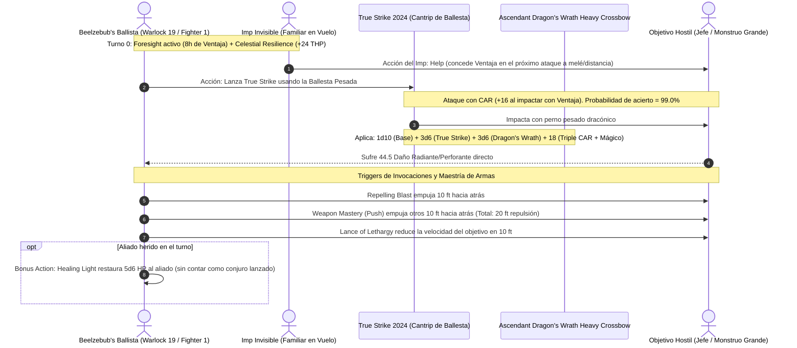

# 🌟 Lista de Conjuros Optimizada — Beelzebub's Ballista (Warlock 19 / Fighter 1)

**Patrón Celestial:** El Celestial (*The Celestial*) & Guerrero (*Fighter*)  
**Ranuras de Pacto:** 4 Ranuras de **5.º Nivel** (recargables en Descanso Corto)  
**CD de Salvación de Conjuros:** $8 + 6 \text{ (Prof)} + 5 \text{ (CAR)} = \mathbf{19}$ (Base) / $\mathbf{22}$ (Con *Rod of the Pact Keeper +3*)  
**Modificador de Ataque de Conjuro:** $+11$ (Base) / $\mathbf{+14}$ (Con *Rod +3*)  

---

## 🔮 Trucos (Cantrips)

1. **True Strike (2024) 🔵 [El Cañón del Build]:** Ataque con ballesta pesada usando Carisma (+5); inflige daño radiante $+3\text{d}6$. Con *Agonizing Blast* y *Radiant Soul*, suma **+15 de daño plano de Carisma** por impacto.
2. **Sacred Flame 🟢 [Ataque Ignora Cobertura]:** $4\text{d}8$ de daño radiante sin tirada de ataque (salvación de Destreza); suma $+5$ de CAR vía *Radiant Soul*.
3. **Eldritch Blast 🟢 [Artillería Secundaria]:** 4 rayos de fuerza a nivel 20 para repartir impactos contra múltiples objetivos.
4. **Light 🟡 [Utilidad Celestial]:** Otorga luz brillante sin coste (otorgado gratis por el patrón Celestial).
5. **Mage Hand 🟡 [Manipulación Remota]:** Manipulación de palancas, pernos o trampas a 30 pies.
6. **Prestidigitation 🟡 [Utilidad]:** Efectos de limpieza y mantenimiento de munición.

---

## 🎒 Ranuras de Pacto de Warlock (4 Ranuras de 5.º Nivel en Descanso Corto)

### Conjuros de Patrón Celestial Siempre Preparados
* **Cure Wounds (Nivel 5):** Cura $5\text{d}8 + 5$ como acción de emergencia.
* **Guiding Bolt (Nivel 5):** $8\text{d}6$ daño radiante y otorga ventaja en el siguiente ataque.
* **Lesser Restoration:** Neutraliza enfermedades, venenos o parálisis de aliados.
* **Revivify 🔵 [Resurrección Rápida]:** Devuelve a la vida a un compañero caído en el último minuto.
* **Wall of Fire 🟢 [Control Térmico]:** Muro de fuego que inflige $5\text{d}8$ de daño de fuego a quienes lo crucen (potenciado por *Radiant Soul*).
* **Greater Restoration 🟢 [Limpieza Vital]:** Elimina petrificación, agotamiento y reducciones de atributos.

### Conjuros de Brujo Seleccionados
* **Hex 🟢 [Marcaje de Daño]:** $+1\text{d}6$ de daño necrótico en cada disparo de ballesta durante 24 horas.
* **Armor of Agathys 🔵 [Amortiguación Ofensiva]:** Concede **25 THP** y devuelve **25 de daño de frío automático** a atacantes cuerpo a cuerpo.
* **Synaptic Static 🟢 [Bomba Psíquica]:** $8\text{d}6$ daño psíquico en radio de 20 pies; resta $1\text{d}6$ a ataques y salvaciones enemigas durante 1 minuto sin concentración.
* **Banishment 🔵 [Control Extraplanar]:** Destierra hasta 2 amenazas a su plano nativo (ranura de nivel 5).
* **Counterspell 🔵 [Interrupción Arcana]:** Reacción para cancelar magia hostil de nivel 5 o menor de forma automática.
* **Dimension Door 🟢 [Evacuación Rápida]:** Teletransporte de 400 pies con un aliado a lugares seguros o posiciones de tiro elevadas.

---

## 👑 Secretos Místicos (Mystic Arcanum — 1 Uso Diario Cada Uno)

* **9.º Nivel: Foresight 🔵 [Omnisciencia Balística]:** Durante 8 horas, obtienes **Ventaja en todas las tiradas de ataque, salvación y pruebas**, e impones **Desventaja a todos los ataques hostiles**, convirtiendo la ballesta pesada en una torreta infalible.
* **8.º Nivel: Sunburst 🔵 [Bomba Solar]:** $12\text{d}6$ de daño radiante en un radio colosal de 60 pies y ceguera permanente a los enemigos.
* **7.º Nivel: Forcecage 🔵 [Prisión Indestructible]:** Jaula de fuerza de 20 pies que encierra al jefe enemigo sin tirada de salvación y sin concentración mientras lo acribillas con la ballesta.
* **6.º Nivel: Heal 🔵 [Sanación Nuclear]:** Restaura **70 Puntos de Golpe fijos** a un aliado y elimina cualquier ceguera o sordera.

---

## ⚡ Diagrama de Secuencia del Disparo de Cañón Pesado (True Strike Snipe)

---

## 🩺 Curación en Segundo Plano y Resiliencia Celestial (Background Healing)

Beelzebub's Ballista es un pilar médico pasivo para todo el escuadrón, manteniendo una alta tasa de disparo sin perder turnos en curaciones menores:

1. **La Luz Sanadora (*Healing Light*):**
   * Dispone de un pozo de **20 dados d6** de curación celestial que se recargan tras cada Descanso Largo.
   * Como Acción Adicional, puede gastar hasta 5 dados a la vez a 60 pies de distancia, curando una media de **17.5 a 35 HP** instantáneamente.
   * **Ventaja Táctica:** No es un conjuro (es un rasgo de clase), por lo que permite disparar un conjuro potente con la Acción principal o continuar el bucle de *True Strike* sin restricciones.
2. **Buffer Colectivo (*Celestial Resilience* — Nivel 10):**
   * Al finalizar cada Descanso Corto o Largo, el Brujo obtiene **24 Puntos de Golpe Temporales (THP)** y hasta **5 aliados obtienen 14 THP cada uno**.
   * Confiere una inyección gratuita de **94 THP colectivos** en cada pausa de 1 hora.
3. **Resurrección y Sanación de Emergencia:**
   * Al contar con *Revivify* y *Greater Restoration* siempre preparados mediante ranuras de pacto de nivel 5, el Brujo puede levantar aliados caídos en combate y recargar inmediatamente los espacios en 1 hora de descanso corto.
4. **Sanación Nuclear (*Heal* — Secreto Místico Nivel 6):**
   * Restaura **70 HP fijos** en un solo asalto para salvar al combatiente principal de una muerte segura.