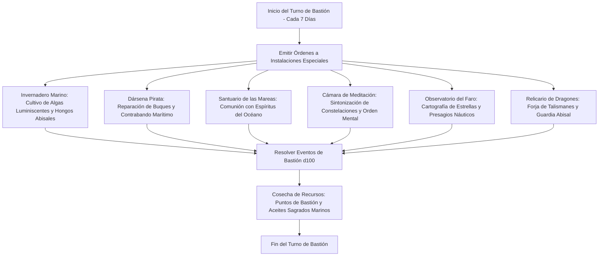

# 🏰 Bastión y Tiempo Muerto — Cursed Pirate

## 🏰 Sistema de Bastiones (Reglas Oficiales DMG 2024 / D&D 5.5e)

* **Nombre del Bastión:** El Faro del Arrecife Estelar (The Star-Reef Lighthouse)
* **Nivel de Bastión:** 20 (Capacidad Máxima)
* **Puntos de Bastión (BP):** 100
* **Puntuación de Mando y Defensas (Defender Stats):**
  * STR 10 (+0), DEX 14 (+2), CON 16 (+3), INT 10 (+0), WIS 20 (+5), CHA 8 (-1)
  * **Bonificador de Defensa de Bastión:** $\mathbf{+11}$ (+6 Competencia + 5 Sabiduría)

---

## 🏛️ Registro de Instalaciones del Bastión (Nivel 20: 4 Roomy + 2 Vast)

### Instalaciones Básicas (Basic Facilities - Gratuitas e Ilimitadas)
1. **Camarote del Capitán Maldito (Bedchambers):** Aposento en lo alto del faro construido con maderas de naufragios célebres, cartas de navegación húmedas y un mapa estelar de perlas.
2. **Taberna del Arrecife (Dining Hall):** Refectorio rústico donde la tripulación come marisco ahumado y bebe ron negro bajo redes de pesca colgadas.
3. **Pabellón de la Cubierta Común (Common Room):** Terraza abierta donde los vigías afinan instrumentos marinos y reparan sables de abordaje.
4. **Bodega Estanca de Carga (Storage):** Cueva marina natural aislada para proteger barriles de pólvora, lingotes de oro y pergaminos impermeables.

---

### Instalaciones Especiales (Special Facilities: Exactamente 6 al Nivel 20)

| Instalación | Tamaño (DMG 2024) | Nivel Mínimo | Estado | Orden Activa | Sinergia con el Build |
| :--- | :---: | :---: | :---: | :--- | :---: |
| **Invernadero Marino (Greenhouse)** | **Roomy** | Nivel 5 | Activa (Maintain) | *Harvest:* Cosecha algas abisales que sustituyen componentes materiales de conjuros marinos de hasta 300 po semanales. | 🟢 **Excelente** |
| **Dársena y Muelle Pirata (Dock / Harbor)** | **Roomy** | Nivel 5 | Activa (Maintain) | *Trade:* Atraque de navíos aliados; genera 1d6 $\times$ 10 BP adicionales y recluta marineros zombis. | 🟢 **Excelente** |
| **Santuario de las Mareas (Sanctuary)** | **Roomy** | Nivel 5 | Activa (Maintain) | *Communion:* Canaliza bendiciones oceánicas; otorga ventaja en tiradas de salvación contra ahogamiento y daño de frío. | 🔵 **Roto** |
| **Cámara de Meditación Celeste (Meditation Chamber)** | **Roomy** | Nivel 13 | Activa (Maintain) | *Focus:* Concede ventaja en dos salvaciones de Sabiduría para la siguiente travesía naval. | 🟢 **Excelente** |
| **Observatorio del Faro Estelar (Observatory)** | **Vast** | Nivel 13 | Activa (Maintain) | *Stargaze:* Cartografía las constelaciones; potencia *Starry Form* y predice borrascas con 7 días de antelación. | 🔵 **Roto** |
| **Relicario de Dragones Marinos (Reliquary / Demiplano)** | **Vast** | Nivel 17 | Activa (Maintain) | *Sanctuary:* Retiro extrapolar abisal que almacena el *Orb of Dragonkind* y suministra **100 THP de reposo prolongado**. | 🔵 **Roto** |

---

## 👥 Guarnición y Personal de Mando (Staff & Garrison)

* **Mayordomo Mayor (Major Domo):** Barnaby el Tuerto (Veterano primer oficial no-muerto con protocolo naval implacable).
* **Guarnición Activa:**
  * 16 Marineros Piratas armados con mosquetes marinos y cimitarras de hierro frío.
  * 4 Escualos de Arrecife centinela patrullando las aguas de acceso al faro.
* **Personal Especialista:**
  * 1 Maestro Carpintero de Ribera experto en reparar cascos con madera encantada.
  * 1 Alquimista Marino para destilación de extractos de algas.
  * 1 Astrónomo Cartógrafo para calibración de lentes del faro.

---

## ⏳ Actividades de Tiempo Muerto (Downtime Priorities)

### Prioridad 1: Destilación de Pociones de Curación Superior y Venenos de Coral
* **Objetivo:** Acumular pociones de curación mayor y venenos paralizantes marinos para flechas estelares y cimitarras.
* **Mecánica:** En el *Invernadero Marino*, utilizar herramientas de herborista (Sabiduría $+11$) para destilar 2 pociones superiores cada semana.
* **Ventaja Táctica:** Garantiza autosuficiencia médica sin gastar espacios de conjuro de alto nivel durante travesías marítimas.

### Prioridad 2: Cartografía de Fosas Abisales y Dominio de Dragones
* **Objetivo:** Rastrear las guaridas submarinas de dragones de bronce y dragones tortuga.
* **Mecánica:** Mediante el *Observatorio del Faro Estelar* y el *Orb of Dragonkind*, emitir llamadas telepáticas para subyugar bestias dracónicas marinas.

### Prioridad 3: Mantenimiento del Navío Insignia (*El Cisne Maldito*)
* **Objetivo:** Forrar el casco del galeón con placas de mitril y runas de viento para triplicar la velocidad de navegación.
* **Mecánica:** Trabajos en la *Dársena Pirata* coordinados por el Maestro Carpintero de Ribera.