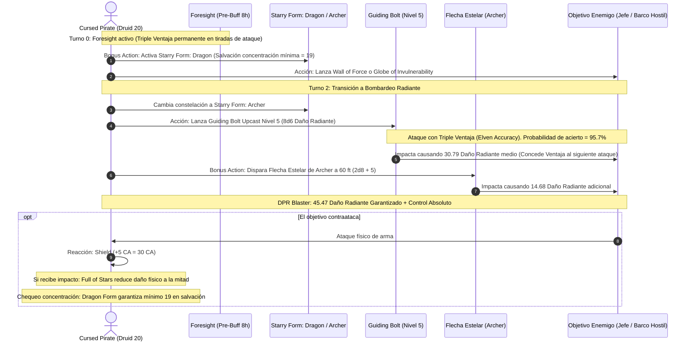

# 🌟 Lista de Conjuros Optimizada — Cursed Pirate (Druid 20)

**Círculo Druídico:** Círculo de las Estrellas (*Circle of the Stars*)  
**Regla Especial de Mesa:** Acceso a la lista completa de **Wizard** y **Druid** preparada diariamente utilizando **Sabiduría** como atributo rector.  
**CD de Salvación de Conjuros:** $8 + 6 \text{ (Prof)} + 5 \text{ (SAB)} = \mathbf{19}$ (Base) / $\mathbf{22}$ (Con foco legendario $+3$)  
**Modificador de Ataque de Conjuro:** $+11$ (Base) / $\mathbf{+14}$ (Con foco $+3$)  

---

## 🔮 Trucos (Cantrips)

1. **Guidance 🔵 [Pilar de Utilidad]:** $+1\text{d}4$ a pruebas de característica (otorgado gratis por el *Star Map*).
2. **Ray of Frost 🟢 [Control Marino]:** $4\text{d}8$ de daño de frío y reduce la velocidad del enemigo en 10 pies.
3. **Mending 🟢 [Utilidad Naval]:** Reparación instantánea de velas rasgadas, cuerdas y timones partidos.
4. **Shocking Grasp 🟢 [Defensivo]:** Cancela reacciones enemigas en caso de apuro cuerpo a cuerpo.
5. **Shape Water 🟡 [Temático / Utilidad]:** Manipulación de olas, congelación de agua o creación de pasajes acuáticos.
6. **Prestidigitation 🟡 [Utilidad]:** Efectos menores de higiene y ambientación en alta mar.

---

## 🌟 Rasgos Estelares y Conjuros Gratuitos (Star Map)

* **Guiding Bolt (Gratis PB veces al día):** Puedes lanzar *Guiding Bolt* a 1.ᵉʳ nivel **6 veces por descanso largo** sin gastar ranuras de conjuro. Inflige $4\text{d}6$ de daño radiante y concede **Ventaja** al siguiente ataque contra el objetivo.
* **Forma Estelar (Starry Form — Usos Ilimitados a Nivel 20 vía Archdruid):**
  * **Archer (Arquero):** Acción adicional para disparar una flecha de luz a 60 pies ($2\text{d}8 + 5$ de daño radiante).
  * **Dragon (Dragón):** Mínimo de 10 en cualquier tirada de concentración de Constitución (mínimo $10 + 3 + 6 = 19$).
  * **Chalice (Cáliz):** Cada vez que lanzas un conjuro de curación con ranura, tú u otra criatura a 30 pies recupera $2\text{d}8 + 5$ HP adicionales.

---

## 🎒 Matriz de Conjuros Preparados (Druida + Mago — 25 Conjuros Diarios)

### 9.º Nivel (1 Ranura)
* **Wish 🔵 [Omnipotencia Arcana]:** Duplica cualquier conjuro de nivel 1-8 existente sin tiempo ni componentes materiales.
* **Foresight 🔵 [Omnisciencia Náutica]:** Durante 8 horas, obtienes **Ventaja en todas las tiradas de ataque, salvación y pruebas**, e impones **Desventaja a todos los ataques enemigos**. Activa la triple ventaja constante de *Elven Accuracy*.

### 8.º Nivel (1 Ranura)
* **Tsunami 🟢 [Control Naval Absoluto]:** Muro de agua de 300 pies de largo que aplasta flotas enemigas y las arrastra 50 pies por turno.
* **Sunburst 🔵 [Bomba Solar]:** $12\text{d}6$ de daño radiante en radio gigantesco de 60 pies y ceguera permanente a los enemigos.

### 7.º Nivel (2 Ranuras)
* **Forcecage 🔵 [Prisión Indestructible]:** Encierra a criaturas enemigas en una jaula de fuerza de 20 pies sin salvación y sin concentración.
* **Plane Shift 🟢 [Movilidad Planar]:** Viaje instantáneo entre planos o destierro hostil con ataque de toque.

### 6.º Nivel (2 Ranuras)
* **Globe of Invulnerability 🔵 [Defensa Definitiva]:** Inmunidad absoluta contra todos los conjuros de nivel 5 o menor dirigidos al interior.
* **Heal 🔵 [Curación Nuclear]:** Restaura **70 HP fijos** y disipa ceguera, sordera y enfermedades.
* **Chain Lightning 🟢 [Artillería Eléctrica]:** $10\text{d}8$ de daño de rayo saltando a 4 objetivos distintos.

### 5.º Nivel (3 Ranuras)
* **Wall of Force 🔵 [Control Absoluto]:** Confinamiento indestructible sin tirada de salvación. Con *Starry Form: Dragon*, es imposible que pierdas la concentración por recibir daño.
* **Synaptic Static 🟢 [Debuff Psíquico]:** $8\text{d}6$ de daño en radio de 20 pies; resta $1\text{d}6$ a ataques y salvaciones enemigas sin concentración.
* **Greater Restoration 🟢 [Limpieza Vital]:** Elimina petrificaciones, agotamiento y reducciones de atributos.

### 4.º Nivel (3 Ranuras)
* **Dimension Door 🟢 [Evacuación Táctica]:** Teletransporte de 400 pies para escapar de bodegas o abordar cubiertas enemigas.
* **Polymorph 🟢 [Soporte / Incapacitación]:** Transforma aliados heridos en bestias masivas.
* **Watery Sphere 🟢 [Control Acuático]:** Atrapa hasta 4 criaturas medianas en una esfera de agua rodante.

### 3.ᵉʳ Nivel (3 Ranuras)
* **Counterspell 🔵 [Interrupción Arcana]:** Cancela conjuros hostiles como reacción a 60 pies.
* **Dispel Magic 🟢 [Purificación Mágica]:** Elimina maldiciones y efectos mágicos persistentes.
* **Tidal Wave 🟢 [Derribo Masivo]:** $4\text{d}8$ de daño contundente que derriba a todos los enemigos en un área de 30 pies para regalar ventaja.
* **Revivify 🔵 [Resurrección Rápida]:** Devuelve la vida a un aliado caído en combate.

### 2.º Nivel (3 Ranuras)
* **Misty Step 🔵 [Movilidad Instantánea]:** Teletransporte de 30 pies como acción adicional.
* **Web 🟢 [Control Táctico]:** Restringe enemigos en 20 pies, confiriendo ventaja en ataques.
* **Lesser Restoration 🟢 [Curación Menor]:** Neutraliza venenos y parálisis.

### 1.ᵉʳ Nivel (4 Ranuras)
* **Shield 🔵 [Defensa Suprema]:** $+5$ a la CA reactiva (alcanzando CA 30).
* **Absorb Elements 🔵 [Defensa Elemental]:** Resistencia reactiva inmediata ante daño elemental.
* **Silvery Barbs 🔵 [Manipulación]:** Fuerza a relanzar un dado alto hostil y otorga ventaja a un aliado.

---

## ⚡ Diagrama de Secuencia del Asalto Nova Estelar

---

## 🩺 Curación en Segundo Plano y Resiliencia Salvaje (Background Healing)

El Cursed Pirate no necesita detener su ofensiva para reponer su vitalidad y la de su tripulación:

1. **La Fuente del Cáliz (*Starry Form: Chalice*):**
   * Cada vez que se lanza un conjuro de curación que gaste una ranura (como *Healing Word* de nivel 1 como acción adicional), la constelación del Cáliz restaura **2d8 + 5 HP adicionales** ($14 \text{ HP}$) a ti mismo o a un aliado a 30 pies. Una simple *Healing Word* cura más de **22 HP** en un solo turno.
2. **Reserva Preventiva de Frutos del Mar (*Goodberry*):**
   * Antes de descansar, consume ranuras excedentes para generar hasta 40 bayas mágicas que curan 1 HP cada una y sacian el hambre, suministrando un colchón médico pasivo para toda la travesía.
3. **Resurrección Nuclear (*Heal*):**
   * Dispone de *Heal* de 6.º nivel para restaurar **70 Puntos de Golpe fijos** de forma inmediata y eliminar enfermedades o afecciones marinas.
4. **Forma Salvaje Ilimitada (*Archdruid* a Nivel 20):**
   * A nivel 20, la cantidad de usos de *Wild Shape* es **ilimitada**.
   * Si el pirata sufre daño severo, puede usar una Acción Adicional para transformarse en un **Elemental de Agua** (114 HP extras) o Elemental de Fuego, absorbiendo todo el castigo enemigo en la forma salvaje y regresando ileso a su cuerpo humanoide al terminar. Repetible en todos los turnos del combate.