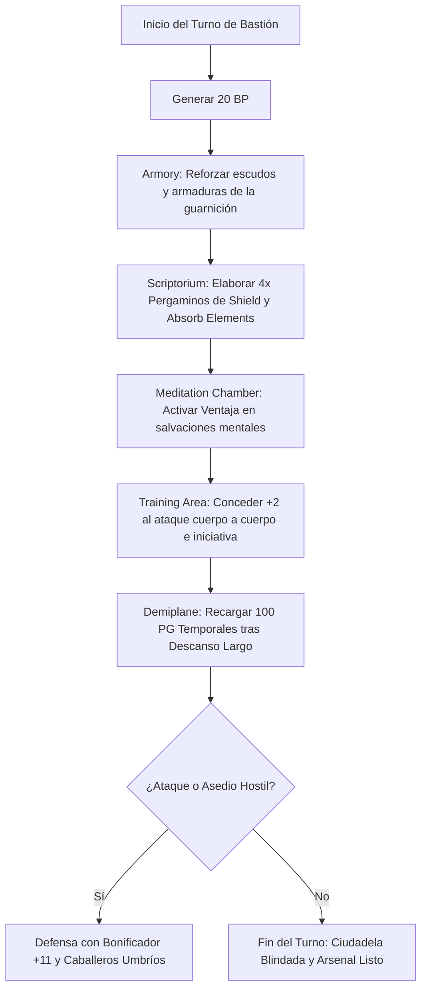

# 🏰 Bastión y Tiempo Muerto — Eldritch Shadow

**Build:** Eldritch Shadow (El Caballero Umbrío Definitivo)  
**Sistema:** D&D 2024 / 5.5e DMG Bastion Rules  
**Nivel de Bastión:** 20  
**Nombre del Bastión:** *The Umbral Citadel & Shadow Spire* (La Ciudadela Umbría y Espira de las Sombras)  
**Documentos Relacionados:**
* [Guía de Personaje](file:///d:/repo-vault/Proyectos/Rol/DnDbuilds/builds/eldritch%20shadow/character%20guide.md)
* [Guía 2024](file:///d:/repo-vault/Proyectos/Rol/DnDbuilds/builds/eldritch%20shadow/character%20guide%202024.md)
* [Lista de Conjuros](file:///d:/repo-vault/Proyectos/Rol/DnDbuilds/builds/eldritch%20shadow/spell%20list.md)
* [Objetos a Obtener](file:///d:/repo-vault/Proyectos/Rol/DnDbuilds/builds/eldritch%20shadow/item%20list%20to%20obtain.md)
* [Hoja de Ruta](file:///d:/repo-vault/Proyectos/Rol/DnDbuilds/builds/eldritch%20shadow/roadmap.md)
* [Inventario Equipado](file:///d:/repo-vault/Proyectos/Rol/DnDbuilds/builds/eldritch%20shadow/actual%20inventory%20list.md)

---

## 🏛️ Estadísticas Defensivas del Bastión

* **Bonificador de Mando y Defensa:** $\mathbf{+11}$ ($\text{PB } +6 + \text{DEX } +5$).
* **Puntos de Bastión (BP):** 20 BP por Turno de Bastión (regeneración según nivel 20).
* **Guarnición Activa:**
  * 16 Caballeros Umbríos de Vanguardia (guerreros arcanos equipados con escudos y armaduras oscurecidas).
  * 6 Escribas y Artífices de runas abjurativas.
  * 2 Gárgolas de Obsidiana vinculadas a las almenas.

---

## 🏗️ Instalaciones Básicas (Basic Facilities)

1. **Dormitorio de la Cúspide (Bedchambers):** Aposento en el pináculo de la torre con cortinajes de terciopelo negro opaco para mantener penumbra permanente y favorecer el descanso nocturno.
2. **Comedor de la Guardia Negra (Dining Hall):** Mesa de piedra pulida con candelabros de fuego azulado; capacidad para alimentar a la guarnición completa.
3. **Pabellón de Estrategia Táctica (Common Room):** Sala de mapas tridimensionales y simulaciones bélicas para el despliegue de las fuerzas del Bastión.
4. **Bóveda Acorazada de Reliquias (Storage):** Depósito subterráneo protegido por runas de alarma y cerraduras arcanas.

---

## 🧪 Instalaciones Especiales (Special Facilities: 4 Roomy + 2 Vast)

Conforme a las reglas oficiales del DMG 2024 a nivel 20, la fortaleza dispone exactamente de 6 Instalaciones Especiales (4 Roomy y 2 Vast):

### 1. [Roomy] Arcane Study (Estudio Arcano de la Espira)
* **Función:** Investigación de conjuros de abjuración y evocación para la lista de Eldritch Knight.
* **Orden de Bastión:** *Research / Scribe*. Permite transcribir y sintetizar pergaminos de *Shield*, *Absorb Elements* y *Misty Step* a mitad del tiempo y coste habitual.

### 2. [Roomy] Armory (Armería de Acero Oscuro)
* **Función:** Forja y templado de placas de acero negro, escudos antimagia y hojas equilibradas para combate fino.
* **Orden de Bastión:** *Craft / Maintain*. Concede a los defensores un bonificador pasivo de $+1$ a la CA de sus armaduras durante 7 días.

### 3. [Roomy] Scriptorium (Scriptorium de Runas de Ocultación)
* **Función:** Elaboración sistemática de diagramas de protección arcana y copiado de pergaminos de nivel 1 a 3.
* **Orden de Bastión:** *Scribe*. Elabora pergaminos defensivos para abastecer al personaje en combate prolongado.

### 4. [Roomy] Meditation Chamber / Reliquary (Cámara de Concentración Umbría)
* **Función:** Sala insonorizada rodeada de cuarzo ahumado para adiestrar la mente contra distracciones.
* **Orden de Bastión:** *Empower*. Otorga al personaje ventaja en tiradas de salvación de Inteligencia y Sabiduría durante 7 días tras completar una meditación de descanso largo.

### 5. [Vast] Training Area (Patios de Esgrima Arcana de la Guarnición)
* **Función:** Pistas de combate equipadas con autómatas de entrenamiento para perfeccionar la combinación de magia y acero (*War Magic*).
* **Orden de Bastión:** *Train*. Otorga al personaje y a la guarnición un bonificador de $+2$ a las tiradas de ataque cuerpo a cuerpo y $+2$ a la iniciativa durante 7 días.

### 6. [Vast] Demiplane (Dominio Extradimensional de las Sombras)
* **Función:** Bolsillo planar conectado con el Páramo Sombrío (Shadowfell) donde la luz es absorbida perpetuamente.
* **Orden de Bastión:** *Sanctuary*. Concede al personaje $100\text{ PG}$ temporales tras completar un descanso largo en su interior y asegura ventaja incondicional en todas las tiradas de *Shadow Blade* libradas dentro de sus límites.

---

## 🔄 Flujograma de Turno de Bastión (Weekly Bastion Turn)

---

## ⏳ Actividades de Tiempo Muerto (Downtime Priorities)

### Prioridad 1: Scribing Scrolls (Elaboración Masiva de Pergaminos de Shield)
* **Mecánica:** Transcripción de pergaminos de *Shield* y *Absorb Elements* a 25 PO la unidad en el *Arcane Study*.
* **Objetivo:** Disponer de una reserva de 20 pergaminos para preservar las ranuras de conjuros propias para *Shadow Blade*.

### Prioridad 2: Entrenamiento de Esgrima Táctica
* **Acción:** Ejercicios de bloqueo y respuesta con *Sentinel* en el *Training Area*. Perfeccionamiento del bucle de ataque de oportunidad con *Booming Blade*.
