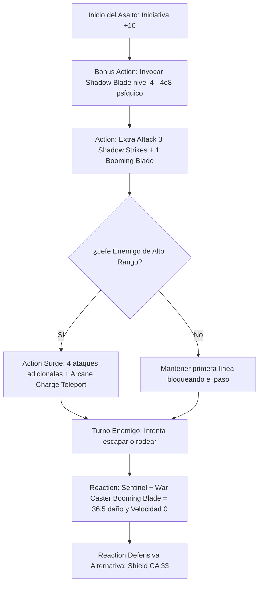

# ⚡ Guía de Personaje — Eldritch Shadow (Edición 2024 / 5.5e)

**Arquetipo:** Frontline Psychic Gish Striker & Lockdown Sentinel  
**Clase:** Fighter (Eldritch Knight) 20  
**Especie:** Human (Reglas 2024)  
**Trasfondo:** Guard / Soldier (Dote de Origen: *War Caster*)  
**Sistema:** D&D 5th Edition (Reglas 2024 / 5.5e)  
**Documentos Relacionados:**
* [Guía Principal](file:///d:/repo-vault/Proyectos/Rol/DnDbuilds/builds/eldritch%20shadow/character%20guide.md)
* [Bastión y Tiempo Muerto](file:///d:/repo-vault/Proyectos/Rol/DnDbuilds/builds/eldritch%20shadow/bastion%20and%20downtime.md)
* [Lista de Conjuros](file:///d:/repo-vault/Proyectos/Rol/DnDbuilds/builds/eldritch%20shadow/spell%20list.md)
* [Objetos a Obtener](file:///d:/repo-vault/Proyectos/Rol/DnDbuilds/builds/eldritch%20shadow/item%20list%20to%20obtain.md)
* [Hoja de Ruta](file:///d:/repo-vault/Proyectos/Rol/DnDbuilds/builds/eldritch%20shadow/roadmap.md)
* [Inventario Equipado](file:///d:/repo-vault/Proyectos/Rol/DnDbuilds/builds/eldritch%20shadow/actual%20inventory%20list.md)

---

## 📊 Atributos y Estadísticas (Nivel 20)

| Atributo | Puntuación | Modificador | Salvación Base | Notas Defensivas |
| :--- | :---: | :---: | :---: | :--- |
| **Fuerza (STR)** | 10 | 0 | +6 (Competente) | Salvación base de Fighter |
| **Destreza (DEX)** | 20 | +5 | +5 | Ataques de Shadow Blade, iniciativa y CA |
| **Constitución (CON)** | 18 | +4 | +10 (Competente) | Salvación con Ventaja (*War Caster*) |
| **Inteligencia (INT)** | 16 | +3 | +3 | Conjuros EK (CD 17) |
| **Sabiduría (WIS)** | 12 | +1 | +7 (Resilient WIS) | Salvación con competencia |
| **Carisma (CHA)** | 8 | -1 | -1 | Atributo de descarte |

* **Puntos de Golpe (PG):** 224 ($20\text{d}10 + 80 \text{ CON} + 40 \text{ Tough}$).
* **Clase de Armadura (CA):** 28 pasiva (Cuero Tachonado +3, Escudo +3, Defense, Capa/Anillo). CA 33 con reacción (*Shield*).
* **Iniciativa 2024:** $+5 (\text{DEX}) + 5 (\text{Alert}) = \mathbf{+10}$.

---

## 🏷️ Matriz de Evaluación Táctica

| Categoría | Nivel | Justificación Mecánica |
| :--- | :---: | :--- |
| **Daño Sostenido (DPR)** | 🔵 S | 4 ataques por acción con *Shadow Blade* upcast a nivel 4 ($4\text{d}8 + 5$ psíquico por impacto) con **Ventaja automática** en luz tenue u oscuridad. |
| **Burst Damage (Nova)** | 🔵 S | 2 usos de *Action Surge*; desata hasta 8 ataques de *Shadow Blade* en un solo asalto ($8 \times 23 = 184$ daño psíquico bruto). |
| **Control de Campo y Lockdown** | 🔵 S | *Sentinel + War Caster*: Ataque de oportunidad lanza *Booming Blade*, inflige daño psíquico masivo y fija la velocidad del enemigo a 0 pies. |
| **Supervivencia / EHP** | 🔵 S | CA 28 pasiva (33 con *Shield*), 224 PG base + 100 PG temporales del *Demiplane*, ventaja en concentración (*War Caster*) y 3 usos de *Indomitable*. |
| **Economía de Acciones** | 🟢 A | *Shadow Blade* invocado como Bonus Action; 4 ataques fluidos por acción; teletransporte de 30 pies integrado en cada Action Surge (*Arcane Charge*). |
| **Versatilidad Mágica** | 🟡 B | Lista de conjuros centrada en abjuración y evocación; cubre protección y daño personal pero carece de utilidad grupal amplia de full caster. |

---

## 🧮 Motor Matemático (2024 Ruleset)

### 1. Eldritch Knight War Magic 2024 Synergy
En las reglas 2024, el rasgo *War Magic* permite sustituir uno de los ataques de *Extra Attack* por un truco con tiempo de lanzamiento de 1 acción.
En una Acción de Ataque completa (4 ataques):
* **Ataques 1 a 3:** 3 ataques con *Shadow Blade* Nivel 4 ($4\text{d}8 + 5$ psíquico cada uno).
* **Ataque 4:** *Booming Blade* ($4\text{d}8 + 5$ psíquico $+ 3\text{d}8$ trueno).

$$\text{Daño Total de Acción} = 3 \times (4\text{d}8 + 5) + (4\text{d}8 + 5 + 3\text{d}8) = 3 \times 23.0 + 36.5 = 69.0 + 36.5 = \mathbf{105.5 \text{ daño bruto por turno}}$$
En penumbra con Ventaja ($P = 0.91$):
$$\text{DPR Sostenido 2024} = 105.5 \times 0.91 = \mathbf{96.0 \text{ DPR neto}}$$
Si el enemigo se mueve tras recibir *Booming Blade*, recibe $4\text{d}8$ adicionales ($18.0$ daño de trueno), alcanzando **114.0 DPR**.

### 2. Nova Burst con Action Surge (8 Ataques)
Al activar *Action Surge*, se ejecutan 8 ataques totales (incluyendo 2 detonaciones de *Booming Blade* si se alternan):
$$\text{Nova Turno 1} = [6 \times 23.0] + [2 \times 36.5] = 138.0 + 73.0 = \mathbf{211.0 \text{ daño bruto}}$$
$$\text{Nova Efectivo con Ventaja} = 211.0 \times 0.91 = \mathbf{192.01 \text{ daño neto en Turno 1}}$$

### 3. Supervivencia Efectiva con Desventaja Enemiga
Con CA 28 pasiva y *Shield* alcanzando CA 33, sumado a la desventaja de *Cloak of Displacement*:
Frente a un enemigo con bono $+14$ contra CA 33 (necesita 19-20 natural, $P = 0.10$):
$$P_{\text{desventaja}} = (0.10)^2 = \mathbf{0.01} \quad (1\% \text{ de probabilidad de impacto})$$
$$\text{EHP Efectivo} = \frac{224 + 100 (\text{Demiplane THP})}{0.01} = \frac{324}{0.01} = \mathbf{32{,}400 \text{ EHP frente a ataques con tirada}}$$

---

## 🔄 Bucle Táctico de Combate (Action Loop)

---

## ⚔️ Integración de Weapon Masteries 2024

* **Shortsword / Rapier (Vex):** Concede **Ventaja** en la siguiente tirada de ataque contra el mismo objetivo si se utiliza un arma física vinculada (*Weapon Bond*).
* **Scimitar (Nick):** Permite realizar un corte con el arma de la mano torpe dentro de la Acción de Ataque sin consumir la Bonus Action, liberando la Bonus Action para *Shadow Blade* o *Second Wind*.
