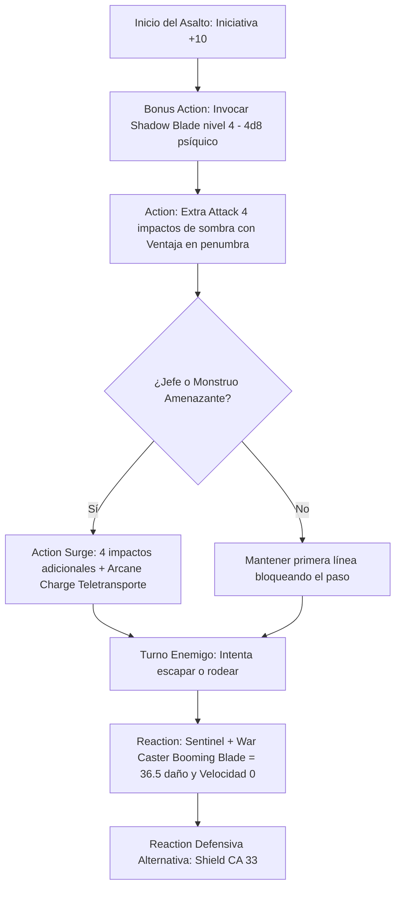

# 🗡️ Guía de Personaje — Eldritch Shadow

**Build:** Eldritch Shadow (El Caballero Umbrío Definitivo)  
**Clase:** Fighter (Eldritch Knight) 20  
**Especie:** Variant Human  
**Trasfondo:** Guard / Soldier (Dote de Origen: *War Caster*)  
**Sistema:** D&D 5th Edition (Reglas 2024 / 5.5e & 2014)  
**Rol:** Frontline Psychic Gish Striker / Lockdown Sentinel / Arcane Tank  
**Documentos Relacionados:**
* [Guía 2024](file:///d:/repo-vault/Proyectos/Rol/DnDbuilds/builds/eldritch%20shadow/character%20guide%202024.md)
* [Bastión y Tiempo Muerto](file:///d:/repo-vault/Proyectos/Rol/DnDbuilds/builds/eldritch%20shadow/bastion%20and%20downtime.md)
* [Lista de Conjuros](file:///d:/repo-vault/Proyectos/Rol/DnDbuilds/builds/eldritch%20shadow/spell%20list.md)
* [Objetos a Obtener](file:///d:/repo-vault/Proyectos/Rol/DnDbuilds/builds/eldritch%20shadow/item%20list%20to%20obtain.md)
* [Hoja de Ruta](file:///d:/repo-vault/Proyectos/Rol/DnDbuilds/builds/eldritch%20shadow/roadmap.md)
* [Inventario Equipado](file:///d:/repo-vault/Proyectos/Rol/DnDbuilds/builds/eldritch%20shadow/actual%20inventory%20list.md)

---

## 📊 Atributos y Estadísticas (Nivel 20)

| Atributo | Puntuación | Modificador | Salvación Base | Notas Defensivas |
| :--- | :---: | :---: | :---: | :--- |
| **Fuerza (STR)** | 10 | 0 | +6 (Competente) | Salvación base de Fighter |
| **Destreza (DEX)** | 20 | +5 | +5 | Ataques de Shadow Blade, iniciativa y CA |
| **Constitución (CON)** | 18 | +4 | +10 (Competente) | Concentración con Ventaja (*War Caster*) |
| **Inteligencia (INT)** | 16 | +3 | +3 | CD de conjuros de EK (CD 17) |
| **Sabiduría (WIS)** | 12 | +1 | +7 (Resilient WIS) | Salvación con competencia vía dote |
| **Carisma (CHA)** | 8 | -1 | -1 | Atributo de descarte |

* **Puntos de Golpe (PG):** 224 ($20\text{d}10 + 80 \text{ CON} + 40 \text{ Tough}$).
* **Clase de Armadura (CA):**
  * Studded Leather +3: $12 + 3 + 5 (\text{DEX}) = \mathbf{20}$.
  * Shield +3: $+5$ a la CA.
  * Estilo de Combate Defense: $+1$ a la CA.
  * Cloak / Ring of Protection: $+2$ a la CA.
  * **CA Pasiva Base:** $\mathbf{28}$.
  * **CA con Reacción (*Shield*):** $\mathbf{33}$.
* **Iniciativa:** $+5 (\text{DEX}) + 5 (\text{Alert}) = \mathbf{+10}$.
* **Recursos de Guerrero:** 4 ataques por acción, 2 usos de *Action Surge*, 3 usos de *Indomitable*, *Arcane Charge* (teletransporte de 30 ft al usar Action Surge).

---

## 🏷️ Matriz de Evaluación Táctica

| Categoría | Nivel | Justificación Mecánica |
| :--- | :---: | :--- |
| **Daño Sostenido (DPR)** | 🔵 S | 4 ataques por acción con *Shadow Blade* upcast a nivel 4 ($4\text{d}8 + 5$ psíquico por impacto) con **Ventaja automática** en luz tenue u oscuridad. |
| **Burst Damage (Nova)** | 🔵 S | 2 usos de *Action Surge* al nivel 20; desata hasta 8 ataques de *Shadow Blade* en un solo asalto ($8 \times 23 = 184$ daño psíquico bruto). |
| **Control de Campo y Lockdown** | 🔵 S | *Sentinel + War Caster*: Ataque de oportunidad lanza *Booming Blade*, inflige daño psíquico masivo y fija la velocidad del enemigo a 0 pies. |
| **Supervivencia / EHP** | 🔵 S | CA 28 pasiva (33 con *Shield*), 224 PG base + 100 PG temporales del *Demiplane*, ventaja en concentración (*War Caster*) y 3 usos de *Indomitable*. |
| **Economía de Acciones** | 🟢 A | *Shadow Blade* invocado como Bonus Action; 4 ataques fluidos por acción; teletransporte de 30 pies integrado en cada Action Surge (*Arcane Charge*). |
| **Versatilidad Mágica** | 🟡 B | Lista de conjuros centrada en abjuración y evocación; cubre protección y daño personal pero carece de utilidad grupal amplia de full caster. |

---

## 🧮 Motor Matemático (2024 / 2014 Ruleset)

### 1. Daño Sostenido por Asalto (Shadow Blade Nivel 4)
Con *Shadow Blade* lanzado con la ranura de nivel 4:
$$\text{Daño por Impacto} = 4\text{d}8 (\text{Psíquico}) + 5 (\text{DEX}) = 18.0 + 5.0 = \mathbf{23.0 \text{ daño por impacto}}$$
En penumbra u oscuridad (condición de ventaja automática):
Probabilidad base frente a CA 18 con bono $+11$: $P = 0.70$.
Con Ventaja de sombra: $P_{\text{ventaja}} = 1 - (1 - 0.70)^2 = 1 - 0.09 = \mathbf{0.91} \quad (91\%)$.
$$\text{DPR Base (4 Ataques)} = 4 \times 23.0 \times 0.91 = \mathbf{83.72 \text{ DPR sostenido}}$$

### 2. Burst Damage Nova (Action Surge — 8 Ataques de Sombra)
$$\text{Nova Turno 1} = 8 \times 23.0 \times 0.91 = \mathbf{167.44 \text{ daño efectivo}}$$
*(Daño bruto con todos los impactos acertados: $8 \times 23.0 = \mathbf{184.0 \text{ daño psíquico}}$).*

### 3. Reacción de Cierre Táctico (Sentinel + War Caster Booming Blade)
Si un enemigo intenta alejarse o atacar a un aliado adyacente:
$$\text{Daño de Reacción} = 4\text{d}8 (\text{Shadow Blade}) + 5 (\text{DEX}) + 3\text{d}8 (\text{Booming Blade}) = 18.0 + 5.0 + 13.5 = \mathbf{36.5 \text{ daño instantáneo}}$$
*Efecto Sentinel:* La velocidad del objetivo se reduce a **0 pies** inmediatamente, anulando su movimiento y dejándolo atrapado junto a ti.

### 4. Supervivencia Efectiva (EHP)
Frente a un monstruo de CR 20 con bono $+14$ contra CA 28:
Probabilidad de impacto: $P = \frac{21 - (28 - 14)}{20} = \frac{7}{20} = 0.35 \quad (35\%)$.
Con reacción de *Shield* activa (CA 33, solo acierta con 19-20 natural, $P = 0.10$):
$$\text{EHP Pasivo} = \frac{224 + 100 (\text{Demiplane THP})}{0.35} = \frac{324}{0.35} \approx \mathbf{925.7 \text{ EHP}}$$
$$\text{EHP con Shield} = \frac{324}{0.10} = \mathbf{3{,}240.0 \text{ EHP}}$$

---

## 🔄 Bucle Táctico de Combate (Action Loop)

### Turno 0 (Preparación)
* Evaluar condiciones de iluminación (luz tenue u oscuridad garantizan ventaja automática).
* Lanzar *Mirror Image* si se anticipa un asalto masivo sin concentración.

### Turno 1 (Despliegue de la Hoja Umbría)
1. **Bonus Action:** Conjurar *Shadow Blade* con la ranura de Nivel 4 ($4\text{d}8$ daño psíquico, propiedad Finesse).
2. **Action:** Ejecutar 4 ataques con *Extra Attack (3)* sobre el objetivo principal ($83.72$ DPR).
3. **Action Surge:** Si el enemigo es un jefe de alto rango, descargar 4 ataques adicionales ($167.4$ daño acumulado) y teletransportarse 30 pies con *Arcane Charge* para cortar la retirada enemiga.

### Turnos Subsiguientes
* Sostener la concentración en *Shadow Blade* blindada con *War Caster* y salvación CON $+10$.
* **Reacción de Centinela:** Castigar cualquier intento de escape enemigo con *Booming Blade*, deteniéndolo en seco.
