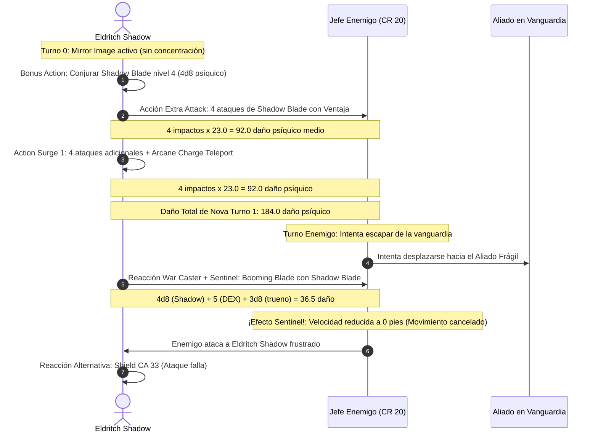

# 📜 Lista de Conjuros e Ilusiones — Eldritch Shadow

**Build:** Eldritch Shadow (El Caballero Umbrío Definitivo)  
**Clase:** Fighter (Eldritch Knight) 20  
**Nivel de Lanzador:** Eldritch Knight Nivel 20 (Caster 1/3)  
**Ranuras Disponibles:** 4 de Nivel 1, 3 de Nivel 2, 3 de Nivel 3, 1 de Nivel 4  
**CD de Salvación de Conjuros:** $8 + 6 (\text{PB}) + 3 (\text{INT}) = \mathbf{17}$  
**Documentos Relacionados:**
* [Guía de Personaje](file:///d:/repo-vault/Proyectos/Rol/DnDbuilds/builds/eldritch%20shadow/character%20guide.md)
* [Guía 2024](file:///d:/repo-vault/Proyectos/Rol/DnDbuilds/builds/eldritch%20shadow/character%20guide%202024.md)
* [Bastión y Tiempo Muerto](file:///d:/repo-vault/Proyectos/Rol/DnDbuilds/builds/eldritch%20shadow/bastion%20and%20downtime.md)
* [Objetos a Obtener](file:///d:/repo-vault/Proyectos/Rol/DnDbuilds/builds/eldritch%20shadow/item%20list%20to%20obtain.md)
* [Hoja de Ruta](file:///d:/repo-vault/Proyectos/Rol/DnDbuilds/builds/eldritch%20shadow/roadmap.md)
* [Inventario Equipado](file:///d:/repo-vault/Proyectos/Rol/DnDbuilds/builds/eldritch%20shadow/actual%20inventory%20list.md)

---

## ⚡ Efectos Activos y Buffs Previos (Turn 0)

| Efecto / Conjuro | Duración | Concentración | Beneficio Mecánico |
| :--- | :---: | :---: | :--- |
| **Mirror Image (Nivel 2)** | 1 minuto | **No** | 3 duplicados ilusorios que desvían ataques enemigos sin consumir concentración. |
| **Shadow Blade (Nivel 4)** | 1 minuto | **Sí** | Arma psíquica de $4\text{d}8$ daño con Ventaja automática en luz tenue u oscuridad. |
| **Shield +3 & Studded Leather +3** | Permanente | No | CA base 28 pasiva. |
| **Alert (Dote)** | Permanente | No | $+5$ a la iniciativa e inmunidad a ser sorprendido. |

---

## 📊 Matriz de Conjuros Conocidos (Eldritch Knight 20)

### Trucos (Cantrips)
* **Booming Blade:** 🔵 S. **Pilar del build**. Utilizado en el bucle de *War Magic* y como ataque de oportunidad con *Sentinel + War Caster* para detener al enemigo.
* **Green-Flame Blade:** 🟢 A. Daño de fuego secundario contra grupos de esbirros adyacentes.
* **Minor Illusion:** 🟢 A. Creación de coberturas o zonas de sombra ilusoria para forzar ventaja.
* **Lightning Lure:** 🟡 B. Tira de enemigos a 15 pies hacia tu alcance cuerpo a cuerpo.

### Nivel 1 (4 Ranuras)
* **Shield:** 🔵 S. Reacción indispensable que eleva la CA a 33, haciendo rebotar cualquier ataque físico o proyectil.
* **Absorb Elements:** 🔵 S. Mitiga a la mitad el daño elemental recibido y carga el siguiente ataque con daño de ese tipo.
* **Find Familiar (Ritual):** 🟢 A. Búho o murciélago para exploración aérea y concesión de ventaja mediante la acción *Help*.
* **Protection from Evil and Good:** 🟢 A. Protección extrema contra aberraciones, infernales y no-muertos.

### Nivel 2 (3 Ranuras)
* **Shadow Blade:** 🔵 S. **El alma ofensiva del caballero**. Daño psíquico puro que elude resistencias físicas convencionales.
* **Mirror Image:** 🔵 S. Defensa pasiva de primer nivel sin concentración.
* **Misty Step:** 🔵 S. Teletransporte de emergencia a 30 pies como Bonus Action.
* **Darkness:** 🟢 A. Crea una zona de penumbra absoluta para activar la ventaja de *Shadow Blade*.

### Nivel 3 y 4 (3 de Nivel 3, 1 de Nivel 4)
* **Counterspell:** 🔵 S. Neutraliza conjuros enemigos críticos que amenacen al grupo.
* **Fireball:** 🟢 A. Limpieza de hordas antes del enganche en primera línea.
* **Haste:** 🟢 A. Alternativa a *Shadow Blade* si se porta un arma legendaria física (+2 CA, velocidad doble, +1 ataque).
* **Fire Shield (Nivel 4):** 🔵 S. Concede resistencia a fuego/frío y devuelve $2\text{d}8$ de daño automático al recibir ataques cuerpo a cuerpo sin concentración.

---

## 🔄 Diagrama de Secuencia: Nova Strike & Sentinel Lockdown

---

## 💖 Curación en Segundo Plano (Background Healing)

1. **Second Wind (Guerrero Nivel 20):** Recupera $1\text{d}10 + 20 = \mathbf{25.5 \text{ PG}}$ como Bonus Action por descanso corto (o múltiples cargas en las reglas 2024).
2. **Indomitable (3 Usos por Descanso Largo):** Permite repetir tiradas de salvación fallidas, previniendo estados alterados y daño masivo.
3. **Reserva de Pociones del Bastión:** 8x *Potion of Superior Healing* ($8\text{d}4 + 8$ PG) destiladas en el laboratorio para recuperación inmediata entre combates.
