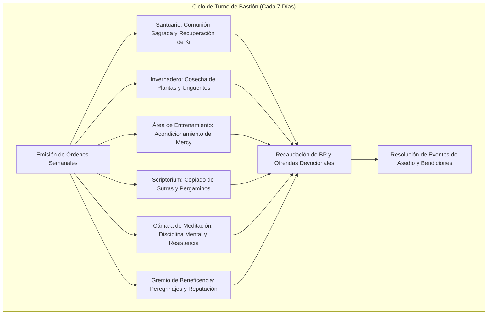

# 🏰 Bastión y Tiempo Muerto — Fist of God

## 🏰 Sistema de Bastiones (Reglas Oficiales DMG 2024 / D&D 5.5e)

*Estructura de gestión de la base de operaciones, economía de bastión y mecánicas de mando.*

* **Nombre del Bastión:** El Templo de la Penumbra Sanadora (Shroud Temple)
* **Nivel de Bastión (Bastion Level):** 20
* **Puntos de Bastión (Bastion Points - BP):** 115
* **Puntuación de Mando (Bastion Defender Stats):** +11 al ataque y salvaciones defensivas (STR 8 [-1], DEX 20 [+5], CON 14 [+2], INT 10 [+0], WIS 20 [+5], CHA 8 [-1]).

---

### Instalaciones Básicas (Basic Facilities)

1. **Dormitorio Monástico (Bedchambers):** Celdas austeras talladas en roca blanca pulida, iluminadas por tragaluces que dejan filtrar la luz solar y la lluvia sobre pequeños estanques interiores.
2. **Comedor del Voto (Dining Hall):** Mesa común de madera de olivo donde se sirven caldos reconstituyentes, infusiones medicinales y pan ácimo.
3. **Patio de la Quietud (Common Area):** Explanada central de arena de cuarzo alisada para ejercicios de meditación, combate desarmado y respiración controlada.

---

### Instalaciones Especiales (Special Facilities — Exactamente 6: 4 Roomy + 2 Vast)

#### 1. Santuario Divino (Sanctuary — Roomy, Desbloqueo Nivel 5)
* **Estado:** Activa (Mantener)
* **Tamaño:** Roomy (Espaciosa)
* **Orden de Bastión:** *Commune & Bless (Comunión y Bendición)*
* **Sinergia con el Build:** 🔵 **Indispensable**. Centro espiritual de devoción bélica y compasiva. Concede al personaje agua bendita y ventaja en salvaciones de Sabiduría contra maldiciones e influencias extraplanarias.

#### 2. Invernadero de Hierbas Médicas (Greenhouse — Roomy, Desbloqueo Nivel 5)
* **Estado:** Activa (Mantener)
* **Tamaño:** Roomy (Espaciosa)
* **Orden de Bastión:** *Harvest (Cosecha Botánica)*
* **Sinergia con el Build:** 🟢 **Excelente**. Cultivo de flora exótica para destilar ungüentos, antitoxinas y cataplasmas del Camino de la Misericordia. Provee 2 dosis de pociones curativas o antitoxinas por semana.

#### 3. Área de Entrenamiento Marcial (Training Area — Roomy, Desbloqueo Nivel 9)
* **Estado:** Activa (Mantener)
* **Tamaño:** Roomy (Espaciosa)
* **Orden de Bastión:** *Train (Acondicionamiento Desarmado)*
* **Sinergia con el Build:** 🟢 **Excelente**. Patio de golpeo con postes de madera de hierro. Otorga al personaje +1d4 a su primera tirada de iniciativa o ataque tras salir del bastión.

#### 4. Scriptorium Sagrado (Scriptorium — Roomy, Desbloqueo Nivel 9)
* **Estado:** Activa (Mantener)
* **Tamaño:** Roomy (Espaciosa)
* **Orden de Bastión:** *Scribe (Transcripción de Pergaminos Sagrados)*
* **Sinergia con el Build:** 🟢 **Excelente**. Copiado de pergaminos divinos de clérigo (*Revivify*, *Death Ward*, *Freedom of Movement*) a mitad de tiempo y oro.

#### 5. Cámara de Meditación Trascendente (Meditation Chamber — Vast, Desbloqueo Nivel 13)
* **Estado:** Activa (Mantener)
* **Tamaño:** Vast (Vasta)
* **Orden de Bastión:** *Focus (Enfoque Espiritual de Ki)*
* **Sinergia con el Build:** 🔵 **Indispensable**. Aislamiento sonoro absoluto para armonizar Ki y energía divina. Otorga inspiración heroica y ventaja en tiradas de concentración durante las primeras 24 horas.

#### 6. Gremio de Beneficencia y Sanación (Guildhall — Vast, Desbloqueo Nivel 17)
* **Estado:** Activa (Mantener)
* **Tamaño:** Vast (Vasta)
* **Orden de Bastión:** *Heal the Masses (Red de Milagros y Hospitalidad)*
* **Sinergia con el Build:** 🔵 **Indispensable**. Hospital y centro de peregrinaje mayor. Permite acoger a cientos de fieles, tratar epidemias mágicas y movilizar una guardia de 20 acólitos y monjes con un bono marcial de mando de +11.

---

### Seguidores y Guarnición (Staff & Garrison)

* **Capataz General (Major Domo):** Abadesa Lía (Anciana elfo de los bosques, maestra de boticarios y sabia consejera espiritual).
* **Guarnición Activa:**
  * 12 Monjes acólitos versados en medicina marcial y combate desarmado.
  * 6 Centinelas de Guerra con mayales y corazas consagradas.
  * 2 Maestros herboristas y boticarios del templo.

---

## ⏳ Actividades de Tiempo Muerto (Downtime Activities)

### Prioridad 1: Destilación de Remedios y Ungüentos de Misericordia
* **Mecánica Oficial:** Xanathar's Guide to Everything / DMG 2024 (Herbalism & Potion Crafting).
* **Bonificadores Aplicables:** Herramientas de Herborista (+11 con pericia), Sabiduría (+5) e instalaciones del Invernadero.
* **Objetivo:** Acumular viales de *Potion of Greater Healing* y antídotos contra toxinas mortales.

### Prioridad 2: Servicio Hospitalario y Peregrinaje
* **Mecánica Oficial:** XGE (Religious Service).
* **Objetivo:** Atender a las poblaciones locales para ganar favor divino, diezmos voluntarios e inspiración religiosa previa a misiones de guerra.

---

## 🏃‍♂️ Modos de Movimiento, Logística y Viaje

* **Caminar (Walk):** 50 ft. (30 ft. base Wood Elf + 20 ft. por Movimiento sin Armadura Monje 12).
* **Iniciativa en Viaje:** +5 base (o +10 con dote *Alert*).
* **Movimiento Vertical (Monje 9):** Puede correr a lo largo de muros verticales y sobre superficies líquidas sin hundirse.
* **Visión en la Oscuridad:** 60 ft. nativa de Elfo de la Selva.
* **Ritmo de Viaje:** Rápido sin penalización de percepción pasiva (*Fleet of Foot* / Monje).

---

## 🎭 Reputación y Facciones

1. **La Orden de la Máscara de Cuervo:** Patriarca Supremo de los Monjes de la Misericordia. Autoridad total para arbitrar juicios de vida y muerte en comunidades rurales.
2. **El Cónclave de los Robles Antiguos:** Aliados elfos que proveen semillas raras y madera sagrada para el templo.