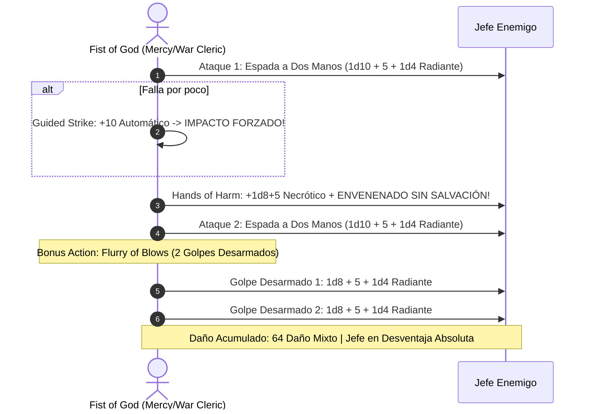

# Guía de Personaje — Fist of God (Edición 2024 / 5.5e Update)

## Datos Generales

* **System Standard:** D&D 5th Edition (2024 Ruleset - 5.5e Compatible)
* **Character Level:** 20 (Total)
* **Class Split:** Monk (Way of Mercy) 12 / Cleric (War Domain) 8
* **Species:** Wood Elf (2024 — +5 ft velocidad de movimiento, Elven Lineage, Darkvision)
* **Background:** Acolyte / Guide (Dote de Origen: *Magic Initiate (Cleric)* o *Alert 2024*)
* **Stats (Point Buy 2024 / Background):**
  * **FUER (STR):** 8 (-1)
  * **DES (DEX):** 20 (+5) *(15 Base + 2 Trasfondo + 2 ASI Nivel 9 + 1 Dote Nivel 13)*
  * **CON:** 14 (+2)
  * **INT:** 10 (+0)
  * **SAB (WIS):** 20 (+5) *(15 Base + 1 Trasfondo + 2 ASI Nivel 16 + 2 ASI Nivel 20 o Tomo)*
  * **CAR (CHA):** 8 (-1)

* **Enlaces de Documentación:**
  * [Bastión y Tiempo Muerto](file:///d:/repo-vault/Proyectos/Rol/DnDbuilds/builds/fist%20of%20god/bastion%20and%20downtime.md)
  * [Lista de Conjuros y Recursos](file:///d:/repo-vault/Proyectos/Rol/DnDbuilds/builds/fist%20of%20god/spell%20list.md)
  * [Objetos a Obtener](file:///d:/repo-vault/Proyectos/Rol/DnDbuilds/builds/fist%20of%20god/item%20list%20to%20obtain.md)
  * [Hoja de Ruta 1-20](file:///d:/repo-vault/Proyectos/Rol/DnDbuilds/builds/fist%20of%20god/roadmap.md)
  * [Inventario Actual](file:///d:/repo-vault/Proyectos/Rol/DnDbuilds/builds/fist%20of%20god/actual%20inventory%20list.md)

---

## Combat Role: Divine Martial Striker, Automatic Debuffer & Flurry Healer

Bajo las reglas oficiales de **D&D 5.5e (2024)**:
1. **Unarmed Strike 2024:** Permite aplicar derribo (*Prone*) o empuje (*Push*) automáticos sin perder daño mediante la CD de Salvación de Monje ($8 + \text{PB} + \text{DEX} = \mathbf{19}$).
2. **Physician's Touch (Way of Mercy):** La Mano del Perjuicio (*Hands of Harm*) inflige daño necrótico y aplica la condición de **Envenenado (*Poisoned*) sin conceder tirada de salvación**.
3. **War Domain 2024:** Permite alternar ataques adicionales y utilizar *Guided Strike* (+10 reactivo) para forzar impactos en momentos críticos.

---

## 1. Gestión de Recursos y Reglas de Inventario (Reglas 2024)

* **Maestría de Golpes Desarmados (Unarmed Strikes 2024):**
  * Opciones de daño, empuje o presa integradas en cada golpe de artes marciales.
* **Economía de Puntos de Foco / Ki 2024:**
  * 12 puntos de foco recargables en descansos cortos y restauración de 1 punto de foco durante 1 minuto fuera de combate (*Uncanny Metabolism 2024*).
* **Foco Divino Unificado:**
  * Vendajes consagrados en las manos que permiten la ejecución de conjuros de Clérigo con las manos libres.

---

## 2. Action Economy & Combat Loop (2024)

* **Preparación (Pre-Combate):**
  * Activar *Divine Favor* (+1d4 radiante por impacto) o *Death Ward*.
* **Action:**
  * **Acción de Ataque:** 2 golpes con espada versátil o golpes desarmados (+11 hit). Al impactar el primero, detona *Hands of Harm* (+1d8+5 necrótico y estado **Envenenado sin salvación**).
* **Bonus Action:**
  * *Flurry of Blows (2024):* 2 golpes desarmados adicionales de 1d8+5+1d4 radiante, pudiendo convertir uno de ellos en *Hands of Healing* (+1d8+5 PG) sin coste extra a nivel 11.
* **Reaction:**
  * *Guided Strike:* +10 a una tirada de ataque propia si falla por poco.
  * *Deflect Attacks (2024):* Reducción de daño para ataques tanto a distancia como cuerpo a cuerpo.

---

## 3. The META Combo 2024: Physician's Touch + Flurry of Blows + Guided Strike

### 🧮 Motor Matemático (2024 Ruleset)

$$\text{Daño Base 2 Golpes de Espada} = 2 \times (1\text{d}10 + 5 + 1\text{d}4) = 2 \times 13.0 = \mathbf{26.0 \text{ daño}}$$

$$\text{Daño Hands of Harm} = 1\text{d}8 + 5 = \mathbf{9.5 \text{ daño necrótico}}$$

$$\text{Daño Flurry of Blows (2 Golpes)} = 2 \times (1\text{d}8 + 5 + 1\text{d}4) = 2 \times 12.0 = \mathbf{24.0 \text{ daño}}$$

$$\text{Daño Divine Strike (Clérigo 8)} = 1\text{d}8 = \mathbf{4.5 \text{ daño radiante}}$$

$$\text{DPR Total del Asalto} = 26.0 + 9.5 + 24.0 + 4.5 = \mathbf{64.0 \text{ daño medio/turno}}$$

$$\text{P(Impactar con Guided Strike Contingente)} \approx 0.95 \implies \mathbf{60.8 \text{ DPR Efectivo Real}}$$