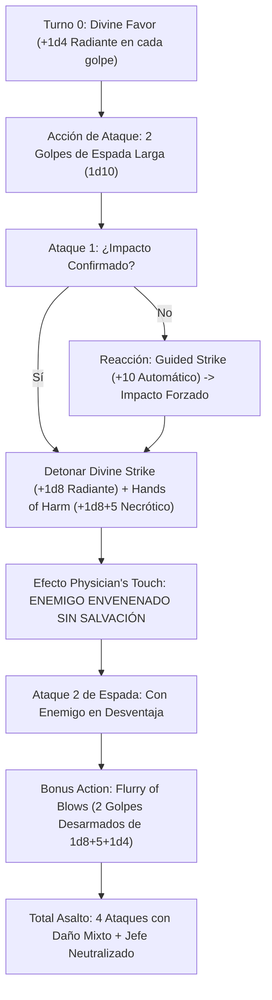

# Guía de Personaje — Fist of God (The Merciful War Arbiter)

## Datos Generales

* **System Standard:** D&D 5th Edition (2024 / 5.5e Update & 2014 Compatibility)
* **Character Level:** 20 (Monk [Way of Mercy] 12 / Cleric [War Domain] 8)
* **Species:** Wood Elf (Dote de Origen: *Fey Touched* — Sabiduría +1, Misty Step, Silvery Barbs)
* **Background:** Acolyte / Hermit (Atributos: Destreza +2, Sabiduría +1)
* **Stats (Point Buy + Racial + ASIs):**
  * **FUER (STR):** 8 (-1) *(Standard Array)*
  * **DES (DEX):** 20 (+5) *(15 Base + 2 Racial + 2 ASI Nivel 9 + 2 ASI Nivel 13)*
  * **CON:** 14 (+2) *(14 Base — Puntos de golpe y concentración)*
  * **INT:** 10 (+0) *(Standard Array)*
  * **SAB (WIS):** 20 (+5) *(15 Base + 1 Fey Touched Nivel 5 + 2 ASI Nivel 16 + 2 ASI Nivel 20 o Tomo)*
  * **CAR (CHA):** 8 (-1) *(Standard Array)*

* **Enlaces de Documentación:**
  * [Bastión y Tiempo Muerto](file:///d:/repo-vault/Proyectos/Rol/DnDbuilds/builds/fist%20of%20god/bastion%20and%20downtime.md)
  * [Lista de Conjuros y Recursos](file:///d:/repo-vault/Proyectos/Rol/DnDbuilds/builds/fist%20of%20god/spell%20list.md)
  * [Objetos a Obtener](file:///d:/repo-vault/Proyectos/Rol/DnDbuilds/builds/fist%20of%20god/item%20list%20to%20obtain.md)
  * [Hoja de Ruta 1-20](file:///d:/repo-vault/Proyectos/Rol/DnDbuilds/builds/fist%20of%20god/roadmap.md)
  * [Inventario Actual](file:///d:/repo-vault/Proyectos/Rol/DnDbuilds/builds/fist%20of%20god/actual%20inventory%20list.md)
  * [Guía de Personaje 2024](file:///d:/repo-vault/Proyectos/Rol/DnDbuilds/builds/fist%20of%20god/character%20guide%202024.md)

---

## Combat Role: Divine Martial Striker, Automatic Debuffer & Tactical Combat Medic

El **Fist of God** combina la fluidez cinética del **Monje del Camino de la Misericordia (12)** con el poder bélico y la magia del **Clérigo del Dominio de la Guerra (8)**.

Su mecánica distintiva radica en aplicar la **Mano del Perjuicio (*Hands of Harm*)** junto con el rasgo *Physician's Touch*: al impactar a un enemigo, añade daño necrótico e impone la condición de **Envenenado (*Poisoned*)** de forma automática **sin conceder tirada de salvación**. Si un ataque crucial corre el riesgo de fallar, activa la reacción de **Ataque Guiado (*Guided Strike*)** (+10 a impactar) para asegurar la conexión del veneno.

---

## 1. Gestión de Recursos y Reglas de Inventario

* **Economía de Manos y Foco Corporal Consagrado:**
  * **Foco Universal Tatuado:** Los vendajes y marcas rúnicas consagradas en sus palmas actúan como foco sagrado de Clérigo, permitiendo canalizar toda su magia sin portar amuletos físicos.
  * **Espada Larga como Arma Dedicada de Monje (*Dedicated Weapon*):** Empuña una espada larga a dos manos ($1\text{d}10$ de daño versátil base) que utiliza Destreza (+5) para sus tiradas de ataque y daño, alternándola con patadas y codazos desarmados para artes marciales.
* **Economía de Puntos de Ki y Ranuras Divinas:**
  * **12 Puntos de Ki por Descanso Corto:** Alimentan *Flurry of Blows*, *Stunning Strike*, *Hand of Harm* y *Hand of Healing*. A nivel 11 (*Flurry of Healing and Harm*), no cuesta Ki extra aplicar curación o daño necrótico dentro de la Ráfaga de Golpes.
  * **2 Usos de Canalizar Divinidad por Descanso Corto:** Dedicados a *Guided Strike* (+10 reactivo a un ataque propio) o *War God's Blessing* (+10 para un aliado).
  * **Ranuras de Clérigo hasta Nivel 4 (4/3/3/2):** Utilizadas para pre-buffs ofensivos (*Divine Favor*, *Spirit Guardians*, *Death Ward*, *Freedom of Movement*).

---

## 2. Action Economy & Combat Loop

* **Preparación (Pre-Combate / Turno 0):**
  * Lanzamiento de *Divine Favor* (Acción Adicional, Nivel 1: +1d4 radiante a cada golpe durante 1 minuto) o *Spirit Guardians* (Nivel 3: aura de 15 ft de 3d8 radiante/necrótico y mitad de velocidad enemiga).
  * Postura defensiva sin armadura: **CA 20 Base** ($10 + 5_{\text{DEX}} + 5_{\text{WIS}}$), elevable a 22 con *Bracers of Defense*.
* **Action:**
  * **Acción de Ataque (2 Ataques con Espada Larga a Dos Manos):**
    * Ataque 1: Espada Larga con Destreza (+11 a impactar, 1d10 + 5 + 1d4 radiante).
    * Al impactar: Detonar *Divine Strike* (+1d8 radiante del Clérigo de Guerra) y *Hands of Harm* ($1\text{d}8 + 5$ necrótico e inflige el estado **Envenenado sin salvación**).
    * Ataque 2: Segundo golpe de espada larga (+11 hit).
* **Bonus Action:**
  * **Flurry of Blows (1 Ki):** 2 ataques desarmados ($1\text{d}8 + 5 + 1\text{d}4$ radiante cada uno). Uno de ellos puede sustituirse por una curación de *Hands of Healing* ($1\text{d}8 + 5 \text{ PG}$) para un aliado adyacente sin coste de acción.
* **Reaction:**
  * 🔵 **Guided Strike (Canalizar Divinidad):** Suma un bono plano de **+10** a una tirada de ataque que haya quedado corta, garantizando el impacto y la activación del veneno.
  * 🟢 **Deflect Missiles:** Reduce daño de proyectiles a distancia en $1\text{d}10 + 5 + 12$.
  * 🟡 **Slow Fall:** Reduce daño de caída en 60 puntos.

---

## 3. The META Combo: La Imposición del Juicio Envenenado

### 🧮 Motor Matemático (Mathematical Engine)

#### 1. Cálculo de Daño por Asalto (DPR con Divine Favor Activo)

$$\text{Daño 2 Golpes de Espada Larga} = 2 \times \left[ 1\text{d}10 (5.5) + 5 (\text{DEX}) + 1\text{d}4 (2.5) \right] = 2 \times 13.0 = \mathbf{26.0 \text{ daño}}$$

$$\text{Daño Divine Strike (Clérigo 8)} = 1\text{d}8 = \mathbf{4.5 \text{ daño radiante}}$$

$$\text{Daño Hands of Harm (Monk 12)} = 1\text{d}8 (4.5) + 5 (\text{WIS}) = \mathbf{9.5 \text{ daño necrótico}}$$

$$\text{Daño 2 Golpes Desarmados (Flurry)} = 2 \times \left[ 1\text{d}8 (4.5) + 5 (\text{DEX}) + 1\text{d}4 (2.5) \right] = 2 \times 12.0 = \mathbf{24.0 \text{ daño}}$$

$$\text{DPR Total del Asalto} = 26.0 + 4.5 + 9.5 + 24.0 = \mathbf{64.0 \text{ daño mixto (Radiante/Necrótico/Físico)}}$$

Con *Ascendant Dragon's Wrath Focus / Insignia of Claws +1*:

$$\text{DPR Optimizado con Equipo Mágico} = 64.0 + 4 (\text{Insignia}) + 4 \times 3\text{d}6 (42.0) = \mathbf{110.0 \text{ daño por asalto}}$$

#### 2. EHP y Supresión Ofensiva Enemiga

$$\text{CA Base Pasiva} = 10 + 5 (\text{DEX}) + 5 (\text{SAB}) + 2 (\text{Bracers of Defense}) = \mathbf{22 \text{ CA Pasiva}}$$

Al aplicar la condición de **Envenenado (*Poisoned*)** sin tirada de salvación:
* Todas las tiradas de ataque del objetivo contra el Fist of God (y sus aliados) sufren **desventaja obligatoria**.
* Contra CA 22 y desventaja, la probabilidad de que un enemigo con bonificador de +12 le impacte se reduce de un 55% base a solo un **30.2%**.

$$\text{EHP Efectivo Dinámico} = \frac{\text{HP Base (154)}}{0.302} \approx \mathbf{509 \text{ EHP Efectivo}}$$

---

## 4. Tabla de Clasificación Táctica de Habilidades

| Habilidad / Recurso | Tipo | Coste | Evaluación | Justificación Táctica |
| :--- | :---: | :---: | :---: | :--- |
| **Hands of Harm** | Ofensiva/Debuff | 1 Ki (o gratis en Flurry) | 🔵 | Inflige daño necrótico e impone **Envenenado sin salvación**, anulando la ofensiva del jefe enemigo. |
| **Guided Strike** | Modificador | 1 Canalizar Divinidad | 🔵 | +10 reactivo a una tirada de ataque fallida, garantizando que el veneno y los castigos conecten. |
| **Hands of Healing** | Soporte | 1 Ki (o gratis en Flurry) | 🟢 | Sana $1\text{d}8 + 5$ PG y cura condiciones como ceguera, sordera o parálisis dentro del ciclo de ataque. |
| **Spirit Guardians** | Área/Control | Ranura Nivel 3 | 🔵 | $3\text{d}8$ de daño radiante por asalto a 15 pies y reducción de velocidad del 50% combinada con la movilidad del monje. |
| **Death Ward** | Defensiva | Ranura Nivel 4 | 🟢 | Previene la caída a 0 PG durante 8 horas sin requerir concentración. |
| **Evasion** | Defensiva | Pasiva Monje 7 | 🟢 | Anula el daño en salvaciones de Destreza superadas y reduce a la mitad en fallos. |
| **Purity of Body** | Pasiva | Monje 10 | 🟢 | Inmunidad total al veneno y las enfermedades. |

---

## 5. Reglas de la Casa (Home Rules)

1. **Foco Corporal Sagrado:** Los vendajes o tatuajes rúnicos en las manos actúan como foco sagrado de clérigo y monje, prescindiendo de amuletos empuñados.
2. **Espada Larga como Arma Dedicada:** Califica como arma de Monje versátil (1d10), permitiendo ejecutar artes marciales y Ráfaga de Golpes tras blandirla con ambas manos.