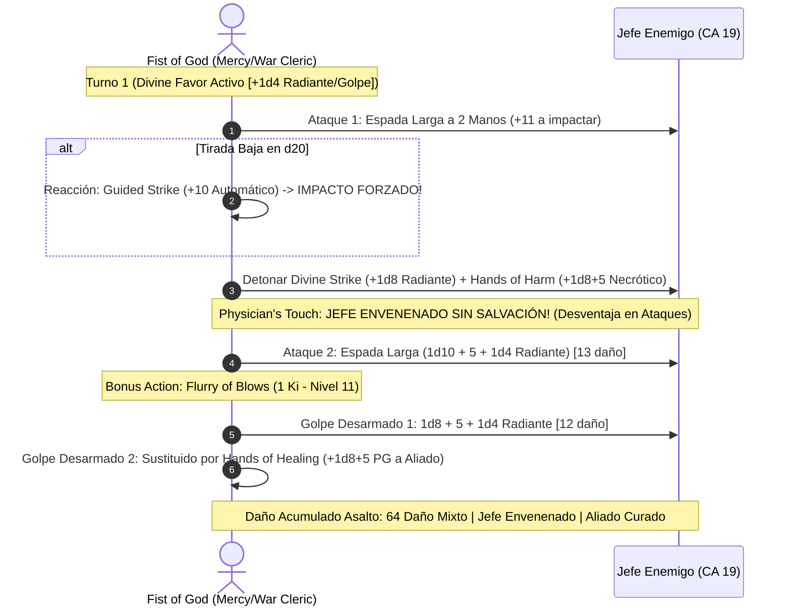

# 🌟 Lista de Conjuros y Recursos Tácticos — Fist of God

El **Fist of God** combina la energía espiritual de un **Monje de la Misericordia (12)** con los conjuros divinos y castigos de un **Clérigo de Guerra (8)**, integrando un arsenal de soporte, mitigación y daño mixto radiante/necrótico.

> **Nota de Regla de Mesa:** Los vendajes y marcas rúnicas consagradas en las palmas del personaje actúan como foco divino unificado, permitiendo ejecutar conjuros de clérigo con las manos libres para artes marciales.

---

## 🔮 Matriz de Recursos y Salvaciones

* **Puntos de Ki:** 12 por Descanso Corto (recuperables tras 1 hora de meditación).
* **Canalizar Divinidad (Clérigo):** 2 usos por Descanso Corto (*Guided Strike* [+10 propio] o *War God's Blessing* [+10 aliado]).
* **Ranuras de Conjuro de Clérigo:** Nivel 1: 4 | Nivel 2: 3 | Nivel 3: 3 | Nivel 4: 2.
* **CD de Salvación de Conjuros y Ki:** $8 + \text{PB (6)} + \text{SAB (5)} = \mathbf{19}$.
* **Bono de Ataque:** $+11$ (+5 DES, +6 PB) con espada versátil y golpes desarmados.
* **Turno 0 Pre-Buffs:**
  * Lanzamiento de *Death Ward* (Nivel 4, duración 8 horas sin concentración) $\implies$ protección contra muerte instantánea.
  * Activación de *Divine Favor* (Acción Adicional, Nivel 1: +1d4 radiante a cada impacto durante 1 minuto) o *Spirit Guardians*.

---

## 🪄 Trucos (Cantrips)

| Conjuro | Escuela | Clasificación | Efecto y Justificación Táctica |
| :--- | :---: | :---: | :--- |
| **Guidance** | Adivinación | 🔵 | +1d4 a cualquier tirada de característica; utilidad suprema fuera y dentro de combate. |
| **Toll the Dead** | Nigromancia | 🟢 | $4\text{d}12$ de daño necrótico a distancia (salvación de Sabiduría CD 19) contra enemigos ya heridos. |
| **Sacred Flame** | Evocación | 🟢 | $4\text{d}8$ de daño radiante que ignora coberturas menores y tres cuartos. |
| **Thaumaturgy** | Transmutación | 🟡 | Efectos sobrenaturales para intimidación y ambientación de templo. |
| **Light** | Evocación | 🟡 | Ilumina objetos cotidianos o vendajes en la penumbra. |

---

## 🎒 Conjuros Preparados de Clérigo (Sabiduría + Nivel = 13 Conjuros)

### Nivel 4 (2 Ranuras)

| Conjuro | Concentración | Clasificación | Efecto y Justificación Táctica |
| :--- | :---: | :---: | :--- |
| **Death Ward** | No (8 horas) | 🔵 | Si el personaje o un aliado cae a 0 PG, se queda en 1 PG en su lugar. No consume concentración. |
| **Banishment** | Sí | 🔵 | Destierra a criaturas hostiles a otro plano si fallan salvación de Carisma (CD 19). |
| **Freedom of Movement** | No (1 hora) | 🟢 | Inmunidad a ser paralizado, ralentizado, atrapado en telarañas o penalizado por terreno difícil bajo el agua. |

### Nivel 3 (3 Ranuras)

| Conjuro | Concentración | Clasificación | Efecto y Justificación Táctica |
| :--- | :---: | :---: | :--- |
| **Spirit Guardians** | Sí (10 min) | 🔵 | **Aura de destrucción:** Convoca espíritus protectores en radio de 15 pies. Inflige $3\text{d}8$ de daño radiante/necrótico cada turno y reduce a la mitad la velocidad de los enemigos. Combinado con los 50 ft de velocidad de monje, controla la mesa por completo. |
| **Revivify** | No | 🔵 | Resurrección inmediata de un compañero caído dentro del primer minuto de su muerte. |
| **Dispel Magic** | No | 🟢 | Cancela y disipa barreras y encantamientos enemigos activos. |

### Nivel 2 (3 Ranuras)

| Conjuro | Concentración | Clasificación | Efecto y Justificación Táctica |
| :--- | :---: | :---: | :--- |
| **Hold Person** | Sí | 🔵 | Paraliza a un humanoide (CD 19). Todos los ataques de monje a 5 pies son **críticos automáticos**. |
| **Spiritual Weapon** | No (1 min) | 🟢 | Espada espiritual flotante que golpea como acción adicional ($1\text{d}8 + 5$) en turnos donde no se gaste Ki en Flurry. |
| **Aid** | No (8 horas) | 🟢 | Aumenta los puntos de golpe máximos de 3 criaturas en +5 de forma pasiva. |
| **Lesser Restoration** | No | 🟢 | Elimina una enfermedad o una condición de ceguera, sordera, parálisis o envenenamiento. |

### Nivel 1 (4 Ranuras)

| Conjuro | Concentración | Clasificación | Efecto y Justificación Táctica |
| :--- | :---: | :---: | :--- |
| **Divine Favor** | Sí (Bonus Action) | 🔵 | **Multiplicador de golpes:** Añade $+1\text{d}4$ de daño radiante a cada uno de los 4 ataques por asalto durante 1 minuto. |
| **Bless** | Sí | 🔵 | +1d4 a tiradas de ataque y salvación para 3 aliados clave. |
| **Shield of Faith** | Sí (Bonus Action) | 🟢 | +2 a la CA (elevando la armadura pasiva a CA 24 con Bracers). |
| **Healing Word** | No (Bonus Action) | 🟢 | Recuperación de emergencia a distancia para aliados caídos. |

---

## 🥋 Habilidades de Ki del Camino de la Misericordia

* **Hands of Harm (Mano del Perjuicio):** Al impactar con un ataque desarmado o arma de monje, gastas 1 Ki (o gratis dentro de Flurry vía nivel 11) para infligir daño necrótico igual a $1\text{d}8 + 5$ ($\text{Artes Marciales} + \text{SAB}$).
  * **Physician's Touch (Nivel 6):** El objetivo impactado por *Hands of Harm* sufre la condición de **Envenenado (*Poisoned*) sin conceder tirada de salvación** hasta el final de tu siguiente turno.
* **Hands of Healing (Mano de la Curación):** Gastas 1 Ki (o gratis en Flurry) para tocar a una criatura y sanar $1\text{d}8 + 5$ puntos de golpe. Cura automáticamente condiciones de ceguera, sordera, parálisis o intoxicación.
* **Flurry of Healing and Harm (Nivel 11):** Al ejecutar *Flurry of Blows* (1 Ki), puedes sustituir un ataque por *Hands of Healing* sin coste de Ki adicional, y añadir *Hands of Harm* a uno de los ataques sin coste de Ki adicional.
* **Stunning Strike (Golpe Aturdidor):** 1 Ki al impactar; la criatura debe superar una salvación de Constitución (CD 19) o quedar aturdida hasta el final de tu siguiente turno.

---

## 💥 Secuencia de Combate Nova (Divine Favor + Physician's Touch + Guided Strike)

---

## 🩺 Curación en Segundo Plano y Mantenimiento Vital

1. **Hands of Healing sin Consumo de Acciones:**
   * Al estar integrado dentro de la *Ráfaga de Golpes* sin coste adicional de Ki a nivel 11, el personaje mantiene a sus compañeros levantados y libres de condiciones debilitantes mientras sostiene su cadencia ofensiva.
2. **Death Ward Pasivo:**
   * Garantiza que el Fist of God sobreviva a golpes letales imprevistos de un solo impacto durante 8 horas sin consumir concentración.
3. **Purity of Body (Monje 10):**
   * Inmunidad total a enfermedades y daño/condición por veneno.
4. **Botica Sagrada del Bastión:**
   * El Invernadero y el Santuario suministran 3 *Potions of Supreme Healing* ($10\text{d}4 + 20 \text{ PG}$) y ungüentos herbales para restaurar reservas entre misiones.