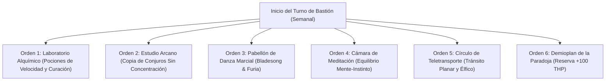

# 🏰 Bastión y Tiempo Muerto — Furious Paradox: The Raging Bladesinger

## 🏰 Sistema de Bastiones (Reglas Oficiales DMG 2024 / 5.5e)

* **Nombre del Bastión:** El Bastión de la Paradoja (*The Paradox Bastion*)
* **Ubicación:** Una aguja élfica de cristal suspendida sobre un cañón glacial azotado por vientos salvajes, uniendo la civilización arcana y la taiga indómita.
* **Nivel de Bastión (Bastion Level):** Nivel 20
* **Puntos de Bastión (Bastion Points - BP):** 520 BP acumulados
* **Bonificador de Defensa de Bastión:** **+11** ($5_{\text{INT}} + 6_{\text{PB}}$)

---

### 🏛️ Instalaciones Básicas (Basic Facilities)

1. **Aposentos de Cristal y Pieles (Bedchambers):** Habitación dividida en dos ambientes: una biblioteca élfica iluminada por orbes arcanos y un lecho rústico de pieles de oso.
2. **Refectorio de la Paradoja (Dining Hall):** Mesa comunal donde conviven magos eruditos de alta cuna y cazadores berserker tribales.
3. **Sala Común de Trofeos y Tratados (Common Room):** Salón con cráneos de monstruos abatidos y estanterías de tratados de magia primordial.
4. **Almacén de Reactivos y Acero (Storage):** Reserva de pergaminos finos, viales de tinta mágica y lingotes de acero élfico.

---

### 🔮 Instalaciones Especiales (Special Facilities — 6 Slots Nivel 20: 4 Roomy + 2 Vast)

1. **Laboratorio Alquímico (Laboratory — Roomy, Nivel 5):**
   * *Orden de Bastión:* **Craft.**
   * *Efecto Mecánico:* Elaboración acelerada de *Potions of Speed*, *Potions of Supreme Healing* y elixires de resistencia física a mitad de coste.
2. **Estudio Arcano y Scriptorium (Arcane Study — Roomy, Nivel 5):**
   * *Orden de Bastión:* **Research / Craft.**
   * *Efecto Mecánico:* Permite transcribir conjuros al libro de magia a 25 po por nivel (en lugar de 50 po) y fabricar pergaminos de conjuros sin concentración (*Fire Shield*, *Mirror Image*, *Longstrider*).
3. **Pabellón de Danza Marcial y Furia (Training Grounds — Roomy, Nivel 9):**
   * *Orden de Bastión:* **Train.**
   * *Efecto Mecánico:* Concede Inspiración Heroica permanente al Bladesinger al salir del bastión y entrena a los guardias en técnicas de esquiva acrobática.
4. **Cámara de Meditación Trascendental (Meditation Chamber — Roomy, Nivel 9):**
   * *Orden de Bastión:* **Empower.**
   * *Efecto Mecánico:* Sincroniza la furia salvaje con la fría lógica arcana. Otorga un talismán que concede Ventaja en salvaciones de Inteligencia y Constitución durante 7 días.
5. **Círculo de Teletransporte Permanente (Vast — Nivel 13):**
   * *Orden de Bastión:* **Maintain.**
   * *Efecto Mecánico:* Enlace planar que conecta la aguja glacial con las cortes élficas de Evermeet y los enclaves tribales del norte.
6. **Demioplano de la Paradoja / Sanctum Atemporal (Vast — Nivel 17):**
   * *Orden de Bastión:* **Empower.**
   * *Efecto Mecánico:* Tras completar un descanso largo en el demioplano, el personaje absorbe un campo de distorsión entrópica que le otorga **+100 Puntos de Golpe Temporales** y resistencia al daño de Fuerza y Psíquico.

---

## ⏳ Actividades de Tiempo Muerto (Downtime Activities)

### Prioridad 1: Búsqueda y Transcripción de Conjuros Raros

* **Mecánica Base:** DMG 2024 / Xanathar's Guide to Everything.
* **Tiradas y Recursos:** Inteligencia (+5 con herramientas de calígrafo).
* **Objetivo de Optimización:** Localizar pergaminos arcanos de alto nivel (*Mind Blank*, *Foresight*, *Crown of Stars*, *Simulacrum*) e integrarlos al grimorio principal.

### Prioridad 2: Destilación de Pociones de Combate

* Elaboración de *Potions of Speed* (Aceleración) para combates donde no se desee gastar ranuras altas.

---

## 🏃‍♂️ Modos de Movimiento, Logística y Viaje

### Velocidades de Movimiento Base

* **Caminar (Walk):** **40 ft/turno** (30 ft Base + 10 ft *Fast Movement* de Bárbaro; **50 ft/turno** durante *Bladesong* y **60 ft** con *Longstrider*).
* **Trepar (Climb):** 40 ft/turno.
* **Nadar (Swim):** 40 ft/turno.
* **Volar (Fly):** 60 ft/turno mediante el conjuro *Fly*.

### Modificadores y Sentidos de Exploración

* **Visión en la Oscuridad:** 60 ft (Linaje Élfico).
* **Percepción Pasiva:** 15 (10 - 1 WIS + 6 PB con competencia élfica).
* **Trance Élfico:** Descanso largo completado en 4 horas de meditación sin dormir. Inmune al sueño mágico.
