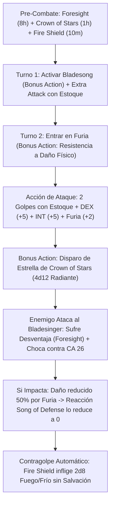

# Resumen General del Personaje: Furious Paradox (The Raging Bladesinger)

## Datos Generales

* **System Standard:** D&D 5th Edition (2014 Ruleset / 2024 Compatible)
* **Character Level:** 20 (Total)
* **Class Split:** Wizard (Bladesinger) 18 / Barbarian 2
* **Species:** High Elf / Elfo (Dote de Nivel 1: *War Caster*)
* **Stats (Point Buy + Racial + ASIs):**
  * **FUER (STR):** 13 (+1) *(Requisito de Multiclaseo de Bárbaro)*
  * **DES (DEX):** 20 (+5) *(15 Base + 1 Racial + 2 ASI Nivel 12 + 2 ASI Nivel 18)*
  * **CON:** 14 (+2) *(Fijada en 19 [+4] con Amulet of Health)*
  * **INT:** 20 (+5) *(15 Base + 2 Racial + 1 Fey Touched + 2 ASI Nivel 6)*
  * **SAB (WIS):** 9 (-1)
  * **CAR (CHA):** 8 (-1)

* **Enlaces de Documentación:**
  * [Bastión y Tiempo Muerto](file:///d:/repo-vault/Proyectos/Rol/DnDbuilds/builds/furious%20paradox/bastion%20and%20downtime.md)
  * [Lista de Conjuros y Recursos](file:///d:/repo-vault/Proyectos/Rol/DnDbuilds/builds/furious%20paradox/spell%20list.md)
  * [Objetos a Obtener](file:///d:/repo-vault/Proyectos/Rol/DnDbuilds/builds/furious%20paradox/item%20list%20to%20obtain.md)
  * [Hoja de Ruta 1-20](file:///d:/repo-vault/Proyectos/Rol/DnDbuilds/builds/furious%20paradox/roadmap.md)
  * [Inventario Actual](file:///d:/repo-vault/Proyectos/Rol/DnDbuilds/builds/furious%20paradox/actual%20inventory%20list.md)

---

## Combat Role: Frontline Thorns Tank / Raging Gish Inmortal / Spell-Shield Engine

El **Furious Paradox** fusiona dos conceptos tradicionalmente irreconciliables: la finura arcana del Mago Bladesinger con la ferocidad salvaje del Bárbaro. Su genialidad mecánica radica en que los rasgos cumbre del Bladesinger (**Bladesong**, **Song of Defense** y **Song of Victory**) son **habilidades de clase y no conjuros**, lo que permite ejecutarlos con total libertad bajo los efectos de la Furia (*Rage*). El personaje apila una CA pasiva de 24 a 26 sin armadura, reduce todo el daño físico a la mitad por Furia, y utiliza su inmensa reserva de espacios de conjuro de nivel 1 a 9 como "combustible" para **Song of Defense**, absorbiendo cualquier daño residual a cero mientras castiga a los agresores con el daño reflejado automático de *Fire Shield*.

---

## 1. Gestión de Recursos y Reglas de Inventario

* **Defensa sin Armadura Tri-Atributo:** La *Unarmored Defense* del Bárbaro fija la CA en $10 + \text{DEX} + \text{CON}$. Al no vestir armadura ni empuñar escudo, califica perfectamente para activar **Bladesong**, que suma tu modificador de **Inteligencia (+5)** a la CA. Con *Amulet of Health* (CON 19), la CA pasiva alcanza **24 CA base** (y **26 CA** con *Bracers of Defense*).
* **Economía de Ranuras como Escudo de Absorción (Song of Defense):** Como Mago de 18.º nivel, dispones de ranuras de hasta 9.º nivel. Cuando un ataque supera tu CA masiva y tus copias de *Mirror Image*, utilizas tu Reacción para activar *Song of Defense*: quemas una ranura de conjuro para restar $5 \times \text{nivel de ranura}$ al daño entrante. Debido a que la Furia reduce primero el daño a la mitad, una ranura de 4.º o 5.º nivel anula por completo impactos titánicos de 40 a 50 de daño.
* **Pre-Buffs Sin Concentración:**
  1. *Foresight* (Nivel 9: 8 horas, sin concentración — otorga Ventaja a tus tiradas y Desventaja a los atacantes).
  2. *Crown of Stars* (Nivel 7: 1 hora, sin concentración — otorga un ataque de $4\text{d}12$ radiante en Acción Adicional utilizable en Furia).
  3. *Fire Shield* (Nivel 4: 10 minutos, sin concentración — devuelve $2\text{d}8$ de fuego/frío por cada golpe recibido).
  4. *Mirror Image* (Nivel 2: 1 minuto, sin concentración — 3 duplicados que interceptan impactos).

---

## 2. Action Economy & Combat Loop

* **Pre-Combate (Turno 0):** Activar *Foresight*, *Crown of Stars*, *Fire Shield* y *Mirror Image*.
* **Turno 1 — Danza de Hojas:**
  * **Bonus Action:** Activar *Bladesong* (+5 a CA, +10 ft de velocidad, ventaja en Acrobacias).
  * **Action:** Extra Attack con Estoque mágico (+13 al ataque con Ventaja permanente).
* **Turno 2+ — Despliegue de Furia Paradojal:**
  * **Bonus Action:** Entrar en Furia de Bárbaro (resistencia a daño cortante, perforante y contundente).
  * **Action:** 2 Ataques con Estoque usando Destreza. Añade *Song of Victory* (+5 INT) y bonificador de Furia (+2) a cada impacto.
  * **Bonus Action (Turnos siguientes):** Disparar una estrella de *Crown of Stars* ($4\text{d}12$ radiante a 120 ft) sin concentración.
  * **Reaction:** *Song of Defense* (reduce el daño recibido en $5 \times \text{ranura gastada}$).

---

## 3. Mathematical Engine (D&D 5e / 2014 & 2024 Compatible)

### 🛡️ Clase de Armadura y Mitigación Absoluta

$$\text{CA Pasiva en Bladesong} = 10 + 5_{\text{DEX}} + 4_{\text{CON (Amulet)}} + 5_{\text{INT (Bladesong)}} + 2_{\text{Bracers of Defense}} = \mathbf{26 \text{ CA Pasiva}}$$

Con *Foresight* activo, cualquier enemigo realiza sus tiradas de ataque con **Desventaja permanente**:

$$\text{Probabilidad de Impacto Enemigo (CR 20 Boss con +14 al Ataque)} = P(\text{Tirada } \ge 12) = 0.45 \implies \text{Con Desventaja} = (0.45)^2 = \mathbf{0.2025 \quad (20.25\%)}$$

* **Matemática del Escudo de Absorción (Impacto de 40 de Daño Físico):**
  1. La Furia del Bárbaro reduce el daño a la mitad: $40 / 2 = 20\text{ de daño}$.
  2. Activas Reacción *Song of Defense* quemando una ranura de 4.º nivel: $20 - (4 \times 5) = 20 - 20 = \mathbf{0 \text{ Daño Sufrido}}$.
  3. El atacante recibe $2\text{d}8$ de daño de fuego ($9.0$ de media) de *Fire Shield* automáticamente.

### 🧮 Daño por Asalto Sostenido (DPR a Nivel 20)

Con Destreza 20 (+5), *Estoque +3*, *Song of Victory* (+5 INT), y bonificador de Furia (+2):

$$\text{Daño por Impacto con Estoque} = 1\text{d}8 + 5_{\text{DEX}} + 5_{\text{INT}} + 2_{\text{Rage}} + 3_{\text{Item}} = 4.5 + 15 = \mathbf{19.5 \text{ Daño por Golpe}}$$

$$\text{DPR Golpes con Ventaja (2 Ataques)} = 2 \times [0.9375 \times 19.5 + 0.0975 \times 4.5] = 2 \times [18.28 + 0.44] = \mathbf{37.44 \text{ DPR}}$$

$$\text{Ataque de Crown of Stars (Acción Adicional en Furia)} = 0.9375 \times 4\text{d}12 (26.0) + 0.0975 \times 26.0 = 24.375 + 2.535 = \mathbf{26.91 \text{ DPR}}$$

$$\text{DPR Total Sostenido} = 37.44 + 26.91 = \mathbf{64.35 \text{ DPR}} + 20\text{ Daño de Espinas Pasivo}$$

### 🩸 Supervivencia y EHP

$$\text{EHP Físico} = \frac{\text{HP Real } (164) + \text{Sanctum Ward } (100) + \text{Song of Defense Pool } (\sim 150)}{1 - 0.50} = \frac{414}{0.50} = \mathbf{828 \text{ EHP Efectivo}}$$

---

## 4. Tabla de Rendimiento Táctico

| Criterio | Valoración | Justificación Mecánica |
| :--- | :---: | :--- |
| **Daño Monobjetivo** | 🟢 | 64+ DPR continuo sumando estoque con DEX+INT+Furia y proyectiles de *Crown of Stars* en Acción Adicional. |
| **Control de Masas (CC)** | 🟢 | Acceso al repertorio completo de Mago de nivel 9 antes de enfurecerse (*Forcecage*, *Mass Suggestion*, *Maze*). |
| **Supervivencia (EHP)** | 🔵 | CA 26 pasiva con Desventaja enemiga permanente (*Foresight*), daño físico reducido al 50%, y *Song of Defense* que anula el remanente a 0. Más de 800 EHP efectivo. |
| **Economía de Acciones** | 🔵 | *Bladesong* en Turno 1, Furia en Turno 2, disparos de *Crown of Stars* en Acción Adicional constante, y *Song of Defense* en Reacción. |
| **Sustentabilidad** | 🔵 | 22 espacios de conjuro para alimentar *Song of Defense*, recuperación arcana (*Arcane Recovery*) en descanso corto, y 2 Furias por descanso largo. |

---

## 5. Home Rules (Reglas de la Mesa)

1. **Foco Universal Único:** El estoque de combate actúa como foco unificado para todos los conjuros arcanos de Mago.
2. **Habilidades No-Mágicas en Furia:** Se confirma el funcionamiento de *Bladesong*, *Song of Defense* y *Song of Victory* durante la Furia de Bárbaro al ser habilidades de clase y no lanzamientos mágicos.
