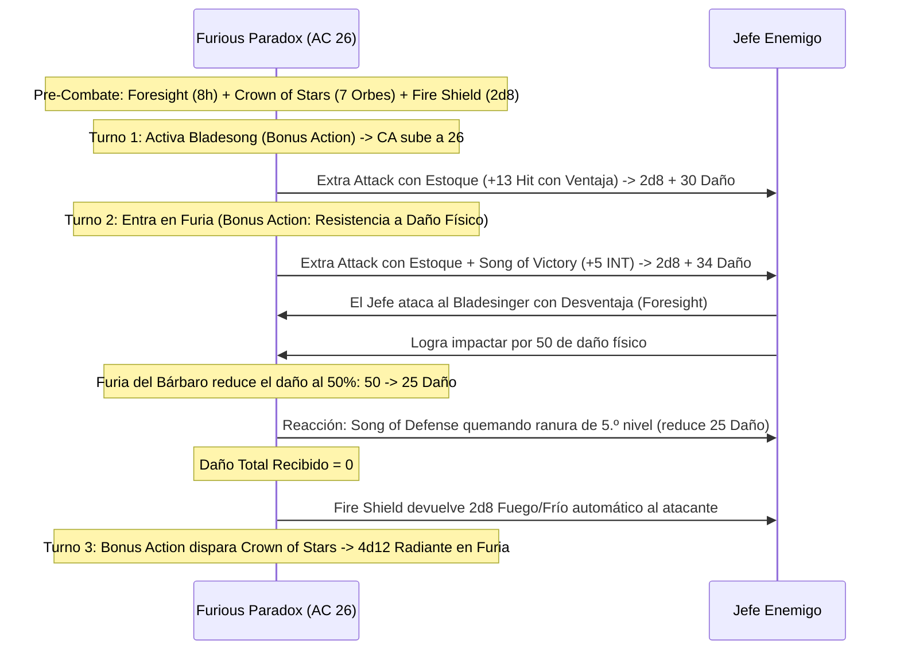

# 🌟 Lista de Conjuros y Recursos — Furious Paradox: The Raging Bladesinger

Esta lista detalla la selección de conjuros y recursos para el **Furious Paradox** (Wizard Bladesinger 18 / Barbarian 2), optimizada bajo reglas de D&D 5e (2014 & 2024).

> **Aviso Táctico Fundamental:** No puedes lanzar conjuros ni mantener concentración durante la Furia (*Rage*). Por ello, tu repertorio se divide en:
> 1. Conjuros de preparación de larga duración **sin concentración** activados antes del combate (*Foresight*, *Crown of Stars*, *Fire Shield*, *Mirror Image*).
> 2. Reserva masiva de ranuras arcanas utilizadas como "combustible" para **Song of Defense** (reacción no mágica que reduce daño consumiendo slots).

---

## ⚡ Conjuros Activos y Pre-Buffs (Turno 0 / Fuera de Combate)

| Conjuro / Recurso | Duración | Concentración | Efecto Táctico Clave |
| :--- | :---: | :---: | :--- |
| **Foresight (Nivel 9)** | 8 horas | No | **Ventaja en todos tus ataques, salvaciones y pruebas**; **Desventaja a todos los ataques enemigos**. Activo 100% en Furia. |
| **Mind Blank (Nivel 8)** | 24 horas | No | Inmunidad absoluta a daño psíquico, lecturas mentales y hechizos de adivinación. |
| **Crown of Stars (Nivel 7)** | 1 hora | No | Crea 7 orbes estelares. Puedes disparar 1 orbe como **Acción Adicional** infligiendo **4d12 de daño radiante** utilizable durante la Furia. |
| **Fire Shield (Nivel 4)** | 10 minutos | No | Resistencia a daño de frío o fuego y devuelve $+2\text{d}8$ de daño de espinas a quien te golpee cuerpo a cuerpo. |
| **Mirror Image (Nivel 2)** | 1 minuto | No | 3 duplicados ilusorios que absorben ataques enemigos sin requerir concentración. |
| **Longstrider (Nivel 1)** | 1 hora | No | +10 ft a todas las velocidades de movimiento (alcanza 60 ft con Bladesong). |
| **Sanctum Ward (Bastión)** | 24 horas | No | Reserva de **+100 Puntos de Golpe Temporales** obtenida en el Demioplano de la Paradoja. |

---

## 🔮 Trucos (Cantrips — Mago)

1. **Booming Blade 🔵 [Roto - Melé Pre-Furia]:** Ataque cuerpo a cuerpo con estoque que añade $3\text{d}8$ de daño de trueno si el objetivo se mueve. Usar en combates donde no se active Furia.
2. **Green-Flame Blade 🟢 [Daño Secundario]:** Golpea a un enemigo y salta fuego ($3\text{d}8 + 5$) a un segundo objetivo adyacente.
3. **Fire Bolt 🟢 [Daño a Distancia]:** $4\text{d}10$ de fuego a 120 ft usando Inteligencia.
4. **Minor Illusion 🟢 [Utilidad]:** Distracciones acústicas o visuales tácticas.
5. **Mage Hand 🟡 [Utilidad]:** Manipulación de objetos a 30 ft.

---

## 🎒 Conjuros Preparados de Mago (18.º Nivel — 23 Conjuros Preparados)

*CD de Salvación de Conjuros:* $8 + 6_{\text{PB}} + 5_{\text{INT}} = \mathbf{19}$. Modificador de Ataque de Conjuro: $\mathbf{+11}$.

### 9.º Nivel (1 Ranura)

1. **Foresight 🔵 [Dios del Combate]:** 8 horas sin concentración. Confiere omnisciencia táctica propia y ceguera al enemigo.
2. **Wish 🔵 [Utilidad Absoluta]:** Permite duplicar cualquier conjuro de nivel 1 a 8 de cualquier clase sin componentes.

### 8.º Nivel (1 Ranura)

3. **Mind Blank 🟢 [Inmunidad Mental]:** 24 horas de inmunidad psíquica sin concentración.
4. **Maze 🔵 [Control de Jefes]:** Destierra a un enemigo a un laberinto extradimensional sin tirada de salvación inicial (usar fuera de Furia).

### 7.º Nivel (2 Ranuras)

5. **Crown of Stars 🔵 [Batería Ofensiva]:** 7 disparos de $4\text{d}12$ radiante en Acción Adicional utilizables bajo Furia.
6. **Forcecage 🔵 [Encierro Absoluto]:** Celda indestructible sin tirada de salvación por 1 hora.
7. **Simulacrum 🔵 [Duplicado Perfecto]:** Crea una copia idéntica del Bladesinger con todas sus ranuras y habilidades.

### 6.º Nivel (1 Ranura)

8. **Mass Suggestion 🔵 [Control Masivo]:** Sugestión a 12 criaturas durante 24 horas sin concentración.
9. **Disintegrate 🟢 [Daño Nuclear]:** $10\text{d}6 + 40$ de daño de fuerza.

### 5.º Nivel (2 Ranuras)

10. **Synaptic Static 🔵 [Detonación sin Concentración]:** $8\text{d}6$ psíquico en 20 ft y debuff de -1d6 a ataques y salvaciones enemigas.
11. **Wall of Force 🔵 [Muro Indestructible]:** Bloqueo táctico impenetrable.

### 4.º Nivel (3 Ranuras)

12. **Fire Shield 🔵 [Espinas sin Concentración]:** $2\text{d}8$ de daño a atacantes en melé.
13. **Dimension Door 🟢 [Movilidad]:** Teletransporte de 500 pies para ti y un aliado.
14. **Greater Invisibility 🟢 [Ofensivo / Defensivo]:** Desventaja enemiga e inmunidad a conjuros con línea de visión.

### 3.ᵉʳ Nivel (3 Ranuras)

15. **Counterspell 🔵 [Reacción Arcana]:** Anula conjuros enemigos antes de enfurecerse.
16. **Dispel Magic 🟢 [Utilidad]:** Cancela efectos mágicos activos.
17. **Fly 🟡 [Movilidad]:** Vuelo táctico para persecución.

### 2.º Nivel (3 Ranuras)

18. **Mirror Image 🔵 [Defensa Ilusoria]:** 3 duplicados sin concentración que absorben impactos.
19. **Misty Step 🟢 [Movilidad]:** Teletransporte de 30 ft como Acción Adicional.
20. **Vortex Warp 🟢 [Reposicionamiento]:** Reubica aliados o enemigos a 90 ft.

### 1.ᵉʳ Nivel (4 Ranuras)

21. **Longstrider 🟢 [Velocidad Pasiva]:** +10 ft de movimiento sin concentración.
22. **Absorb Elements 🔵 [Defensa Elemental]:** Reacción ante daño elemental antes de la Furia.
23. **Shield 🔵 [Reacción de CA]:** +5 a la CA alcanzando **CA 31** (utilizable en Turno 1 antes de enfurecerse).

---

## 💥 Secuencia Táctica de la Danza de la Furia (The Paradox Loop)

---

## 💚 Curación en Segundo Plano y Sostenibilidad

* **Combustible Inagotable para Song of Defense:** Con 22 espacios de conjuro disponibles y *Arcane Recovery* (que recupera hasta 9 niveles de ranuras en descanso corto), el Bladesinger puede anular impactos durante decenas de asaltos.
* **Pociones en Acción Adicional:** Consumo rápido de *Potion of Supreme Healing* ($10\text{d}4 + 20 \approx 45\text{ PG}$) bajo reglas oficiales 2024.
* **Trance Élfico:** Recupera la totalidad de sus recursos en solo 4 horas de meditación.
