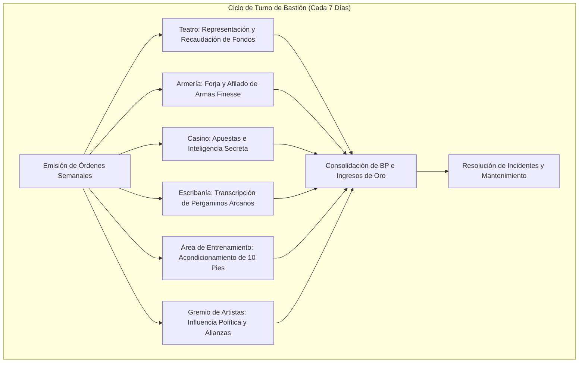

# 🏰 Bastión y Tiempo Muerto — Furry Fury

## 🏰 Sistema de Bastiones (Reglas Oficiales DMG 2024 / D&D 5.5e)

*Estructura de gestión de la base de operaciones, economía de bastión y mecánicas de mando.*

* **Nombre del Bastión:** La Taberna de la Garra (The Claw Tavern & Spire)
* **Nivel de Bastión (Bastion Level):** 20
* **Puntos de Bastión (Bastion Points - BP):** 120
* **Puntuación de Mando (Bastion Defender Stats):** +11 al ataque y salvaciones defensivas (STR 8 [-1], DEX 20 [+5], CON 16 [+3], INT 8 [-1], WIS 10 [+0], CHA 18 [+4]).

---

### Instalaciones Básicas (Basic Facilities)

1. **Dormitorio Principal (Bedchambers):** Gran estancia decorada con pieles de osos polares, astas de monstruos y un perchero blindado para estoques y laúdes de concierto.
2. **Gran Salón y Asador (Dining Hall):** Salón rústico con tres grandes chimeneas de piedra volcánica donde se sirven banquetes diarios de jabalí y cerveza enana.
3. **Sala Común de Juglares (Common Area):** Espacio central con mesas redondas donde bardos locales, mercenarios y acróbatas intercambian historias y melodías.

---

### Instalaciones Especiales (Special Facilities — Exactamente 6: 4 Roomy + 2 Vast)

#### 1. Teatro y Salón de Espectáculos (Theater — Roomy, Desbloqueo Nivel 5)
* **Estado:** Activo (Mantener)
* **Tamaño:** Roomy (Espaciosa)
* **Orden de Bastión:** *Perform (Actuar e Inspirar)*
* **Sinergia con el Build:** 🔵 **Indispensable**. Centro neurálgico del Bardo de Valor. Atrae a aristócratas y aventureros acaudalados, generando un ingreso neto semanal de $1\text{d}10 \times 20$ po y otorgando inspiración previa a las incursiones.

#### 2. Armería de Precisión (Armory — Roomy, Desbloqueo Nivel 5)
* **Estado:** Activo (Mantener)
* **Tamaño:** Roomy (Espaciosa)
* **Orden de Bastión:** *Equip (Equipar a la Guardia)*
* **Sinergia con el Build:** 🟢 **Excelente**. Asegura el mantenimiento perfecto de estoques, cimitarras y armaduras medias de la guarnición de bugbears. Eleva la defensa del bastión en +4 contra intrusiones.

#### 3. Casino y Salón de Apuestas (Gaming Hall — Roomy, Desbloqueo Nivel 9)
* **Estado:** Activo (Mantener)
* **Tamaño:** Roomy (Espaciosa)
* **Orden de Bastión:** *Gamble & Gather Intel (Juego e Inteligencia)*
* **Sinergia con el Build:** 🟢 **Excelente**. Recopila rumores críticos sobre criptas y santuarios arcanos de labios de viajeros ebrios, reportando datos estratégicos para expediciones.

#### 4. Escribanía de Canciones y Pergaminos (Scriptorium — Roomy, Desbloqueo Nivel 9)
* **Estado:** Activo (Mantener)
* **Tamaño:** Roomy (Espaciosa)
* **Orden de Bastión:** *Scribe (Transcribir Magia)*
* **Sinergia con el Build:** 🔵 **Indispensable**. Permite transcribir pergaminos de conjuros de Bardo (*Counterspell*, *Dimension Door*, *Greater Restoration*) a mitad de coste y tiempo.

#### 5. Área de Entrenamiento Marcial Avanzado (Training Area — Vast, Desbloqueo Nivel 13)
* **Estado:** Activo (Mantener)
* **Tamaño:** Vast (Vasta)
* **Orden de Bastión:** *Train (Entrenar Coordinación Híbrida)*
* **Sinergia con el Build:** 🟢 **Excelente**. Patio de armas con maniquíes móviles a 10 pies. Otorga al personaje +1d4 a la iniciativa durante las primeras 24 horas tras abandonar el bastión.

#### 6. Gremio de Espectáculos y Artistas (Guildhall — Vast, Desbloqueo Nivel 17)
* **Estado:** Activo (Mantener)
* **Tamaño:** Vast (Vasta)
* **Orden de Bastión:** *Trade & Influence (Influencia Internacional)*
* **Sinergia con el Build:** 🔵 **Indispensable**. Sindicato que agrupa compañías teatrales y juglares en todo el reino. Permite despachar delegaciones diplomáticas y movilizar una guardia de 20 veteranos con un bono marcial de mando de +11.

---

### Seguidores y Guarnición (Staff & Garrison)

* **Capataz General (Major Domo):** Krog el Viejo (Semiorco veterano de guerra, tabernero implacable y administrador financiero).
* **Guarnición Activa:**
  * 12 Guardaespaldas Bugbears armados con cimitarras y manguales.
  * 6 Juglares espías entrenados en disfraces e infiltración.
  * 2 Maestros copistas y lauderos encargados de la escribanía y reparación de instrumentos.

---

## ⏳ Actividades de Tiempo Muerto (Downtime Activities)

### Prioridad 1: Actuaciones y Relaciones Diplomáticas (Carousing)
* **Mecánica Oficial:** Xanathar's Guide to Everything / DMG 2024 (Carousing).
* **Bonificadores Aplicables:** Carisma (+4), Persuasión (+10), Actuación (+10) y pericia musical.
* **Objetivo:** Ganar favores con gremios mercantiles y autoridades locales para asegurar patrocinio y libre tránsito.

### Prioridad 2: Fabricación de Pergaminos Arcanos
* **Mecánica Oficial:** DMG 2024 (Crafting Spell Scrolls).
* **Objetivo:** Almacenar pergaminos de *Counterspell* y *Dimension Door* en el Scriptorium para emergencias en combate.

---

## 🏃‍♂️ Modos de Movimiento, Logística y Viaje

* **Caminar (Walk):** 30 ft.
* **Iniciativa en Viaje:** +10 (+5 DES + 5 Dote Alert + Medio PB Jack of All Trades).
* **Alcance de Combate:** 10 pies constante en ataques cuerpo a cuerpo (*Long-Limbed*).
* **Visión en la Oscuridad:** 60 ft. nativa del Bugbear.
* **Sigilo en Movimiento:** Capaz de ocultarse en espacios diseñados para criaturas de tamaño Pequeño gracias al rasgo *Sneaky*.

---

## 🎭 Reputación y Facciones

1. **La Cofradía del Canto de Guerra:** Alto Maestre de los Bardos de Valor. Capacidad de convocar bardos aliados en cualquier ciudadela aliada.
2. **El Cónclave de las Garras:** Alianza de clanes Bugbear y trasgos independientes que reconocen la autoridad del personaje.