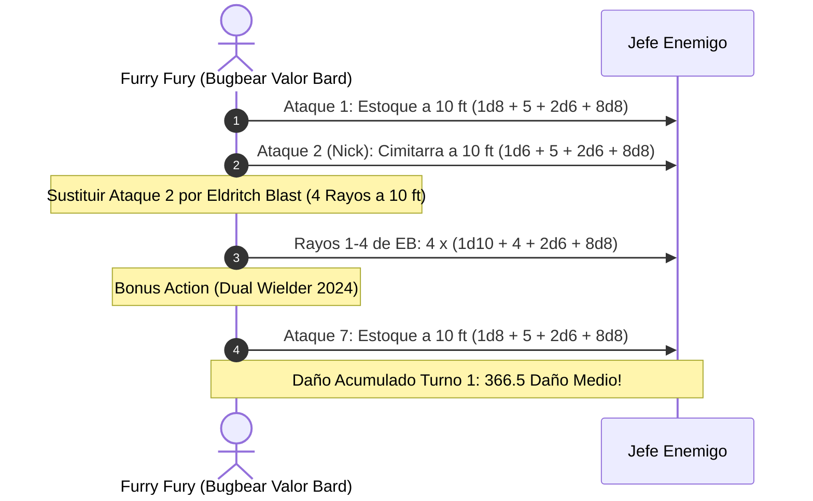

# Guía de Personaje — Furry Fury (Edición 2024 / 5.5e Update)

## Datos Generales

* **System Standard:** D&D 5th Edition (2024 Ruleset - 5.5e Compatible)
* **Character Level:** 20 (Total)
* **Class Split:** Bard (College of Valor) 19 / Warlock 1
* **Species:** Bugbear (2024 / MPMOT — Long-Limbed 10 ft reach, Surprise Attack +2d6 por impacto en Turno 1)
* **Background:** Entertainer / Guide (Dote de Origen: *Alert 2024* — +5 Iniciativa e intercambio con aliados)
* **Stats (Point Buy 2024 / Background):**
  * **FUER (STR):** 8 (-1)
  * **DES (DEX):** 20 (+5) *(15 Base + 2 Trasfondo + 2 ASI Nivel 5 + 1 ASI Nivel 9)*
  * **CON:** 16 (+3) *(14 Base + 2 ASI Nivel 20 o Amulet of Health 19)*
  * **INT:** 8 (-1)
  * **SAB (WIS):** 10 (+0)
  * **CAR (CHA):** 18 (+4) *(15 Base + 1 Trasfondo + 1 ASI Nivel 9 + 1 Dote)*

* **Enlaces de Documentación:**
  * [Bastión y Tiempo Muerto](file:///d:/repo-vault/Proyectos/Rol/DnDbuilds/builds/furry%20fury/bastion%20and%20downtime.md)
  * [Lista de Conjuros y Recursos](file:///d:/repo-vault/Proyectos/Rol/DnDbuilds/builds/furry%20fury/spell%20list.md)
  * [Objetos a Obtener](file:///d:/repo-vault/Proyectos/Rol/DnDbuilds/builds/furry%20fury/item%20list%20to%20obtain.md)
  * [Hoja de Ruta 1-20](file:///d:/repo-vault/Proyectos/Rol/DnDbuilds/builds/furry%20fury/roadmap.md)
  * [Inventario Actual](file:///d:/repo-vault/Proyectos/Rol/DnDbuilds/builds/furry%20fury/actual%20inventory%20list.md)

---

## Combat Role: 10-Foot Kinetic Machine Gun, CME Exploiter & Burst Gish

Bajo el marco de reglas oficial de 2024 (5.5e):
1. **Extra Attack Híbrido (Valor Bard 2024):** Permite sustituir un ataque de la acción de ataque por un cantrip de acción completa como *Eldritch Blast* (4 rayos).
2. **Maestría Nick (Cimitarra 2024):** El ataque con el arma secundaria se realiza como parte de la acción de ataque principal sin consumir la Acción Adicional.
3. **Long-Limbed Bugbear:** Otorga un alcance de 10 pies en ataques cuerpo a cuerpo. Posicionándose a 10 pies, el personaje realiza sus ataques con estoque y cimitarra y dispara *Eldritch Blast* sin estar adyacente (5 pies) al objetivo, **evitando la desventaja por melé**.
4. **Conjure Minor Elementals (CME 2024):** Añade daño elemental escalado a todos y cada uno de los ataques exitosos.

---

## 1. Gestión de Recursos y Reglas de Inventario (Reglas 2024)

* **Maestría de Armas (Weapon Masteries 2024):**
  * **Scimitar (Nick):** Libera la Acción Adicional para dotes como *Dual Wielder 2024* o *Battle Magic*.
  * **Rapier (Vex):** Concede ventaja automáticamente en el siguiente ataque tras un impacto.
* **Economía de Ranuras 2024:**
  * Ranuras completas de nivel 1 a 9 de lanzador para potenciar *Conjure Minor Elementals* a nivel 7 (+8d8) u 8 (+10d8).

---

## 2. Action Economy & Combat Loop (2024)

* **Preparación (Pre-Combate):**
  * Activar *Foresight* (Mystic Arcanum 9, 8 horas sin concentración) y *Conjure Minor Elementals* (Nivel 7+, concentración).
* **Action:**
  * **Acción de Ataque:**
    * Ataque 1: Estoque a 10 pies (+11 hit).
    * Ataque 2 (Nick): Cimitarra a 10 pies como parte de la acción (+11 hit).
    * Ataque 3 (Cantrip Sustituido): *Eldritch Blast* (4 rayos de fuerza independientes a 10 pies sin desventaja).
* **Bonus Action:**
  * Ataque 7 con *Dual Wielder (2024)* o *Battle Magic* a 10 pies.
* **Reaction:**
  * *Shield* (+5 CA) o *Counterspell*.

---

## 3. The META Combo 2024: 10-Foot CME Machine Gun (7 Ataques)

### 🧮 Motor Matemático (2024 Ruleset)

$$\text{Daño Base por Impacto} \approx 52.5 \text{ daño}$$

$$\text{DPR Nova Turno 1 (7 Impactos con CME Nivel 7 y Surprise)} = \mathbf{366.5 \text{ daño medio}}$$

$$\text{P(Impactar con Ventaja de Foresight)} \approx 0.90 \implies \mathbf{330.0 \text{ DPR Efectivo Real}}$$