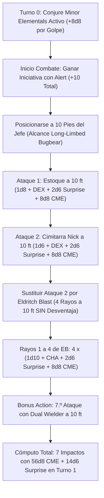

# Guía de Personaje — Furry Fury (The 10-Foot Nova Blaster)

## Datos Generales

* **System Standard:** D&D 5th Edition (2024 / 5.5e Update & 2014 Compatibility)
* **Character Level:** 20 (Bard [College of Valor] 19 / Warlock 1)
* **Species:** Bugbear (Extremidades Largas: alcance cuerpo a cuerpo de 10 pies; Ataque Sorpresa: +2d6 por impacto en el Turno 1)
* **Background:** Entertainer / Guide (Dote de Origen: *Alert* — +5 a la iniciativa e intercambio de orden con aliados)
* **Stats (Point Buy + Racial + ASIs):**
  * **FUER (STR):** 8 (-1) *(Standard Array)*
  * **DES (DEX):** 20 (+5) *(15 Base + 2 Racial + 2 ASI Nivel 5 + 1 ASI Nivel 9)*
  * **CON:** 16 (+3) *(14 Base + 2 ASI Nivel 20 o Amulet of Health 19)*
  * **INT:** 8 (-1) *(Standard Array)*
  * **SAB (WIS):** 10 (+0) *(Standard Array)*
  * **CAR (CHA):** 18 (+4) *(15 Base + 1 Racial + 1 ASI Nivel 9 + 1 Dote Fey Touched/War Caster)*

* **Enlaces de Documentación:**
  * [Bastión y Tiempo Muerto](file:///d:/repo-vault/Proyectos/Rol/DnDbuilds/builds/furry%20fury/bastion%20and%20downtime.md)
  * [Lista de Conjuros y Recursos](file:///d:/repo-vault/Proyectos/Rol/DnDbuilds/builds/furry%20fury/spell%20list.md)
  * [Objetos a Obtener](file:///d:/repo-vault/Proyectos/Rol/DnDbuilds/builds/furry%20fury/item%20list%20to%20obtain.md)
  * [Hoja de Ruta 1-20](file:///d:/repo-vault/Proyectos/Rol/DnDbuilds/builds/furry%20fury/roadmap.md)
  * [Inventario Actual](file:///d:/repo-vault/Proyectos/Rol/DnDbuilds/builds/furry%20fury/actual%20inventory%20list.md)
  * [Guía de Personaje 2024](file:///d:/repo-vault/Proyectos/Rol/DnDbuilds/builds/furry%20fury/character%20guide%202024.md)

---

## Combat Role: Hybrid Nova Striker, 10-Foot Spell-Blade & Kinetic Machine Gun

**Furry Fury** es uno de los arquetipos más letales de D&D 2024 / 5.5e. Explota la anatomía del **Bugbear** (*Long-Limbed*, alcance cuerpo a cuerpo de 10 pies) combinada con el *Extra Attack* del **College of Valor Bard** (que permite sustituir un ataque de arma por un truco de acción completa como *Eldritch Blast*).

Al posicionarse exactamente a 10 pies del objetivo, golpea con sus armas cuerpo a cuerpo a máxima distancia y luego dispara los 4 rayos de *Eldritch Blast* **sin sufrir desventaja por cuerpo a cuerpo**, sumando a cada uno de los 7 impactos del asalto el daño de *Conjure Minor Elementals* (+8d8) y el daño de *Surprise Attack* (+2d6).

---

## 1. Gestión de Recursos y Reglas de Inventario

* **Economía de Manos y Empuñadura Doble con Maestría Nick:**
  * **Mano Principal:** Estoque (*Rapier*, propiedad *Vex* o daño de 1d8 de sutileza).
  * **Mano Secundaria:** Cimitarra (*Scimitar*, propiedad *Nick*). La maestría *Nick* permite realizar el ataque con la mano torpe como parte de la acción de ataque principal en lugar de gastar la Acción Adicional.
  * **Foco Universal Único:** Un broche rúnico en la capa canaliza los componentes somáticos y materiales de Bardo y Warlock sin liberar las armas.
* **Gestión de Ranuras de Nivel 1 a 9:**
  * Como Bardo 19 / Warlock 1, dispone de ranuras completas de nivel 1 a 9.
  * **Conjure Minor Elementals (CME):** El pilar absoluto del build (preparado vía *Magical Secrets* a nivel 10). Escalado a nivel 7 otorga $+8\text{d}8$ de daño elemental adicional a **cada ataque exitoso** durante 10 minutos (concentración).

---

## 2. Action Economy & Combat Loop

* **Preparación (Pre-Combate / Turno 0):**
  * Lanzar **Conjure Minor Elementals** (Espacio de Nivel 7: +8d8 por impacto; o Nivel 8: +10d8). Dura 10 minutos.
  * Posicionamiento a 10 pies del objetivo prioritario gracias a la alta iniciativa de *Alert* (+10 con Jack of All Trades).
* **Action:**
  * **Acción de Ataque (Valor Bard 2024 Híbrido):**
    1. **Ataque 1 (Estoque):** Golpe cuerpo a cuerpo a 10 pies de distancia (+11 a impactar).
    2. **Ataque 2 (Cimitarra vía Nick):** Ataque con la mano secundaria realizado como parte de la misma acción de ataque a 10 pies de distancia.
    3. **Ataque 3 (Cantrip en lugar de Ataque):** Lanzamiento de **Eldritch Blast** (4 rayos de fuerza independientes). Al estar a 10 pies del enemigo, no hay criaturas a 5 pies, por lo que **ningún rayo sufre desventaja**.
    * **Total de Impactos de la Acción:** 6 ataques directos.
* **Bonus Action:**
  * **Ataque Adicional (Dote Dual Wielder 2024 / Battle Magic):** Realiza un 7.º impacto con su estoque o cimitarra a 10 pies de distancia.
  * **Alternativa:** Otorgar *Bardic Inspiration* (d12) a un aliado.
* **Reaction:**
  * 🔵 **Shield (Warlock):** +5 a la CA reactivo (alcanzando CA 23).
  * 🔵 **Counterspell (Magical Secrets):** Interrupción inmediata de conjuros enemigos de alto nivel.
  * 🟢 **Absorb Elements:** Resistencia a daño elemental imprevisto.

---

## 3. The META Combo: La Ametralladora de 10 Pies (Long-Limbed CME Blender)

### 🧮 Motor Matemático (Mathematical Engine)

#### 1. Daño Individual por Impacto en Turno 1 (CME Nivel 7 [+8d8] + Bugbear Surprise [+2d6])

$$\text{Daño Estoque} = 1\text{d}8 + 5 (\text{DEX}) + 2\text{d}6 (\text{Surprise}) + 8\text{d}8 (\text{CME}) = 4.5 + 5 + 7 + 36 = \mathbf{52.5 \text{ daño}}$$

$$\text{Daño Cimitarra (Nick)} = 1\text{d}6 + 5 (\text{DEX}) + 2\text{d}6 (\text{Surprise}) + 8\text{d}8 (\text{CME}) = 3.5 + 5 + 7 + 36 = \mathbf{51.5 \text{ daño}}$$

$$\text{Daño por Rayo de Eldritch Blast} = 1\text{d}10 + 4 (\text{CAR}) + 2\text{d}6 (\text{Surprise}) + 8\text{d}8 (\text{CME}) = 5.5 + 4 + 7 + 36 = \mathbf{52.5 \text{ daño/rayo}}$$

$$\text{Daño Séptimo Ataque (Bonus Action Dual Wielder)} = 1\text{d}8 + 5 (\text{DEX}) + 2\text{d}6 (\text{Surprise}) + 8\text{d}8 (\text{CME}) = \mathbf{52.5 \text{ daño}}$$

#### 2. Cómputo Total del Turno Nova (7 Impactos Exitosos)

$$\text{Daño Acumulado} = 52.5 (\text{Estoque}) + 51.5 (\text{Cimitarra}) + (4 \times 52.5) (\text{EB}) + 52.5 (\text{BA}) = 52.5 + 51.5 + 210.0 + 52.5 = \mathbf{366.5 \text{ daño medio}}$$

*Desglose de dados acumulados en un solo turno:*
$$\text{Dados Totales} = 56\text{d}8 (\text{CME}) + 14\text{d}6 (\text{Surprise}) + 4\text{d}10 (\text{EB}) + 2\text{d}8 + 1\text{d}6 + 36 (\text{Plano}) = 252 + 49 + 22 + 9 + 3.5 + 36 = \mathbf{371.5 \text{ daño bruto}}$$

#### 3. Ajuste por Probabilidad de Impacto contra CA 18

Con bono de ataque de armas $+11$ ($P \approx 0.70$) y bono de conjuro $+10$ ($P \approx 0.65$):
* Con ventaja (familiar búho / sigilo / sorpresa / *Foresight*): $P_{\text{armas}} \approx 0.91$, $P_{\text{EB}} \approx 0.88$.

$$\text{DPR Efectivo Esperado} = (3 \times 0.91 \times 52.2) + (4 \times 0.88 \times 52.5) = 142.5 + 184.8 = \mathbf{327.3 \text{ DPR Efectivo en Turno 1}}$$

---

## 4. Tabla de Clasificación Táctica de Habilidades

| Habilidad / Recurso | Tipo | Coste | Evaluación | Justificación Táctica |
| :--- | :---: | :---: | :---: | :--- |
| **Conjure Minor Elementals** | Ofensiva | Ranura Nivel 7+ | 🔵 | Otorga +8d8 de daño elemental a cada impacto durante 10 minutos. Es el multiplicador nuclear del build. |
| **Extra Attack Híbrido** | Ofensiva | Pasiva Valor Bard | 🔵 | Permite lanzar Eldritch Blast (4 rayos) dentro de la acción de ataque sin gastar acciones adicionales. |
| **Long-Limbed (Bugbear)** | Movilidad/Alcance | Pasiva Racial | 🔵 | Alcance de 10 pies; permite disparar Eldritch Blast a 10 pies sin sufrir desventaja por melé. |
| **Surprise Attack** | Ofensiva | Pasiva Turno 1 | 🔵 | Añade +2d6 a cada impacto contra enemigos que aún no han actuado en el asalto. |
| **Counterspell** | Control | Reacción | 🔵 | Salvaguarda la concentración del personaje y anula la magia del jefe enemigo. |
| **Foresight** | Buff | Ranura Nivel 9 | 🔵 | 8 horas de ventaja en todas las tiradas sin concentración; anula la necesidad de generar ventaja externa. |
| **Combat Inspiration** | Soporte | 1 Inspiración | 🟢 | Permite a los aliados sumar un d12 al daño de sus ataques o a su CA reactivamente. |

---

## 5. Reglas de la Casa (Home Rules)

1. **Disparo a 10 Pies sin Desventaja:** Al atacar a una criatura a 10 pies de distancia mediante el rasgo *Long-Limbed*, no hay enemigos a 5 pies, por lo que *Eldritch Blast* se dispara como ataque a distancia normal sin penalización.
2. **Foco Universal de Bardo/Brujo:** El foco canaliza indistintamente conjuros de ambas clases mientras se empuñan dos armas ligeras.