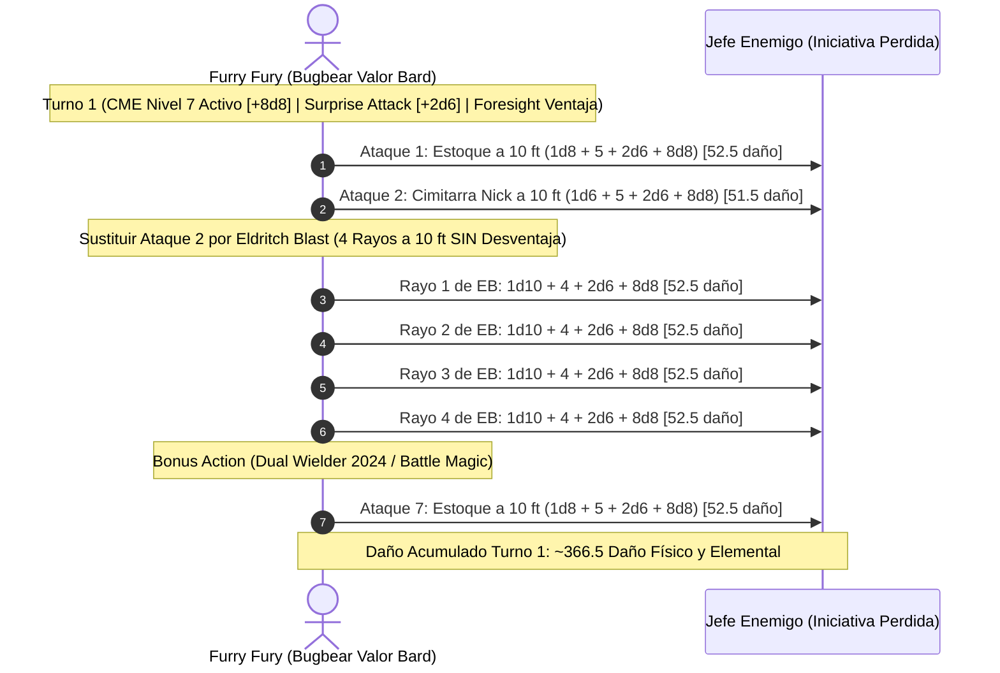

# 🌟 Lista de Conjuros y Recursos Tácticos — Furry Fury

Esta selección de conjuros optimiza al **Bardo del Colegio de Valor (19) / Brujo (1)** bajo el estándar de **D&D 5.5e (2024)**, combinando ranuras de nivel 1 a 9 con el multiplicador nuclear de *Conjure Minor Elementals* (CME) y *Eldritch Blast*.

---

## 🔮 Matriz de Recursos y Salvaciones

* **Ranuras de Bardo:**
  * Nivel 1: 4 espacios | Nivel 2: 3 espacios | Nivel 3: 3 espacios
  * Nivel 4: 3 espacios | Nivel 5: 3 espacios | Nivel 6: 2 espacios
  * Nivel 7: 2 espacios | Nivel 8: 1 espacio | Nivel 9: 1 espacio
* **Ranuras de Brujo:** 1 espacio de Nivel 1 (se recarga en descanso corto).
* **Dados de Inspiración Bárdica:** 5d12 por Descanso Corto (*Combat Inspiration*).
* **CD de Salvación de Conjuros:** $8 + \text{PB (6)} + \text{CAR (4)} = \mathbf{18}$.
* **Turno 0 Pre-Buffs:**
  * Lanzamiento de **Foresight** (Nivel 9, duración 8 horas sin concentración) $\implies$ ventaja universal y desventaja enemiga.
  * Lanzamiento de **Conjure Minor Elementals** (Espacio de Nivel 7 u 8, duración 10 minutos, concentración).

---

## 🪄 Trucos (Cantrips)

| Conjuro | Escuela | Clasificación | Efecto y Justificación Táctica |
| :--- | :---: | :---: | :--- |
| **Eldritch Blast (Warlock)** | Evocación | 🔵 | **El pilar del combo:** 4 rayos de fuerza independientes disparados dentro del *Extra Attack* del Bardo de Valor sin consumir la acción adicional. A 10 pies de distancia, no sufre desventaja. |
| **True Strike (Warlock)** | Adivinación | 🟢 | Alternativa para atacar con Carisma si la Destreza se ve impedida o reducida. |
| **Vicious Mockery (Bard)** | Encantamiento | 🟡 | Inflige $4\text{d}4$ de daño psíquico e impone desventaja en el siguiente ataque hostil. |
| **Minor Illusion (Bard)** | Ilusión | 🟢 | Crea coberturas visuales para habilitar sigilo previo al asalto. |
| **Prestidigitation (Bard)** | Transmutación | 🟡 | Limpieza y efectos ambientales utilitarios en el bastión. |

---

## 🎒 Conjuros Preparados por Niveles (Magical Secrets & Valor Bard)

### Nivel 9 (1 Ranura)

| Conjuro | Concentración | Clasificación | Efecto y Justificación Táctica |
| :--- | :---: | :---: | :--- |
| **Foresight** | No (8 horas) | 🔵 | Otorga ventaja en todas las tiradas de ataque, salvación y habilidad, e impone desventaja a los atacantes durante 8 horas sin consumir concentración. |
| **Power Word Heal** | No | 🟢 | Sana a un aliado por completo a sus puntos de golpe máximos y elimina todas sus condiciones negativas al instante. |

### Nivel 8 (1 Ranura)

| Conjuro | Concentración | Clasificación | Efecto y Justificación Táctica |
| :--- | :---: | :---: | :--- |
| **Mind Blank** | No (24 horas) | 🟢 | Inmunidad total a daño psíquico, encantamientos y lecturas mentales durante 24 horas sin concentración. |

### Nivel 7 (2 Ranuras)

| Conjuro | Concentración | Clasificación | Efecto y Justificación Táctica |
| :--- | :---: | :---: | :--- |
| **Conjure Minor Elementals (Upcast Lvl 7)** | Sí (10 min) | 🔵 | **Multiplicador nuclear:** Añade $+8\text{d}8$ de daño elemental a **cada impacto exitoso** (armas y rayos de Eldritch Blast). |
| **Forcecage** | No (1 hora) | 🔵 | Encarcela a cualquier monstruo sin conceder tirada de salvación en una jaula indestructible. |

### Nivel 6 (2 Ranuras)

| Conjuro | Concentración | Clasificación | Efecto y Justificación Táctica |
| :--- | :---: | :---: | :--- |
| **Otto's Irresistible Dance** | Sí (1 min) | 🔵 | Hace bailar al objetivo inmediatamente sin salvación inicial, consumiendo su movimiento y otorgando ventaja a tus ataques. |

### Nivel 5 (3 Ranuras)

| Conjuro | Concentración | Clasificación | Efecto y Justificación Táctica |
| :--- | :---: | :---: | :--- |
| **Hold Monster** | Sí | 🟢 | Paraliza a un monstruo; todos los ataques a menos de 5 pies son críticos automáticos. |
| **Synaptic Static** | No | 🔵 | $8\text{d}6$ daño psíquico en área y penalizador de $-1\text{d}6$ a tiradas de ataque y salvación enemigas durante 1 minuto sin concentración. |

### Nivel 4 (3 Ranuras)

| Conjuro | Concentración | Clasificación | Efecto y Justificación Táctica |
| :--- | :---: | :---: | :--- |
| **Conjure Minor Elementals (Base)** | Sí (10 min) | 🔵 | Versión base (+2d8 por impacto) en caso de conservar ranuras altas. |
| **Dimension Door** | No | 🟢 | Teletransporte táctico de 500 pies para escape o infiltración. |

### Nivel 3 (3 Ranuras)

| Conjuro | Concentración | Clasificación | Efecto y Justificación Táctica |
| :--- | :---: | :---: | :--- |
| **Counterspell (Magical Secrets)** | No (Reacción) | 🔵 | Interrumpe y anula conjuros enemigos para proteger tu concentración de CME. |
| **Hypnotic Pattern** | Sí | 🔵 | Incapacita a grupos masivos de esbirros que fallen salvación de Sabiduría. |
| **Dispel Magic** | No | 🟢 | Neutraliza efectos mágicos enemigos activos sobre aliados o el terreno. |

### Nivel 2 (3 Ranuras)

| Conjuro | Concentración | Clasificación | Efecto y Justificación Táctica |
| :--- | :---: | :---: | :--- |
| **Mirror Image** | No | 🔵 | 3 duplicados ilusorios que absorben ataques sin requerir concentración. |
| **Misty Step** | No (Bonus Action) | 🟢 | Teletransporte de 30 pies para recolocarse a exactamente 10 pies del objetivo. |
| **Aid** | No (8 horas) | 🟢 | Incrementa los puntos de golpe máximos de 3 criaturas en +5 (escalable). |

### Nivel 1 (4 Ranuras Bard + 1 Warlock)

| Conjuro | Concentración | Clasificación | Efecto y Justificación Táctica |
| :--- | :---: | :---: | :--- |
| **Shield (Warlock)** | No (Reacción) | 🔵 | +5 a la CA reactivo (elevando la CA a 23). |
| **Healing Word** | No (Bonus Action) | 🟢 | Levanta a aliados inconscientes a distancia como acción adicional. |
| **Silvery Barbs** | No (Reacción) | 🔵 | Fuerza a un enemigo a repetir un impacto crítico o salvación exitosa. |
| **Absorb Elements** | No (Reacción) | 🟢 | Resistencia a daño elemental imprevisto. |

---

## 💥 Secuencia de Combate Nova (CME Level 7 + Bugbear Surprise + 7 Ataques)

---

## 🩺 Curación en Segundo Plano y Mantenimiento Vital

1. **Healing Word en Emergencias:**
   * Acción adicional de bajo coste para recuperar aliados a 0 PG sin interrumpir la ofensiva de *Conjure Minor Elementals*.
2. **Power Word Heal:**
   * Reserva definitiva de nivel 9 para restaurar la totalidad de los puntos de golpe de un aliado en el clímax de un encuentro.
3. **Song of Rest (Bardo Nivel 2):**
   * Durante los descansos cortos, otorga $+1\text{d}12$ de curación extra a cada compañero que gaste dados de golpe.
4. **Suministros Médicos del Bastión:**
   * El Área de Entrenamiento y el Teatro suministran 3 *Potions of Supreme Healing* ($10\text{d}4 + 20 \text{ PG}$) preparadas rutinariamente durante el tiempo muerto.