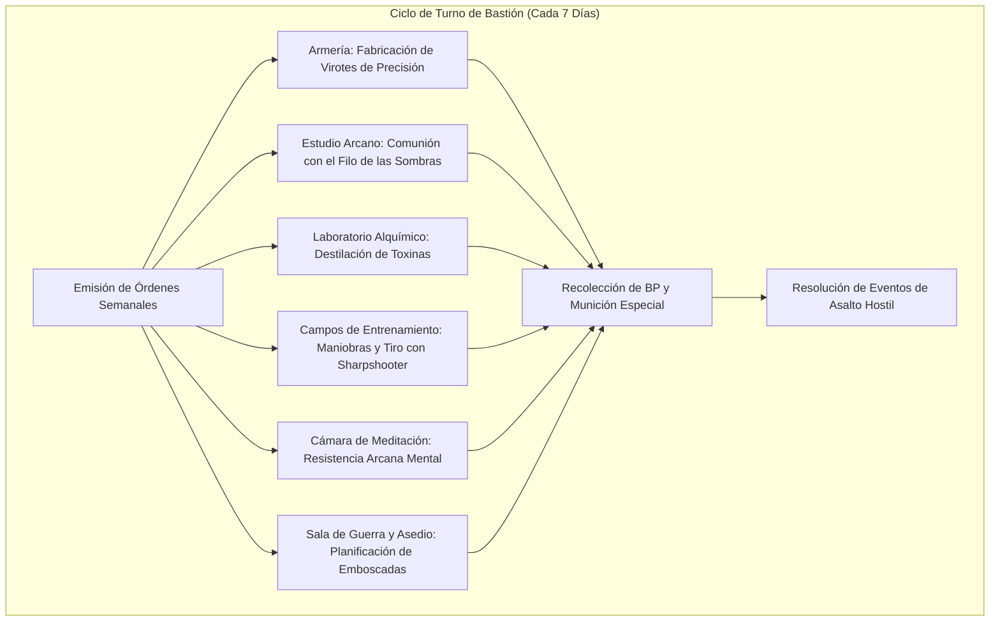

# 🏰 Bastión y Tiempo Muerto — Hexbow

## 🏰 Sistema de Bastiones (Reglas Oficiales DMG 2024 / D&D 5.5e)

*Estructura de gestión de la base de operaciones, economía de bastión y mecánicas de mando.*

* **Nombre del Bastión:** La Atalaya del Filo Sombreado (Shadowblade Spire)
* **Nivel de Bastión (Bastion Level):** 20
* **Puntos de Bastión (Bastion Points - BP):** 100
* **Puntuación de Mando (Bastion Defender Stats):** +11 al ataque y salvaciones defensivas (STR 8 [-1], DEX 14 [+2], CON 16 [+3], INT 8 [-1], WIS 10 [+0], CHA 20 [+5]).

---

### Instalaciones Básicas (Basic Facilities)

1. **Dormitorio Principal (Bedchambers):** Estancia ubicada en la torre superior, fortificada con aspilleras de ángulo estrecho y soporte blindado para ballestas.
2. **Comedor Táctico (Dining Hall):** Sala sobria y silenciosa; alimentos conservados sin humo de chimenea para no delatar la posición de la aguja.
3. **Puesto de Mando (Common Area):** Cámara circular con mesa de arena para cartografía militar y siluetas para tiro balístico.

---

### Instalaciones Especiales (Special Facilities — Exactamente 6: 4 Roomy + 2 Vast)

#### 1. Armería de Precisión (Armory — Roomy, Desbloqueo Nivel 5)
* **Estado:** Activa (Mantener)
* **Tamaño:** Roomy (Espaciosa)
* **Orden de Bastión:** *Equip & Craft (Fabricar Munición)*
* **Sinergia con el Build:** 🔵 **Indispensable**. Asegura una reserva permanente de virotes de ballesta de mano de calidad superior y pertrechos para la guarnición de francotiradores. Aumenta la defensa base del bastión en +4 puntos contra asedios.

#### 2. Estudio Arcano de las Sombras (Arcane Study — Roomy, Desbloqueo Nivel 5)
* **Estado:** Activa (Mantener)
* **Tamaño:** Roomy (Espaciosa)
* **Orden de Bastión:** *Craft Magic / Arcane Focus (Comunión Sombría)*
* **Sinergia con el Build:** 🟢 **Excelente**. Centro de rituales para sintonizar el Arma de Pacto y preparar pergaminos arcanos de utilidad (*Mirror Image*, *Misty Step*).

#### 3. Laboratorio Alquímico de Toxinas (Laboratory — Roomy, Desbloqueo Nivel 9)
* **Estado:** Activa (Mantener)
* **Tamaño:** Roomy (Espaciosa)
* **Orden de Bastión:** *Brew Toxins (Destilar Venenos)*
* **Sinergia con el Build:** 🟢 **Excelente**. Elabora venenos virulentos (como *Drow Poison* o veneno de serpiente gigante) para aplicar a los virotes de la ballesta de mano, añadiendo daño y efectos de sueño/incapacitación.

#### 4. Campos de Tiro y Maniobras (Training Grounds — Roomy, Desbloqueo Nivel 9)
* **Estado:** Activa (Mantener)
* **Tamaño:** Roomy (Espaciosa)
* **Orden de Bastión:** *Train (Entrenar Precisión de Francotirador)*
* **Sinergia con el Build:** 🟢 **Excelente**. Pistas de tiro con blancos móviles a 120 pies. Otorga al personaje +1d4 a su primera tirada de ataque con ballesta tras salir de la base.

#### 5. Cámara de Meditación Sombría (Meditation Chamber — Vast, Desbloqueo Nivel 13)
* **Estado:** Activa (Mantener)
* **Tamaño:** Vast (Vasta)
* **Orden de Bastión:** *Focus (Enfoque de Pacto)*
* **Sinergia con el Build:** 🔵 **Indispensable**. Aislamiento sensitivo total que conecta la mente del Hexbow con el plano de las sombras. Otorga inspiración heroica y ventaja en las tiradas de concentración de *Shadow of Moil* durante las primeras 24 horas.

#### 6. Sala de Guerra y Asedio Táctico (War Room — Vast, Desbloqueo Nivel 17)
* **Estado:** Activa (Mantener)
* **Tamaño:** Vast (Vasta)
* **Orden de Bastión:** *Recruit & Command (Inteligencia e Incursiones)*
* **Sinergia con el Build:** 🔵 **Indispensable**. Centro de mando militar que coordina compañías de exploradores y hostigadores a distancia. Permite desplegar escuadras de asalto con un bono de mando marcial de +11 para asegurar perímetros y resolver eventos hostiles.

---

### Seguidores y Guarnición (Staff & Garrison)

* **Capataz General (Major Domo):** Kaelen el Silencioso (Ex-asesino elfo de sombras, frío, calculador y experto en contrainteligencia).
* **Guarnición Activa:**
  * 15 Ballesteros de élite armados con ballestas pesadas y de mano.
  * 4 Saboteadores especialistas en trampas de abrojos y cables de detonación.
  * 2 Flecheros alquimistas encargados de revestir saetas con aleaciones de plata y venenos.

---

## ⏳ Actividades de Tiempo Muerto (Downtime Activities)

### Prioridad 1: Destilación de Venenos y Munición Especial
* **Mecánica Oficial:** Xanathar's Guide to Everything / DMG 2024 (Crafting Poison).
* **Bonificadores Aplicables:** Kit de Envenenador (+6), Inteligencia/Destreza y suministros del Laboratorio.
* **Objetivo:** Acumular 10 viales de veneno de contacto o herida para emboscar objetivos de alto rango.

### Prioridad 2: Reconocimiento e Infiltración Militar
* **Mecánica Oficial:** XGE (Downtime: Scouting).
* **Objetivo:** Trazar planos de fortalezas hostiles y marcar rutas de tiro elevadas antes de iniciar misiones de asesinato táctico.

---

## 🏃‍♂️ Modos de Movimiento, Logística y Viaje

* **Caminar (Walk):** 30 ft.
* **Iniciativa en Viaje:** +2 (o +7 si cuenta con la dote *Alert*).
* **Rango Operativo:** 120 pies sin desventaja con ballesta de mano gracias a *Sharpshooter* (ignorando coberturas de media y tres cuartos).
* **Visión en la Oscuridad:** 120 ft. nativa a través de *Devil's Sight* (visión perfecta en oscuridad mágica y natural).
* **Ritmo de Viaje:** Sigiloso / Normal.

---

## 🎭 Reputación y Facciones

1. **La Hermandad del Virote Negro:** Red secreta de tiradores de elite. Proveen contratos de alto valor, refugios ocultos y rutas de contrabando de armas.
2. **El Cónclave de las Sombras:** Entidad patronal del Hexblade. Otorga bendiciones arcanas y protección contra cazadores divinos a cambio de almas segadas.