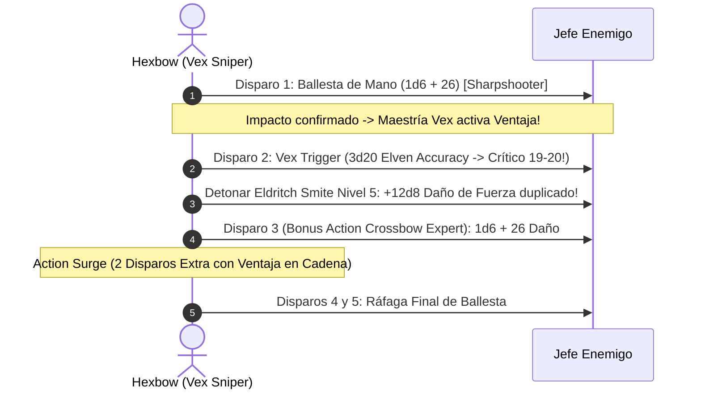

# Guía de Personaje — Hexbow (Edición 2024 / 5.5e Update)

## Datos Generales

* **System Standard:** D&D 5th Edition (2024 Ruleset - 5.5e Compatible)
* **Character Level:** 20 (Total)
* **Class Split:** Warlock (Hexblade) 17 / Fighter (Battle Master) 3
* **Species:** Elf (Drow / Wood Elf 2024 — Linaje Elfo para *Elven Accuracy*)
* **Background:** Soldier / Guide (Dote de Origen: *Alert* o *Magic Initiate*)
* **Stats (Point Buy 2024 / Background):**
  * **FUER (STR):** 8 (-1)
  * **DES (DEX):** 14 (+2)
  * **CON:** 16 (+3) *(15 Base + 1 Trasfondo)*
  * **INT:** 8 (-1)
  * **SAB (WIS):** 10 (+0)
  * **CAR (CHA):** 20 (+5) *(15 Base + 2 Trasfondo + 1 Elven Accuracy Nivel 11 + 2 ASI Nivel 19)*

* **Enlaces de Documentación:**
  * [Bastión y Tiempo Muerto](file:///d:/repo-vault/Proyectos/Rol/DnDbuilds/builds/hexbow/bastion%20and%20downtime.md)
  * [Lista de Conjuros y Recursos](file:///d:/repo-vault/Proyectos/Rol/DnDbuilds/builds/hexbow/spell%20list.md)
  * [Objetos a Obtener](file:///d:/repo-vault/Proyectos/Rol/DnDbuilds/builds/hexbow/item%20list%20to%20obtain.md)
  * [Hoja de Ruta 1-20](file:///d:/repo-vault/Proyectos/Rol/DnDbuilds/builds/hexbow/roadmap.md)
  * [Inventario Actual](file:///d:/repo-vault/Proyectos/Rol/DnDbuilds/builds/hexbow/actual%20inventory%20list.md)

---

## Combat Role: Ranged Heavy Striker, Vex/Push Ballistics & Critical Assassin

Bajo las reglas oficiales de 2024 (5.5e), las armas a distancia ganan maestrías de armas tácticas:
* **Hand Crossbow (Vex):** Cada impacto concede ventaja automáticamente en el siguiente tiro contra el mismo enemigo.
* **Heavy Crossbow (Push):** Empuja a la criatura impactada 10 pies hacia atrás sin tirada de salvación si se desea controlar el espacio.

Combinado con *Elven Accuracy* y *Eldritch Smite*, el Hexbow domina el campo de batalla a distancias seguras.

---

## 1. Gestión de Recursos y Reglas de Inventario (Reglas 2024)

* **Maestría de Armas 2024 (Weapon Mastery):**
  * **Vex (Ballesta de Mano):** Mantiene un bucle continuo de ventaja entre disparos sucesivos.
* **Economía de Ranuras y Magia de Brujo 2024:**
  * 4 ranuras de pacto de nivel 5 que se recuperan por descanso corto.
  * Invocaciones arcanas de 2024: *Pact of the Blade* permite vincular cualquier arma marcial y utilizar Carisma para ataques y daño de forma nativa.
* **Economía de Manos Libres:**
  * Se mantiene la regla estricta de mano libre para recargar armas con propiedad de munición.

---

## 2. Action Economy & Combat Loop (2024)

* **Preparación (Pre-Combate):**
  * Lanzamiento de *Foresight* (Mystic Arcanum 9, 8 horas sin concentración) o *Shadow of Moil*.
* **Action:**
  * **Acción de Ataque:** 2 disparos de ballesta con Carisma (+13 hit). El primer impacto activa la maestría *Vex*, habilitando ventaja triple (*Elven Accuracy*) en el segundo disparo.
  * **Action Surge:** 2 disparos adicionales en la misma acción con ventaja encadenada.
* **Bonus Action:**
  * *Hexblade's Curse* (Turno 1) o disparo adicional vía *Crossbow Expert* (Turnos 2+).
* **Reaction:**
  * *Shield* (+5 CA) o *Armor of Hexes* (50% de probabilidad de anular ataques del objetivo maldito).

---

## 3. The META Combo 2024: Vex Ballistics + Elven Accuracy + Eldritch Smite

### 🧮 Motor Matemático (2024 Ruleset)

$$\text{Daño Base por Tiro} = 1\text{d}6 + 5 (\text{CAR}) + 6 (\text{Curse}) + 5 (\text{Lifedrinker}) + 10 (\text{Sharpshooter}) = \mathbf{29.5 \text{ daño/tiro}}$$

Con *Ascendant Dragon's Wrath Hand Crossbow (+3, +3d6)* y Action Surge (5 disparos):

$$\text{Daño 5 Virotes Optimizados} = 5 \times (1\text{d}6 + 29 + 3\text{d}6) = 5 \times 43.0 = \mathbf{215.0 \text{ daño}}$$

$$\text{Eldritch Smite Crítico Nivel 5} = 12\text{d}8 \text{ de fuerza} = \mathbf{54.0 \text{ daño}}$$

$$\text{DPR Nova Total del Asalto} = 215.0 + 54.0 = \mathbf{269.0 \text{ daño medio en Turno 2}}$$