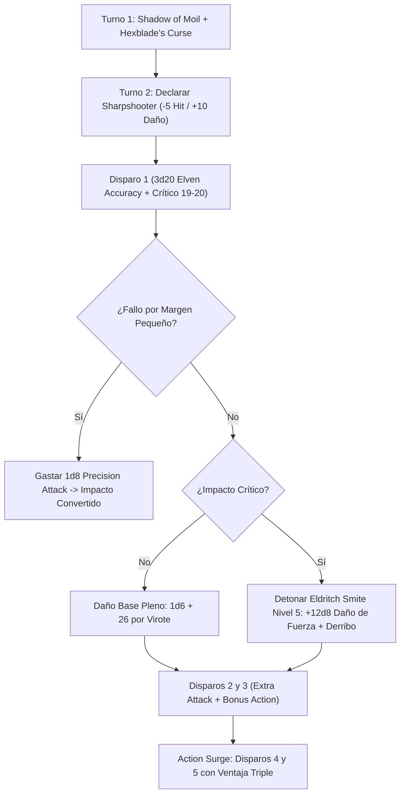

# Guía de Personaje — Hexbow (The Shadow Sniper)

## Datos Generales

* **System Standard:** D&D 5th Edition (2024 / 5.5e Update & 2014 Compatibility)
* **Character Level:** 20 (Warlock [Hexblade] 17 / Fighter [Battle Master] 3)
* **Species:** Half-Elf / Elf (Imprescindible para la dote de linaje *Elven Accuracy*)
* **Background:** Soldier / Urchin (Atributos: Carisma +2, Constitución +1, Destreza +1)
* **Stats (Point Buy + Racial + ASIs):**
  * **FUER (STR):** 8 (-1) *(Standard Array)*
  * **DES (DEX):** 14 (+2) *(13 Base + 1 Racial — Optimiza la Armadura Media)*
  * **CON:** 16 (+3) *(15 Base + 1 Racial — Puntos de golpe y concentración)*
  * **INT:** 8 (-1) *(Standard Array)*
  * **SAB (WIS):** 10 (+0) *(Standard Array)*
  * **CAR (CHA):** 20 (+5) *(15 Base + 2 Racial + 1 Elven Accuracy Nivel 11 + 2 ASI Nivel 19)*

* **Enlaces de Documentación:**
  * [Bastión y Tiempo Muerto](file:///d:/repo-vault/Proyectos/Rol/DnDbuilds/builds/hexbow/bastion%20and%20downtime.md)
  * [Lista de Conjuros y Recursos](file:///d:/repo-vault/Proyectos/Rol/DnDbuilds/builds/hexbow/spell%20list.md)
  * [Objetos a Obtener](file:///d:/repo-vault/Proyectos/Rol/DnDbuilds/builds/hexbow/item%20list%20to%20obtain.md)
  * [Hoja de Ruta 1-20](file:///d:/repo-vault/Proyectos/Rol/DnDbuilds/builds/hexbow/roadmap.md)
  * [Inventario Actual](file:///d:/repo-vault/Proyectos/Rol/DnDbuilds/builds/hexbow/actual%20inventory%20list.md)
  * [Guía de Personaje 2024](file:///d:/repo-vault/Proyectos/Rol/DnDbuilds/builds/hexbow/character%20guide%202024.md)

---

## Combat Role: Ranged Nova Striker, Triple-Advantage Crit Fisher & Battlefield Sniper

El **Hexbow** es una batería de artillería arcano-marcial que transforma una ballesta de mano en una ametralladora de precisión quirúrgica. Mediante la sinergia de **Hex Warrior** (ataque y daño con Carisma), **Crossbow Expert**, **Sharpshooter**, **Elven Accuracy** (ventaja triple, 3d20) y **Shadow of Moil**, asegura una lluvia de impactos letales con rango de crítico expandido a 19-20 (*Hexblade's Curse*).

Al conseguir un impacto crítico, detona **Eldritch Smite** de nivel 5, infligiendo daño de fuerza colosal duplicado ($12\text{d}8$) y derribando al objetivo automáticamente sin tirada de salvación.

---

## 1. Gestión de Recursos y Reglas de Inventario

* **Economía de Manos y Munición (Hand Crossbow):**
  * La ballesta de mano es tu Arma de Pacto vinculada (*Pact Weapon*). La dote *Crossbow Expert* ignora la propiedad de *carga (Loading)*, permitiendo múltiples ataques por turno.
  * **Regla Inmutable:** Aunque no tenga propiedad de carga, conserva la propiedad de *munición (Ammunition)*. Requiere una mano libre para colocar cada virote, lo que **prohíbe el uso de escudos**.
* **Gestión de Espacios Pactados y Dados de Superioridad:**
  * **4 Ranuras de Brujo de Nivel 5:** Se recargan íntegramente en descansos cortos, permitiendo descargar smites de nivel 5 en cada encuentro del día.
  * **4 Dados de Superioridad (d8) de Battle Master:** Reservados casi exclusivamente para *Precision Attack*, convirtiendo cualquier fallo cercano por *Sharpshooter* en un impacto certero.

---

## 2. Action Economy & Combat Loop

* **Preparación (Pre-Combate / Turno 0):**
  * Si hay aviso previo, activar *Shadow of Moil* (Nivel 4, concentración) o *Foresight* (Mystic Arcanum 9, 8 horas sin concentración).
* **Action:**
  * **Turno 1 [Fase de Configuración]:**
    * Lanzar *Shadow of Moil* (ventaja en todos tus disparos, desventaja en ataques hostiles).
  * **Turnos 2+ [Fase de Descarga Ranged]:**
    * Acción de Ataque: 2 disparos de ballesta de mano usando Carisma (+13 base con *Archery* y *Sharpshooter* activo).
    * Si se activa **Action Surge (Fighter 2)**: 2 disparos adicionales en la misma ronda.
* **Bonus Action:**
  * **Turno 1:** Aplicar *Hexblade's Curse* sobre el enemigo prioritario (+6 daño plano por impacto, crítico con 19-20).
  * **Turnos 2+:** Disparo adicional de ballesta de mano mediante *Crossbow Expert*.
* **Reaction:**
  * 🔵 **Shield:** Eleva la CA a 24 temporalmente.
  * 🟢 **Armor of Hexes (Warlock 10):** Si el objetivo de tu maldición te impacta, tira 1d6; con un 4, 5 o 6 el ataque falla automáticamente sin importar la tirada.
  * 🟡 **Absorb Elements / Hellish Rebuke:** Respuesta elemental o represalia reactiva.

---

## 3. The META Combo: La Ametralladora de Críticos de la Sombra

### 🧮 Motor Matemático (Mathematical Engine)

#### 1. Probabilidad de Crítico con Elven Accuracy y Hexblade's Curse

Con rango de crítico de 19-20 ($P = 0.10$) y ventaja triple ($3\text{d}20$):

$$P(\text{Crítico por Virote}) = 1 - (1 - 0.10)^3 = 1 - (0.90)^3 = 1 - 0.729 = \mathbf{0.271 \text{ (27.1\% por ataque)}}$$

Al disparar una ráfaga completa de 5 virotes con *Action Surge*:

$$P(\text{Al menos 1 Crítico en Turno Nova}) = 1 - (1 - 0.271)^5 = 1 - (0.729)^5 = 1 - 0.2059 = \mathbf{0.7941 \text{ (79.4\%)}}$$

#### 2. Daño por Virote Individual (Sharpshooter + Curse + Lifedrinker)

$$\text{Daño Base} = 1\text{d}6 + 5 (\text{CAR}) + 6 (\text{Curse}) + 5 (\text{Lifedrinker}) + 10 (\text{Sharpshooter}) = 3.5 + 26 = \mathbf{29.5 \text{ daño medio/tiro}}$$

Con *Ascendant Dragon's Wrath Hand Crossbow (+3, +3d6 elemental)*:

$$\text{Daño Optimizado por Tiro} = 1\text{d}6 + 26 + 3 (\text{Mágico}) + 3\text{d}6 (\text{Dracónico}) = 3.5 + 29 + 10.5 = \mathbf{43.0 \text{ daño por virote}}$$

#### 3. Cálculo Nova de 5 Disparos con Eldritch Smite Crítico

$$\text{Daño 5 Virotes Optimizados} = 5 \times 43.0 = \mathbf{215.0 \text{ daño}}$$

Al conectar un impacto crítico con *Eldritch Smite* gastando una ranura de Nivel 5:

$$\text{Daño Eldritch Smite Crítico} = 2 \times (1\text{d}8 + 5\text{d}8) = 12\text{d}8 \text{ de fuerza} \implies 12 \times 4.5 = \mathbf{54.0 \text{ daño}}$$

$$\text{DPR Nova Total del Asalto} = 215.0 + 54.0 = \mathbf{269.0 \text{ daño en Turno 2}}$$

---

## 4. Tabla de Clasificación Táctica de Habilidades

| Habilidad / Recurso | Tipo | Coste | Evaluación | Justificación Táctica |
| :--- | :---: | :---: | :---: | :--- |
| **Elven Accuracy** | Pasiva | Dote | 🔵 | Otorga ventaja triple (3d20) en todos los ataques de Carisma, elevando la precisión y la tasa de críticos al 27.1%. |
| **Eldritch Smite** | Ofensiva / Nova | Ranura Nivel 5 | 🔵 | $6\text{d}8$ de fuerza ($12\text{d}8$ en crítico) y derriba a la criatura sin conceder salvación. |
| **Precision Attack** | Modificador | 1 Dado Superioridad | 🔵 | Añade 1d8 al ataque, neutralizando el penalizador de -5 de Sharpshooter y garantizando impactos. |
| **Shadow of Moil** | Buff | Ranura Nivel 4 | 🔵 | Te oculta en sombras impenetrables; ventaja para ti, desventaja para enemigos, sin bloquear visión aliada. |
| **Lifedrinker** | Pasiva | Invocación Arcana | 🟢 | Suma +5 de daño necrótico plano a cada impacto con tu ballesta de pacto. |
| **Armor of Hexes** | Defensiva | Reacción / Pasivo | 🟢 | 50% de probabilidad fija (4-6 en 1d6) de anular por completo cualquier ataque del objetivo maldito. |
| **Action Surge** | Ofensiva | 1 Uso / SR | 🔵 | Permite disparar 5 virotes en un único turno decisivo. |

---

## 5. Reglas de la Casa (Home Rules)

1. **Requisito de Mano Libre con Crossbow Expert:** Se respeta estrictamente que cargar una ballesta de mano requiere una mano desocupada; el personaje no porta escudo.
2. **Derribo con Eldritch Smite:** El efecto de derribo de *Eldritch Smite* se reserva tácticamente para el último virote del asalto para no generar desventaja en disparos propios a más de 5 pies.