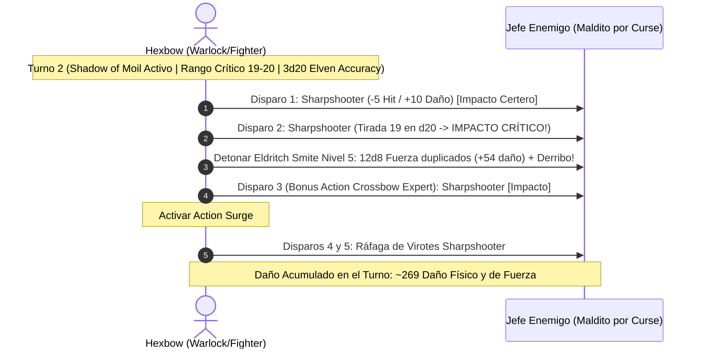

# 🌟 Lista de Conjuros y Recursos Tácticos — Hexbow

El **Hexbow** combina la magia pactada de un **Hexblade Warlock (17)** con las maniobras balísticas de un **Battle Master Fighter (3)**. Todas las ranuras pactadas son de nivel 5 y se recuperan íntegramente tras un descanso corto.

---

## 🔮 Matriz de Recursos y Salvaciones

* **Ranuras de Pacto de Brujo:** 4 espacios de Nivel 5 por Descanso Corto.
* **Dados de Superioridad (Battle Master):** 4d8 por Descanso Corto (CD de maniobras: $8 + \text{PB (6)} + \text{CAR (5)} = \mathbf{19}$).
* **CD de Salvación de Conjuros:** $8 + \text{PB (6)} + \text{CAR (5)} = \mathbf{19}$.
* **Modificador de Ataque a Distancia:** $+13$ base (+5 CAR, +6 PB, +2 Archery Fighting Style). Con *Sharpshooter* activo: $+8$ base (con 3d20 de ventaja triple).
* **Turno 0 Pre-Buffs:**
  * Lanzamiento de *Foresight* (Mystic Arcanum 9, duración 8 horas sin concentración) o *Shadow of Moil* (Nivel 4, concentración).
  * Postura de tiro con ballesta de mano mágica cargada y mano secundaria desocupada.

---

## 🪄 Trucos (Cantrips)

| Conjuro | Escuela | Clasificación | Efecto y Justificación Táctica |
| :--- | :---: | :---: | :--- |
| **Eldritch Blast** | Evocación | 🔵 | 4 rayos de fuerza ($1\text{d}10$ cada uno) a 120 pies; opción de contingencia si el personaje es desarmado. |
| **Mending** | Transmutación | 🔵 | Repara virotes dañados y cuerdas de ballesta tras los encuentros. |
| **Minor Illusion** | Ilusión | 🟢 | Genera coberturas visuales ilusorias de 5 pies para habilitar disparos sigilosos. |
| **Prestidigitation** | Transmutación | 🟡 | Limpia sangre y residuos de pólvora o veneno de la ballesta de mano. |

---

## 🎒 Conjuros Preparados de Brujo (Ranuras de Nivel 5)

*Todas las ranuras se lanzan como Nivel 5 y se recargan en descansos cortos.*

### Nivel 5

| Conjuro | Concentración | Clasificación | Efecto y Justificación Táctica |
| :--- | :---: | :---: | :--- |
| **Banishing Smite** | Sí (1 min) | 🔵 | Al impactar con la ballesta, suma $+5\text{d}10$ de daño de fuerza. Si el objetivo queda con 50 PG o menos, es desterrado automáticamente sin salvación. Sinergiza con *Eldritch Smite*. |
| **Synaptic Static** | No | 🔵 | Explosión de $8\text{d}6$ de daño psíquico en radio de 20 pies (salvación de INT CD 19). Resta 1d6 a los ataques y salvaciones de los enemigos por 1 minuto sin concentración. |
| **Hold Monster** | Sí | 🟢 | Paraliza a cualquier criatura que falle salvación de Sabiduría. Todos los disparos a menos de 5 pies son críticos automáticos. |

### Nivel 4

| Conjuro | Concentración | Clasificación | Efecto y Justificación Táctica |
| :--- | :---: | :---: | :--- |
| **Shadow of Moil** | Sí (1 min) | 🔵 | Te envuelve en sombras pesadas. Eres considerado pesadamente oculto (*Heavily Obscured*): tienes ventaja en todos tus ataques de ballesta (activando *Elven Accuracy*) y los enemigos tienen desventaja al atacarte. No bloquea la visión de tus aliados. |
| **Dimension Door** | No | 🟢 | Teletransporte táctico de hasta 500 pies para escapar de emboscadas o reposicionarse en torres elevadas. |
| **Banishment** | Sí | 🟡 | Destierra hasta 2 criaturas extraplanarias (escalado a nivel 5) si fallan salvación de Carisma. |

### Niveles 1 a 3

| Conjuro | Concentración | Clasificación | Efecto y Justificación Táctica |
| :--- | :---: | :---: | :--- |
| **Shield (Hexblade)** | No (Reacción) | 🔵 | +5 a la CA reactivo (alcanzando CA 24) frente a proyectiles o impactos cuerpo a cuerpo imprevistos. |
| **Armor of Agathys** | No (1 hora) | 🟢 | Escalado a nivel 5: Otorga 25 PG temporales e inflige 25 de daño por frío fijo a cualquier enemigo que te golpee en cuerpo a cuerpo. |
| **Misty Step** | No (Bonus Action) | 🟢 | Teletransporte de 30 pies para desengancharse de melé sin provocar ataques de oportunidad. |
| **Darkness** | Sí | 🟡 | Genera oscuridad mágica; combo inicial con *Devil's Sight* antes de obtener *Shadow of Moil*. |

---

## 🔮 Arcanos Místicos (Mystic Arcanum — 1 Uso / Descanso Largo cada uno)

| Nivel | Conjuro | Clasificación | Justificación Táctica |
| :---: | :--- | :---: | :--- |
| **6.º** | **Scatter** | 🔵 | Teletransporta a 5 criaturas simultáneamente hasta 120 pies para romper formaciones enemigas o salvar aliados. |
| **7.º** | **Forcecage** | 🔵 | Encarcela a cualquier monstruo sin conceder salvación inicial en una jaula de fuerza durante 1 hora. |
| **8.º** | **Maddening Darkness / Demiplane** | 🟢 | Área colosal de 60 pies de radio que inflige $8\text{d}8$ de daño psíquico continuo y anula la visión enemiga. |
| **9.º** | **Foresight** | 🔵 | Concede ventaja en absolutamente todas las tiradas de ataque, salvación y característica durante 8 horas (sin concentración), liberando la concentración para otros conjuros mientras *Elven Accuracy* opera de continuo. |

---

## 🎯 Maniobras de Battle Master (4d8 por Descanso Corto)

* **Precision Attack:** Añade 1d8 a una tirada de ataque que haya errado por poco con *Sharpshooter*, asegurando el impacto.
* **Trip Attack:** Suma 1d8 al daño y derriba a la criatura al suelo (salvación de Fuerza CD 19); se emplea en el último tiro para no imponer desventaja en tiros propios a distancia.
* **Menacing Attack:** Suma 1d8 al daño e infunde miedo en el objetivo (salvación de Sabiduría CD 19), impidiéndole aproximarse.

---

## 💥 Secuencia de Combate Nova (Triple Advantage + Eldritch Smite + Action Surge)

---

## 🩺 Curación en Segundo Plano y Mantenimiento Vital

1. **Recuperación por Maldición (*Hexblade's Curse Healing*):**
   * Cuando la criatura afectada por tu maldición es destruida, recuperas automáticamente $\text{Warlock Level (17)} + \text{CAR (5)} = \mathbf{22 \text{ PG}}$ sin gastar acciones ni ranuras.
2. **Escudo de Escarcha (*Armor of Agathys*):**
   * Otorga una reserva de **25 PG temporales** antes del combate que absorbe daño y castiga a los agresores con 25 puntos de daño frío de represalia fija.
3. **Second Wind (Guerrero):**
   * Acción adicional: Restaura $1\text{d}10 + 3$ PG por descanso corto en situaciones de desgaste menor.
4. **Reserva Farmacéutica del Bastión:**
   * El Laboratorio de la Atalaya suministra 3 *Potions of Supreme Healing* ($10\text{d}4 + 20 \text{ PG}$) para reponer salud entre asaltos.