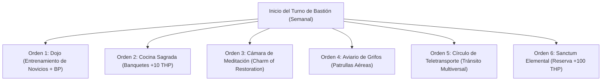

# 🏰 Bastión y Tiempo Muerto — Hurricane Monk

## 🏰 Sistema de Bastiones (Reglas Oficiales DMG 2024 / 5.5e)

* **Nombre del Bastión:** El Santuario de los Cuatro Vientos (*The Sanctuary of Four Winds*)
* **Ubicación:** Cima escarpada de la Cordillera de los Dientes de Tormenta (3,800 metros de altitud).
* **Nivel de Bastión (Bastion Level):** Nivel 20
* **Puntos de Bastión (Bastion Points - BP):** 450 BP acumulados
* **Bonificador de Defensa de Bastión:** **+11** ($5_{\text{DEX}} + 6_{\text{PB}}$)

---

### 🏛️ Instalaciones Básicas (Basic Facilities)

1. **Aposentos Ascéticos (Bedchambers):** Celda de meditación en roca viva, abierta a los vientos glaciales.
2. **Refectorio Comunal (Dining Hall):** Gran mesa comunitaria para novicios y maestros donde se comparten las comidas.
3. **Plaza de Entrenamiento (Courtyard):** Fosa de grava y postes de madera para equilibrio y acondicionamiento elemental.
4. **Almacén de Suministros (Storage):** Reserva de grano de montaña, telas élficas y hierbas curativas.

---

### 🔮 Instalaciones Especiales (Special Facilities — 6 Slots Nivel 20: 4 Roomy + 2 Vast)

1. **Dojo Monástico (Roomy — Nivel 5):**
   * *Orden de Bastión:* **Train / Maintain.**
   * *Efecto Mecánico:* Entrena a una orden de acólitos marciales. Concede Inspiración Heroica permanente al Monje al salir del bastión y genera $1\text{d}6 \times 10$ BP adicionales en cada ciclo.
2. **Sacred Kitchen / Cocina Sagrada Gourmet (Roomy — Nivel 9):**
   * *Orden de Bastión:* **Harvest / Maintain.**
   * *Sinergia con el Build:* Aprovecha la competencia con Herramientas de Cocinero (+5). Prepara un Festín de Cumbres que confiere **+10 Puntos de Golpe Temporales** a todos los defensores de la guarnición y a los miembros del grupo por 24 horas.
3. **Cámara de Meditación Trascendental (Roomy — Nivel 9):**
   * *Orden de Bastión:* **Empower.**
   * *Efecto Mecánico:* Otorga el **Charm of Restoration** (permite recuperar la totalidad de los 19 Focus points una vez al día sin gastar descanso corto, o lanzar *Lesser Restoration* a voluntad).
4. **Aviario de Cumbres / Menagerie de Grifos (Roomy — Nivel 13):**
   * *Orden de Bastión:* **Recruit / Defend.**
   * *Efecto Mecánico:* Mantiene 4 Águilas Gigantes y 2 Grifos domesticados para patrullas de reconocimiento aéreo en un radio de 50 millas y defensa de murallas ante invasores.
5. **Círculo de Teletransporte Permanente (Vast — Nivel 13):**
   * *Orden de Bastión:* **Maintain.**
   * *Efecto Mecánico:* Enlace con todos los círculos mayores del plano material y los dominios de Ashari. Permite al grupo replegarse al bastión instantáneamente ante cualquier catástrofe.
6. **Sanctum Elemental de los Vientos (Vast — Nivel 17):**
   * *Orden de Bastión:* **Empower.**
   * *Efecto Mecánico:* Tras completar un descanso largo dentro del Sanctum, el Monje sintoniza con las corrientes primordiales, obteniendo una reserva de **+100 Puntos de Golpe Temporales** y resistencia al daño de Frío y Rayo hasta agotarse.

---

## ⏳ Actividades de Tiempo Muerto (Downtime Activities)

### Prioridad 1: Acondicionamiento con El Gravamen de Cuatro Dobles (*The Four-Fold Burden*)

* **Mecánica Base:** Entrenamiento de Habilidades y Dotes (DMG 2024 / Xanathar's).
* **Tiradas Aplicables:** +11 Atletismo, +11 Acrobacias, +10 Herramientas de Cocinero.
* **Objetivo:** Meditar bajo cascadas congeladas y cargar monolitos con el *Four-Fold Burden* activo. Esto prepara la transición hacia el retiro final del gravamen a nivel 20 al obtener la dote épica *Epic Boon of Speed*.

### Prioridad 2: Fabricación de Consumibles y Pociones de Movilidad

* **Taller Farmacéutico / Botica:** Elaboración de *Potions of Speed* (Poción de Aceleración) y *Potions of Supreme Healing*. Coste: 250 po y 5 días de trabajo por poción gracias al apoyo de los novicios del Dojo.

---

## 🏃‍♂️ Modos de Movimiento, Logística y Viaje

### Velocidades de Movimiento Base (Nivel 20)

* **Caminar (Walk):** **110 ft/turno** ($30\text{ ft Base} + 30\text{ ft Unarmored Movement} + 50\text{ ft Epic Boon of Speed}$).
* **Trepar (Climb):** **110 ft/turno** (*Acrobatic Movement* — corre por superficies verticales sin penalización).
* **Nadar (Swim):** **110 ft/turno** (*Stride of the Elements*).
* **Volar (Fly):** **110 ft/turno** (*Stride of the Elements* mientras *Elemental Attunement* está activa).

### Modificadores de Exploración

* **Ritmo de Viaje:** Rápido (recorre 40 millas al día sin fatiga gracias a la constitución de Goliat).
* **Visión en la Oscuridad:** 60 ft (Adaptación racial de montaña).
* **Percepción Pasiva:** 14 (10 + 4 WIS).
* **Perspicacia Pasiva:** 14 (10 + 4 WIS).

---

## 🎭 Reputación y Red de Contactos

1. **Círculo de Ashari del Viento:**
   * *Estatus:* Campeón Honorífico de la Aguja Celeste.
   * *Beneficio:* Acceso libre a naves de viento y redes de teletransporte elementales.
2. **Tribus de Goliat de las Montañas (Hill & Storm Clans):**
   * *Estatus:* Héroe de la Balanza (demostró que la agilidad y el flujo vencen al tamaño y la fuerza bruta).
