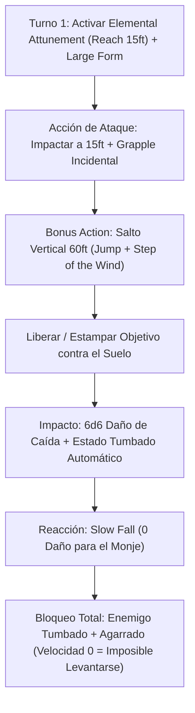

# Resumen General del Personaje: Hurricane Monk (Crag Horn Climber)

## Datos Generales

* **System Standard:** D&D 5th Edition (2024 / 5.5e Update)
* **Character Level:** 20 (Monk [Warrior of Elements] 19 / Ranger 1)
* **Species:** Goliath (Hill Goliath — *Hill Giant's Tumble*, *Large Form*)
* **Background:** Guide (Origin Feat: *Magic Initiate [Druid/Ranger]* -> Conjuro: *Jump*)
* **Stats (Point Buy + Background + ASIs):**
  * **STR:** 12 (+1) *(Standard Array)*
  * **DEX:** 20 (+5) *(15 Base + 2 Background + 1 Dote Grappler + 2 ASI Nivel 9)*
  * **CON:** 14 (+2) *(13 Base + 1 ASI)*
  * **INT:** 8 (-1) *(Standard Array)*
  * **WIS:** 18 (+4) *(14 Base + 2 ASI Nivel 13 + 2 ASI Nivel 17)*
  * **CHA:** 10 (+0) *(Standard Array)*

* **Enlaces de Documentación:**
  * [Bastión y Tiempo Muerto](file:///d:/repo-vault/Proyectos/Rol/DnDbuilds/builds/hurricane%20monk%20unmatched%20martial%20control%20%20dd%2055/bastion%20and%20downtime.md)
  * [Lista de Conjuros y Recursos](file:///d:/repo-vault/Proyectos/Rol/DnDbuilds/builds/hurricane%20monk%20unmatched%20martial%20control%20%20dd%2055/spell%20list.md)
  * [Objetos a Obtener](file:///d:/repo-vault/Proyectos/Rol/DnDbuilds/builds/hurricane%20monk%20unmatched%20martial%20control%20%20dd%2055/item%20list%20to%20obtain.md)
  * [Hoja de Ruta 1-20](file:///d:/repo-vault/Proyectos/Rol/DnDbuilds/builds/hurricane%20monk%20unmatched%20martial%20control%20%20dd%2055/roadmap.md)
  * [Inventario Actual](file:///d:/repo-vault/Proyectos/Rol/DnDbuilds/builds/hurricane%20monk%20unmatched%20martial%20control%20%20dd%2055/actual%20inventory%20list.md)

---

## Combat Role: Martial Controller, Aerial Pile-Driver & Battlefield Dominator

El **Hurricane Monk** representa la cúspide del control marcial cinético en D&D 5.5e (2024). Combina la enorme movilidad del Monje con la dote *Grappler* (2024), el alcance extendido de 15 pies de *Elemental Attunement*, la triplicación de salto mediante *Jump*, y el motor táctico de desplazamiento forzado sin reducción de velocidad.

### 1. Gestión de Recursos y Reglas de Inventario

* **Alcance Desarmado de 15 Pies y Grapple a Distancia:** Bajo la regla oficial confirmada para D&D 2024 (*Warrior of Elements*), *Elemental Attunement* extiende el alcance de los ataques desarmados a 15 pies. Como el agarre (*Grapple*) se realiza mediante un ataque desarmado, el Monje puede apresar y retener a un enemigo a 15 pies sin entrar dentro del alcance de represalia de este.
* **Grapple Incidental (Dote Grappler 2024):** Al impactar con un ataque desarmado, puedes infligir daño normal y apresar a la criatura como parte del mismo impacto (sin sacrificar ataques). Además, arrastrar a una criatura apresada **no reduce a la mitad tu velocidad de movimiento**.
* **Economía de Salto y Ranger Dip:** El dip de 1 nivel en Ranger otorga 2 espacios de conjuro de nivel 1 para lanzar *Jump* (que en 2024 dura 1 minuto sin concentración y añade +30 ft de salto por cada acción/salto), permitiendo saltar verticalmente 60+ pies mientras cargas con un enemigo apresado.

---

## 2. Action Economy & Combat Loop

* **Turno 1 — Iniciación y Anclaje:**
  * **Bonus Action:** Activar *Elemental Attunement* (1 Focus — +10 ft reach, daño elemental fuego/frío/rayo, empuje o atracción de 10 ft por impacto) y/o *Large Form* de Goliat (para poder apresar criaturas Enormes sin penalización).
  * **Action:** 2 Ataques Desarmados con *Wraps of Unarmed Prowess +3*.
    * Impacto 1: Inflige $1\text{d}12 + 8$ y aplica **Grapple incidental** automático (CD Salvación = $8 + 6_{\text{PB}} + 5_{\text{DEX}} = 19$).
    * Impacto 2: Inflige $1\text{d}12 + 8$ y empuja al objetivo 10 ft o lo derriba con *Hill Giant's Tumble*.
* **Turno 2+ — El Martinete Aéreo (Pile-Driver) y Cheese Grater:**
  * **Bonus Action:** *Step of the Wind* (Dash) o *Flurry of Blows* (3 ataques extra a nivel 10+).
  * **Movimiento:** Con velocidad base de 110 ft/turno (y sin reducción por arrastre de Grappler 2024), arrastra al enemigo a través de áreas de daño aliado (*Spike Growth*, *Wall of Fire*) o salta 60 pies en el aire.
  * **Caída Libre:** Suelta al enemigo en la cúspide del salto. El objetivo sufre $6\text{d}6$ de daño por caída y queda **Tumbado (Prone)**.
  * **Reaction:** *Slow Fall* reduce el daño de caída del monje a 0.
  * **Efecto de Bloqueo Absoluto:** Como el enemigo sigue agarrado a 15 pies de alcance, su velocidad es 0. **Levantarse de Tumbado requiere la mitad de tu velocidad de movimiento; con velocidad 0, es matemáticamente imposible levantarse**. Todos los ataques cuerpo a cuerpo aliados disfrutan de Ventaja permanente.

---

## 3. Mathematical Engine (D&D 5.5e / 2024)

### 📊 Fórmula de Daño por Asalto (DPR con Flurry of Blows a Nivel 20)

Con 5 ataques desarmados ($1\text{d}12 + 5_{\text{DEX}} + 3_{\text{Item}} = 1\text{d}12 + 8 \approx 14.5$ de media por impacto) y Ventaja permanente contra objetivos tumbados/apresados:

$$\text{Probabilidad de Impacto con Ventaja } P(\text{Hit}) = 1 - (1 - 0.70)^2 = 0.91 \quad (91\%)$$

$$\text{Probabilidad de Crítico con Ventaja } P(\text{Crit}) = 1 - (1 - 0.05)^2 = 0.0975 \quad (9.75\%)$$

$$\text{DPR Golpes} = 5 \times \left[ 0.91 \times (6.5 + 8) + 0.0975 \times 6.5 \right] = 5 \times [13.195 + 0.634] = 69.15$$

$$\text{DPR Total con Daño de Caída (Pile-Driver 60ft)} = 69.15 + 6\text{d}6_{\text{Caída}} (21.0) = \mathbf{90.15 \text{ DPR}}$$

### 🌪️ Motor de Rallador de Queso (Cheese Grater Drag):

Bajo la dote *Grappler 2024*, mover a una criatura apresada no cuesta velocidad adicional. Con velocidad de 110 ft/turno:

$$\text{Distancia de Arrastre} = 110\text{ ft} \implies \frac{110}{5} = 22\text{ casillas}$$

$$\text{Daño Spike Growth Aliado} = 22 \times 2\text{d}4_{\text{Perforante}} = \mathbf{44\text{d}4 \approx 110 \text{ Daño sin Salvación}}$$

El monje permanece a 15 pies de distancia del área de espinas gracias al alcance de *Elemental Attunement*, sufriendo **0 daño personal**.

### 🛡️ Motor de Supervivencia y EHP

$$\text{CA Base} = 10 + 5_{\text{DEX}} + 4_{\text{WIS}} + 2_{\text{Bracers of Defense}} = \mathbf{21 \text{ CA}} \quad (\text{con Desventaja por Cloak of Displacement})$$

$$\text{EHP Efectivo} = \frac{\text{HP Real } (164) + \text{Bastion Sanctum THP } (100)}{1 - \text{Resistencia Superior Defense } (0.50)} = \frac{264}{0.50} = \mathbf{528 \text{ EHP}}$$

* *Discipline of Survivor:* Competencia en las 6 tiradas de salvación. Posibilidad de repetir cualquier fallo gastando 1 Focus point.
* *Deflect Attacks & Deflect Energy:* Reacción que reduce el daño recibido en $1\text{d}10 + 5_{\text{DEX}} + 19_{\text{Nivel}} = 1\text{d}10 + 24 \approx 29.5$ de mitigación por asalto para cualquier tipo de daño. Si reduce el daño a 0, gasta 1 Focus para redirigir el ataque al atacante o a otro enemigo a 60 ft.

---

## 4. Tabla de Rendimiento Táctico

| Criterio | Valoración | Justificación Mecánica |
| :--- | :---: | :--- |
| **Daño Monobjetivo** | 🟢 | 90+ DPR sostenido con 5 ataques de d12+8 con Ventaja constante y caída aérea. Con combo Cheese Grater supera los 150+ DPR. |
| **Control de Masas (CC)** | 🔵 | Agarre a 15 pies de distancia, empuje forzado de 40 ft/turno, derribo automático (*Prone*) con velocidad 0 (*Hard Lockdown*). |
| **Supervivencia (EHP)** | 🔵 | CA 21 con Desventaja permanente, mitigación de 29.5 de daño por reacción, resistencia universal (*Superior Defense*), salvaciones con +11 en todo. |
| **Economía de Acciones** | 🔵 | Agarre incidental en el propio ataque, salto/Dash en Acción Adicional, *Slow Fall* o *Deflect Energy* en Reacción. Cero fricción. |
| **Sustentabilidad** | 🟢 | 19 Focus points que se reinician en descansos cortos, recarga completa en combate con *Uncanny Metabolism*, y 4 Focus mínimos garantizados por *Perfect Focus*. |

---

## 5. Home Rules (Reglas de la Mesa)

1. **Foco Universal Único:** El foco monástico o las vendas de combate actúan como foco de lanzamiento universal para los conjuros de Ranger/Druida, obviando componentes somáticos o materiales de coste insignificante.
2. **Progresión Full Caster Integrada:** Si adquiere niveles de lanzador de conjuros en el futuro, suma niveles completos a la tabla multiclase.
3. **Ruling de Agarre a Distancia (WotC Oficial):** El alcance de 15 ft concedido por *Elemental Attunement* modifica los ataques desarmados, permitiendo iniciar y mantener un *Grapple* a 15 pies de distancia del cuerpo del Monje.
