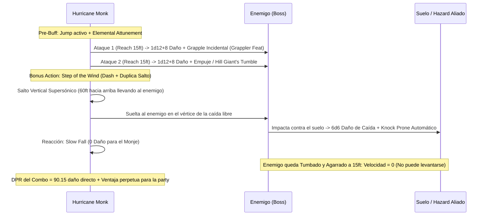

# 🌟 Lista de Conjuros y Recursos — Hurricane Monk

Esta lista detalla la selección de conjuros y recursos para el build **Hurricane Monk**, optimizada bajo las reglas de **D&D 5e (2024 / 5.5e)** para un Monje 19 / Ranger 1.

---

## ⚡ Conjuros Activos y Pre-Buffs (Turno 0 / Fuera de Combate)

| Conjuro / Recurso | Duración | Concentración | Efecto Táctico Clave |
| :--- | :---: | :---: | :--- |
| **Longstrider (Nivel 1)** | 1 hora | No | +10 ft a todas las velocidades de movimiento (alcanza 120 ft con Boon of Speed). |
| **Jump (Nivel 1)** | 1 minuto | No | Añade +30 ft a la distancia de cada salto (vertical y horizontal) sin gastar acción extra. |
| **Sanctum Ward (Bastión)** | 24 horas | No | +100 Puntos de Golpe Temporales obtenidos en el Sanctum de los Cuatro Vientos. |
| **Festín de la Cocina Sagrada** | 24 horas | No | +10 Puntos de Golpe Temporales para todo el grupo. |

---

## 🔮 Trucos (Cantrips)

*Procedentes de la dote de origen **Magic Initiate (Druid / Ranger)** (Background Guide).*

1. **Guidance 🔵 [Indispensable]:** Añade +1d4 a cualquier prueba de habilidad. Imprescindible para pruebas de Atletismo al apresar o Acrobacias.
2. **Thorn Whip 🟢 [Excelente]:** Ataque de conjuro cuerpo a cuerpo con 30 ft de alcance que atrae al enemigo 10 ft hacia ti. Permite iniciar el control de distancias antes de cerrar el combate.

---

## 🎒 Conjuros Preparados de Ranger (Nivel 1 — 2 Ranuras + 1 Uso Gratuito)

*CD de Salvación de Conjuros:* $8 + 6_{\text{PB}} + 4_{\text{WIS}} = \mathbf{18}$. Modificador de Ataque de Conjuro: $\mathbf{+10}$.

1. **Jump (Salto) 🔵 [Roto / Motor de Combate]:** En D&D 2024, no requiere concentración y otorga +30 ft a cada salto durante 1 minuto completo. Es el catalizador indispensable del **Martinete Aéreo (Pile-Driver)** para estampar enemigos desde las alturas.
2. **Hunter's Mark (Marca del Cazador) 🟢 [Excelente - Daño Sostenido]:** Requiere concentración. Añade $1\text{d}6$ de daño por cada impacto desarmado (hasta +5d6 de daño por asalto en Flurry of Blows contra objetivos de alto calibre).
3. **Longstrider 🟢 [Excelente - Movilidad]:** 1 hora de duración sin concentración para maximizar el radio de arrastre de *Grappler*.
4. **Goodberry 🟡 [Curación de Emergencia]:** Crea 10 bayas que curan 1 PG cada una y alimentan por un día entero. Ideal para estabilizar aliados caídos fuera de combate.
5. **Absorb Elements 🟢 [Reacción Defensiva]:** Reacción ante daño elemental. Otorga resistencia y añade 1d6 a tu siguiente ataque cuerpo a cuerpo.

---

## 🌪️ Matriz de Recursos de Focus Monástico (19 Puntos a Nivel 20)

| Habilidad de Focus | Coste de Focus | Acción Requerida | Efecto Mecánico |
| :--- | :---: | :---: | :--- |
| **Flurry of Blows** | 1 Focus | Bonus Action | Realiza **3 ataques desarmados** adicionales (gracias a *Heightened Focus*). |
| **Patient Defense** | 1 Focus | Bonus Action | Realiza la acción de Esquivar (*Dodge*) y recupera $1\text{d}12 + 5$ PG. |
| **Step of the Wind** | 1 Focus | Bonus Action | Realiza la acción de Carrera (*Dash*) y Retirada (*Disengage*), duplicando la distancia de salto. |
| **Elemental Attunement** | 1 Focus | Bonus Action | Activa alcance desarmado de 15 ft, daño elemental y empuje/atracción de 10 ft por 10 minutos. |
| **Elemental Burst** | 2 Focus | Action | Explosión de 20 ft de radio a 120 ft. $3\text{d}12$ de daño elemental en área y control de posición. |
| **Deflect Attacks / Energy** | 1 Focus | Reacción | Si reduce el daño a 0, redirige el ataque infligiendo el daño al atacante u otro objetivo a 60 ft. |
| **Superior Defense** | 3 Focus | Bonus Action | Concede **resistencia a todos los tipos de daño** (salvo Fuerza) durante 1 minuto completo. |

---

## 💥 Secuencia de Daño Nova (The Sky-Shatter Pile-Driver)

---

## 💚 Curación en Segundo Plano (Background Healing)

* **Pociones en Acción Adicional (Regla Oficial D&D 2024):** El Monje puede beber una *Potion of Supreme Healing* ($10\text{d}4 + 20 \approx 45\text{ PG}$) como Acción Adicional en cualquier turno de crisis sin renunciar a sus ataques principales.
* **Patient Defense Healing:** Al usar *Patient Defense*, cura de forma pasiva $1\text{d}12 + 5 \approx 11.5\text{ PG}$ mientras entra en guardia defensiva con Desventaja para los atacantes.
* **Charm of Restoration (Bastión):** Reserva de restauración que limpia parálisis, venenos o ceguera al instante.
* **Goodberry Surplus:** Al terminar cada descanso largo, convierte los 2 espacios de nivel 1 no utilizados en 20 bayas de curación para distribuir entre los aliados heridos.
