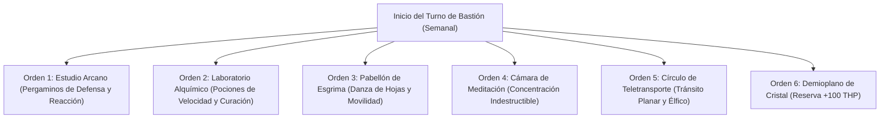

# 🏰 Bastión y Tiempo Muerto — Iron Dancer: The Angelic Bladestorm

## 🏰 Sistema de Bastiones (Reglas Oficiales DMG 2024 / 5.5e)

* **Nombre del Bastión:** La Academia de la Espada de Oro (*Gilded Blade Academy*)
* **Ubicación:** Un complejo de agujas de mármol blanco y cristal suspendidas en una isla flotante sobre un valle boscoso.
* **Nivel de Bastión (Bastion Level):** Nivel 20
* **Puntos de Bastión (Bastion Points - BP):** 530 BP acumulados
* **Bonificador de Defensa de Bastión:** **+11** ($5_{\text{INT}} + 6_{\text{PB}}$)

---

### 🏛️ Instalaciones Básicas (Basic Facilities)

1. **Aposentos Astronómicos (Bedchambers):** Estudio con balcones abiertos al cielo para despegues de vuelo y estanterías de tratados esgrimísticos.
2. **Refectorio de los Danzantes (Dining Hall):** Salón con mesas circulares y sirvientes mágicos autónomos que sirven néctares y frutas estelares.
3. **Galería Común de Estudio (Common Room):** Sala de lectura iluminada por orbes de luz perenne para debate de teoría arcana.
4. **Armería y Archivo de Cristales (Storage):** Reserva de estoques de acero argentífero, pergaminos de vitela y diamantes de transmutación.

---

### 🔮 Instalaciones Especiales (Special Facilities — 6 Slots Nivel 20: 4 Roomy + 2 Vast)

1. **Estudio Arcano (Arcane Study — Roomy, Nivel 5):**
   * *Orden de Bastión:* **Research / Craft.**
   * *Efecto Mecánico:* Fabricación de pergaminos arcanos de reacción y defensa (*Shield*, *Absorb Elements*, *Counterspell*, *Misty Step*) a mitad de coste y tiempo.
2. **Laboratorio de Alquimia (Laboratory — Roomy, Nivel 5):**
   * *Orden de Bastión:* **Craft.**
   * *Efecto Mecánico:* Destilación de elixires de velocidad (*Potion of Speed*) y *Potions of Supreme Healing* con un 50% de descuento en materiales.
3. **Pabellón de Esgrima Acrobática (Training Grounds — Roomy, Nivel 9):**
   * *Orden de Bastión:* **Train.**
   * *Efecto Mecánico:* Concede Inspiración Heroica automática al Bladesinger al salir del bastión y entrena a la guarnición en técnicas de combate con estoque sin provocar ataques de oportunidad (*Mobile*).
4. **Cámara de Meditación Trascendental (Meditation Chamber — Roomy, Nivel 9):**
   * *Orden de Bastión:* **Empower.**
   * *Efecto Mecánico:* Otorga el *Charm of the Iron Mind*: Ventaja en tiradas de salvación de Inteligencia y Constitución durante 7 días para asegurar el mantenimiento de *Shapechange*.
5. **Círculo de Teletransporte Permanente (Vast — Nivel 13):**
   * *Orden de Bastión:* **Maintain.**
   * *Efecto Mecánico:* Enlace planar que conecta la Academia flotante con las capitales arcanas de Faerûn y los planos superiores celestiales.
6. **Demioplano de Cristal / Sanctum Celestial (Sanctum — Vast, Nivel 17):**
   * *Orden de Bastión:* **Empower.**
   * *Efecto Mecánico:* Tras completar un descanso largo en el demioplano, el personaje absorbe un aura radiante que le otorga **+100 Puntos de Golpe Temporales** y resistencia total al daño Radiante y Necrótico.

---

## ⏳ Actividades de Tiempo Muerto (Downtime Activities)

### Prioridad 1: Copiado de Conjuros al Grimorio de la Academia

* **Mecánica Base:** PHB / DMG 2024 (Reglas de Transcripción de Mago).
* **Tiradas y Bonificadores:** Inteligencia (+5 con herramientas de calígrafo).
* **Objetivo de Optimización:** Transcribir la totalidad de la lista de conjuros de Mago para disponer de preparación flexible ante cualquier amenaza cósmica.

### Prioridad 2: Elaboración de Infusiones y Túnicas Mágicas

* Fabricación y recarga de la túnica *Mind Sharpener* (4 éxitos de concentración al día).

---

## 🏃‍♂️ Modos de Movimiento, Logística y Viaje

### Velocidades de Movimiento Base

* **Caminar (Walk):** **40 ft/turno** (30 ft Base + 10 ft *Mobile*; **50 ft** durante *Bladesong*).
* **Trepar (Climb):** 40 ft/turno.
* **Nadar (Swim):** 40 ft/turno.
* **Volar (Fly):** **140 ft/turno** en forma de **Planetar** ($120\text{ ft Base} + 10\text{ ft Bladesong} + 10\text{ ft Mobile}$ sin provocar ataques de oportunidad).

### Modificadores y Sentidos de Exploración

* **Visión Verdadera:** 120 ft en forma de Planetar (visión a través de ilusiones, oscuridad mágica y metamorfosis).
* **Percepción Pasiva:** 21 en forma de Planetar (+11 con percepción divina).
* **Resistencia Mágica:** Ventaja permanente en tiradas de salvación contra conjuros y otros efectos mágicos.
