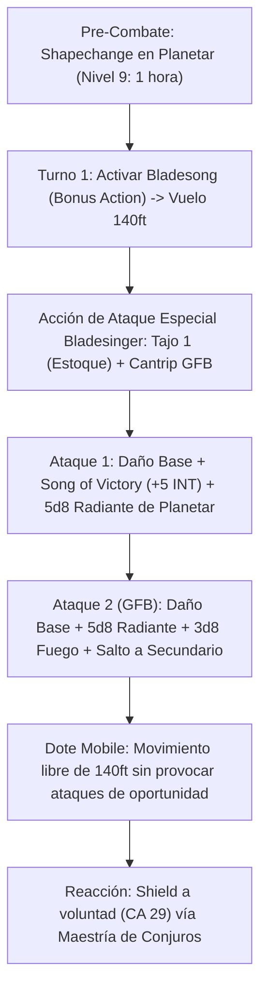

# Resumen General del Personaje: Iron Dancer (The Angelic Bladestorm)

## Datos Generales

* **System Standard:** D&D 5th Edition (2014 Ruleset / 2024 Compatible)
* **Character Level:** 20 (Total)
* **Class Split:** Wizard (Bladesinger) 18 / Artificer 2
* **Species:** Custom Lineage o Elfo (Dote Nivel 1: *War Caster*)
* **Stats (Point Buy + Dotes + ASIs):**
  * **FUER (STR):** 8 (-1)
  * **DES (DEX):** 20 (+5) *(15 Base + 2 Racial + 1 ASI Nivel 10 + 2 ASI Nivel 18)*
  * **CON:** 14 (+2) *(Fijada en 19 [+4] con Amulet of Health)*
  * **INT:** 20 (+5) *(15 Base + 1 Fey Touched + 2 ASI Nivel 14 + 2 ASI Nivel 18)*
  * **SAB (WIS):** 10 (+0)
  * **CAR (CHA):** 8 (-1)

* **Enlaces de Documentación:**
  * [Bastión y Tiempo Muerto](file:///d:/repo-vault/Proyectos/Rol/DnDbuilds/builds/iron%20dancer/bastion%20and%20downtime.md)
  * [Lista de Conjuros y Recursos](file:///d:/repo-vault/Proyectos/Rol/DnDbuilds/builds/iron%20dancer/spell%20list.md)
  * [Objetos a Obtener](file:///d:/repo-vault/Proyectos/Rol/DnDbuilds/builds/iron%20dancer/item%20list%20to%20obtain.md)
  * [Hoja de Ruta 1-20](file:///d:/repo-vault/Proyectos/Rol/DnDbuilds/builds/iron%20dancer/roadmap.md)
  * [Inventario Actual](file:///d:/repo-vault/Proyectos/Rol/DnDbuilds/builds/iron%20dancer/actual%20inventory%20list.md)

---

## Combat Role: Frontline Evasive Tank / Angelic Apex Striker / Concentration Inmortal

El **Iron Dancer** personifica el pináculo del gish arcano evasivo. Comenzando como Artífice para adquirir salvaciones de Constitución nativas e infusiones defensivas (*Mind Sharpener* para ignorar pérdidas de concentración), progresa 18 niveles como Mago Bladesinger hasta desbloquear **Spell Mastery** (*Shield* a voluntad como Reacción sin coste de ranura) y el combo cumbre de **Shapechange** (Nivel 9): se transmuta en un **Planetar** (Ángel celestial CR 16) mientras preserva todos sus rasgos de Bladesinger (*Bladesong*, *Song of Victory*, *Extra Attack* cantrip, *War Caster*, *Mobile*). En esta forma celestial, vuela a **140 pies por asalto**, añade **$+5\text{d}8$ de daño radiante natural** a cada impacto de estoque, y baila por encima de las cabezas enemigas con una CA de 29 y concentración indestructible.

---

## 1. Gestión de Recursos y Reglas de Inventario

* **Economía de Manos y Foco Universal:** El estoque actúa como foco unificado de lanzamiento para todos los conjuros de Mago y Artífice. Bladesong prohíbe el uso de armaduras medias/pesadas y escudos, lo que se compensa mediante *Mage Armor* o la *Robe of the Archmagi* (CA 15 + DES).
* **Maestría de Conjuros (Spell Mastery - Wizard 18):** Elige el conjuro *Shield* (Nivel 1) y *Misty Step* (Nivel 2). Puede lanzar *Shield* a voluntad en Reacción **sin consumir espacios de conjuro**, elevando su CA en +5 de manera prácticamente inagotable.
* **Salvaguarda de Concentración Indestructible:**
  1. Competencia nativa en tiradas de salvación de Constitución por iniciar como Artífice (+6 PB).
  2. Bonificador de Inteligencia (+5) sumado a las salvaciones de concentración por *Bladesong*.
  3. Modificador de Constitución (+4 con *Amulet of Health*): Bonificador total de concentración = **+15**.
  4. Ventaja en concentración concedida por la dote *War Caster*.
  5. Infusión *Mind Sharpener*: Permite tener éxito automático ante 4 fallos fortuitos al día.

---

## 2. Action Economy & Combat Loop

* **Pre-Combate (Turno 0):** Lanzar *Shapechange* de nivel 9 para transformarse en **Planetar**. Si no se dispone de ranura 9, activar *Mage Armor* y *Mind Blank*.
* **Turno 1 — Despliegue de la Tempestad Angelical:**
  * **Bonus Action:** Activar *Bladesong* (+5 a CA, +10 ft velocidad, +5 a concentración).
  * **Movimiento:** Vuelo supersónico de **140 pies/turno** ($120\text{ ft Planetar} + 10\text{ ft Bladesong} + 10\text{ ft Mobile}$).
  * **Action:** Extra Attack especial de Bladesinger:
    * **Ataque 1 (Estoque +3):** Inflige $1\text{d}8 + 5_{\text{DEX}} + 5_{\text{INT}} + 5\text{d}8_{\text{Radiant}} + 3\text{d}6_{\text{Dragon's Wrath}} + 3_{\text{Item}} = \mathbf{50.5 \text{ Daño}}$.
    * **Ataque 2 (Cantrip - Green-Flame Blade):** Inflige $1\text{d}8 + 5_{\text{DEX}} + 5_{\text{INT}} + 5\text{d}8_{\text{Radiant}} + 3\text{d}8_{\text{Fuego}} + 3\text{d}6_{\text{Item}} + 5_{\text{INT}} + 3_{\text{Item}} = \mathbf{69.0 \text{ Daño}}$.
    * **Salto de Llama:** Inflige $3\text{d}8 + 10 = \mathbf{23.5 \text{ Daño de Fuego}}$ a un segundo objetivo adyacente.
  * **Dote Mobile:** Te alejas volando hacia la estratosfera sin provocar ataques de oportunidad del objetivo atacado.
* **Reaction:**
  * *Shield (Spell Mastery):* Lanza *Shield* gratis para elevar la CA a **29**.
  * *Song of Defense:* Reduce daño residual consumiendo ranuras bajas si algún golpe conecta.

---

## 3. Mathematical Engine (D&D 5e / 2014 & 2024 Compatible)

### 🛡️ Clase de Armadura y Defensa en Forma de Planetar

$$\text{CA Base de Planetar} = 19 \text{ (Armadura Natural Celestial)}$$

$$\text{CA en Bladesong} = 19_{\text{Natural}} + 5_{\text{INT (Bladesong)}} = \mathbf{24 \text{ CA Pasiva}}$$

$$\text{CA con Conjuro Shield Ilimitado} = 24 + 5_{\text{Shield (Spell Mastery)}} = \mathbf{29 \text{ CA Efectiva}}$$

* **Defensa sin Shapechange (Forma Humanoide):**
  $$\text{CA Humanoide} = 15_{\text{Robe of Archmagi}} + 5_{\text{DEX}} + 5_{\text{INT}} + 5_{\text{Shield}} = \mathbf{30 \text{ CA}}$$

* **Probabilidad de Impacto Enemigo (+14 al Ataque contra CA 29):**
  $$\text{Impacto} = P(\text{Tirada } \ge 15) = \frac{6}{20} = \mathbf{0.30 \quad (30\%)}$$
  Con la dote *Mobile*, el Iron Dancer raramente se encuentra al alcance de melé enemiga al terminar su turno a 60 pies en el aire.

### 🧮 Daño por Asalto Sostenido (DPR a Nivel 20 en Forma Planetar)

Con Destreza 20 (+5), Inteligencia 20 (+5), *Ascendant Dragon's Wrath Rapier +3*, y rasgo *Angelic Weapons* de Planetar ($+5\text{d}8$ radiante por impacto):

$$\text{Daño Ataque 1} = 1\text{d}8 + 5_{\text{DEX}} + 5_{\text{Song of Victory}} + 5\text{d}8_{\text{Planetar}} + 3\text{d}6_{\text{Dragon's Wrath}} + 3_{\text{Item}} = 6\text{d}8 + 3\text{d}6 + 13 = \mathbf{50.5 \text{ Daño}}$$

$$\text{Daño Ataque 2 (GFB)} = 1\text{d}8 + 5 + 5 + 5\text{d}8 + 3\text{d}8_{\text{GFB}} + 3\text{d}6 + 5_{\text{INT}} + 3 = 9\text{d}8 + 3\text{d}6 + 18 = \mathbf{69.0 \text{ Daño}}$$

$$\text{Daño Salto de Llama (Objetivo Secundario)} = 3\text{d}8 + 10 = \mathbf{23.5 \text{ Daño de Fuego}}$$

$$\text{DPR al Objetivo Principal} = 0.75 \times (50.5 + 69.0) + 0.05 \times (27.0 + 40.5) = 89.62 + 3.37 = \mathbf{93.0 \text{ DPR Sostenido}}$$

$$\text{DPR Total con Objetivo Secundario} = 93.0 + 23.5 = \mathbf{116.5 \text{ DPR Combinado sin Ranuras de Conjuro}}$$

### 🩸 Supervivencia y EHP

$$\text{Puntos de Golpe en Forma de Planetar} = \mathbf{200 \text{ PG Celestiales}} \quad (\text{Colchón que absorbe daño antes de tocar los 164 PG del Mago})$$

$$\text{EHP Efectivo Total} = 200_{\text{Planetar}} + 164_{\text{Mago}} + 100_{\text{Sanctum Ward}} = \mathbf{464 \text{ EHP}} \quad (\text{con Resistencia Mágica permanente})$$

---

## 4. Tabla de Rendimiento Táctico

| Criterio | Valoración | Justificación Mecánica |
| :--- | :---: | :--- |
| **Daño Monobjetivo** | 🔵 | 116+ DPR sin gastar ranuras mediante *Angelic Weapons* ($+5\text{d}8$ radiante), *Song of Victory* (+5 INT) y *Green-Flame Blade*. |
| **Control de Masas (CC)** | 🔵 | Repertorio completo de Mago de nivel 9 (*Forcecage*, *Maze*, *Wall of Force*, *Simulacrum*). |
| **Supervivencia (EHP)** | 🔵 | CA 29 con *Shield* a voluntad gratis, 200 PG celestiales de Planetar, ventaja en salvaciones contra magia, y vuelo de 140 ft fuera de alcance. |
| **Economía de Acciones** | 🔵 | Vuelo de 140 ft con *Mobile*, Extra Attack con cantrip integrado, *Shield* a voluntad en Reacción y *Misty Step* en Acción Adicional. |
| **Sustentabilidad** | 🔵 | *Spell Mastery* elimina el coste de ranuras de nivel 1 y 2. El daño ofensivo celestial de Planetar opera de forma indefinida sin ranuras. |

---

## 5. Home Rules (Reglas de la Mesa)

1. **Estoques como Foco Mágico:** El estoque actúa como canalizador universal para conjuros de Mago y Artífice.
2. **Mantenimiento de Rasgos en Shapechange:** Se ratifica que el Bladesinger preserva *Bladesong*, dotes (*Mobile*, *War Caster*) y rasgos de clase (*Song of Victory*) al transformarse con *Shapechange*.
