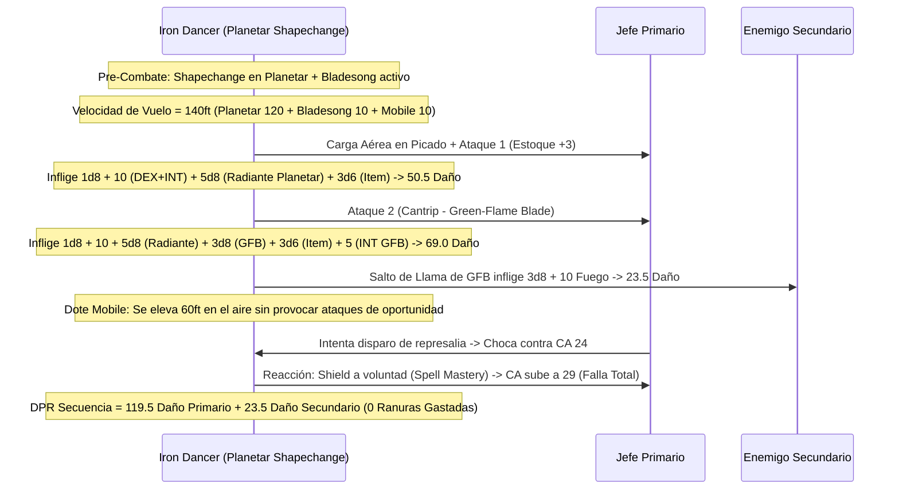

# 🌟 Lista de Conjuros y Recursos — Iron Dancer: The Angelic Bladestorm

Esta lista detalla la selección de conjuros y recursos para el **Iron Dancer** (Wizard Bladesinger 18 / Artificer 2), optimizada bajo reglas de D&D 5e (2014 & 2024).

> **Nivel de Lanzador Multiclase:** $2/2_{\text{Artificer}} + 18_{\text{Wizard}} = \mathbf{19.^{\circ} \text{ Nivel de Lanzador}}$.  
> Dispone del repertorio completo de espacios de conjuro de nivel 1 a 9, más la **Maestría de Conjuros (Spell Mastery)** que permite lanzar *Shield* y *Misty Step* a voluntad.

---

## ⚡ Conjuros Activos y Pre-Buffs (Turno 0 / Fuera de Combate)

| Conjuro / Recurso | Duración | Concentración | Efecto Táctico Clave |
| :--- | :---: | :---: | :--- |
| **Shapechange (Nivel 9)** | 1 hora | Sí | Te transforma en un **Planetar (CR 16)** manteniendo *Bladesong*, *Song of Victory*, *Mobile* y *War Caster*. Otorga vuelo 140 ft, $+5\text{d}8$ de daño radiante por ataque, CA 19 natural y Resistencia Mágica. |
| **Mind Blank (Nivel 8)** | 24 horas | No | Inmunidad total al daño psíquico y a la detección o control mental. |
| **Mage Armor (Nivel 1)** | 8 horas | No | Concede CA 13 + DES para cuando se combate en forma humanoide. |
| **Sanctum Ward (Bastión)** | 24 horas | No | Reserva de **+100 Puntos de Golpe Temporales** obtenida en el Demioplano de Cristal. |

---

## 🔮 Trucos (Cantrips)

### Artífice (2) + Mago (5)

1. **Green-Flame Blade 🔵 [Roto - Cantrip de Combate]:** Sustituye tu segundo ataque e inflige $3\text{d}8$ de fuego al objetivo principal y salta $3\text{d}8 + 5$ a un enemigo secundario.
2. **Booming Blade 🔵 [Control de Movimiento]:** Añade $3\text{d}8$ de trueno si el objetivo intenta moverse tras ser golpeado.
3. **Guidance 🔵 [Indispensable]:** +1d4 a pruebas de habilidad propias o de aliados.
4. **Minor Illusion 🟢 [Utilidad]:** Creación de coberturas visuales tácticas.
5. **Mage Hand 🟡 [Utilidad]:** Manipulación remota de objetos a 30 ft.
6. **Fire Bolt 🟢 [Daño a Distancia]:** $4\text{d}10$ de fuego a 120 ft.
7. **Light 🟡 [Utilidad]:** Iluminación básica.

---

## 🎒 Conjuros Preparados de Mago y Artífice (22 Mago + 4 Artífice)

*CD de Salvación de Conjuros (INT):* $8 + 6_{\text{PB}} + 5_{\text{INT}} = \mathbf{19}$ (o **21** con *Robe of the Archmagi* / *Staff of the Magi*).

### 9.º Nivel (1 Ranura)

1. **Shapechange 🔵 [Roto / Núcleo del Build]:** Transformación en Planetar (CR 16).
2. **Wish 🔵 [Utilidad Cósmica]:** Duplica cualquier conjuro de nivel 1 a 8 sin componentes.

### 8.º Nivel (1 Ranura)

3. **Maze 🔵 [Control Absoluto]:** Destierra a un jefe enemigo a un laberinto extradimensional sin tirada de salvación.
4. **Mind Blank 🟢 [Inmunidad Mental]:** 24 horas sin concentración.

### 7.º Nivel (2 Ranuras)

5. **Simulacrum 🔵 [Duplicado Perfecto]:** Crea una copia idéntica del Bladesinger para duplicar el DPR celestial en combate.
6. **Forcecage 🔵 [Encierro]:** Celda invisible indestructible sin salvación durante 1 hora.

### 6.º Nivel (2 Ranuras)

7. **Mass Suggestion 🔵 [Control Masivo]:** Sugestión a 12 criaturas durante 24 horas sin concentración.
8. **Disintegrate 🟢 [Daño Nuclear]:** $10\text{d}6 + 40$ de daño de fuerza.

### 5.º Nivel (3 Ranuras)

9. **Wall of Force 🔵 [Muro Indestructible]:** Aísla o divide a grupos de enemigos sin tirada de salvación.
10. **Synaptic Static 🔵 [Detonación sin Concentración]:** $8\text{d}6$ psíquico en 20 ft y -1d6 a ataques enemigos.

### 4.º Nivel (3 Ranuras)

11. **Greater Invisibility 🟢 [Ventaja Total]:** Ataques con Ventaja e inmunidad a hechizos dirigidos.
12. **Dimension Door 🟢 [Movilidad]:** Teletransporte de 500 pies.
13. **Fire Shield 🔵 [Espinas]:** $2\text{d}8$ de daño de fuego/frío a atacantes en melé sin concentración.

### 3.ᵉʳ Nivel (3 Ranuras)

14. **Counterspell 🔵 [Reacción]:** Cancela conjuros enemigos reactivamente.
15. **Dispel Magic 🟢 [Utilidad]:** Anula magia enemiga activa.
16. **Shadow Blade 🔵 [Arma Psíquica]:** $3\text{d}8$ a $4\text{d}8$ psíquico con Ventaja en penumbra (alternativa a Shapechange).

### 2.º Nivel (3 Ranuras)

17. **Misty Step 🔵 [Spell Mastery — A Voluntad]:** Teletransporte de 30 ft como Acción Adicional **gratis y sin límite**.
18. **Mirror Image 🔵 [Defensa Ilusoria]:** 3 duplicados sin concentración.
19. **Vortex Warp 🟢 [Reposicionamiento]:** Reubica aliados o enemigos a 90 ft.

### 1.ᵉʳ Nivel (4 Ranuras)

20. **Shield 🔵 [Spell Mastery — A Voluntad]:** +5 a la CA como Reacción **gratis y sin límite** (CA sube a 29-30).
21. **Absorb Elements 🔵 [Defensa Elemental]:** Resistencia como Reacción ante daño elemental.
22. **Mage Armor 🔵 [Defensa Pasiva]:** CA 13 + DES.

---

## 💥 Secuencia de Daño Nova (The Angelic Executioner)

---

## 💚 Curación en Segundo Plano y Sostenibilidad

* **Lanzamiento Innato del Planetar:** En forma de Planetar, dispone de conjuros divinos innatos (1/día cada uno):
  * **Heal (Curación Suprema):** Restaura de forma instantánea **70 Puntos de Golpe** y limpia ceguera, sordera y enfermedades.
  * **Cure Wounds:** $2\text{d}8 + 5$ de curación directa.
  * **Lesser Restoration & Raise Dead:** Soporte vital y resurrección celestial.
* **Mind Sharpener Robe:** Asegura 4 éxitos automáticos diarios si alguna tirada de concentración llegara a fallar.
* **Pociones en Acción Adicional:** Consumo rápido de *Potion of Supreme Healing* ($10\text{d}4 + 20 \approx 45\text{ PG}$) bajo reglas oficiales 2024.
