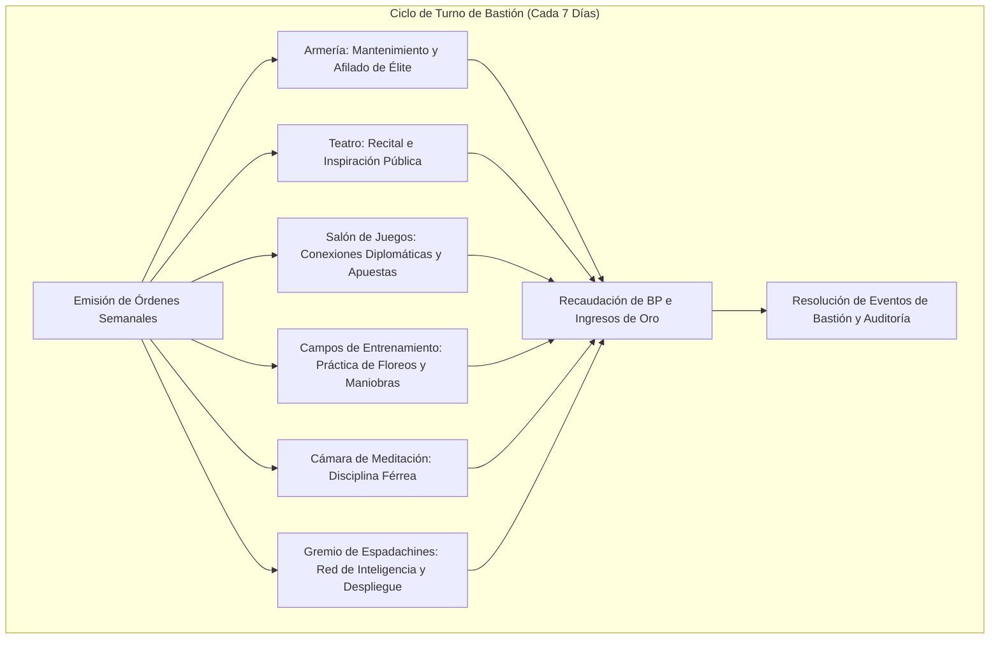

# 🏰 Bastión y Tiempo Muerto — Le Biter

## 🏰 Sistema de Bastiones (Reglas Oficiales DMG 2024 / D&D 5.5e)

*Estructura de gestión de la base de operaciones, economía de bastión y mecánicas de mando.*

* **Nombre del Bastión:** La Academia de las Hojas Musicales (The Blade Academy)
* **Nivel de Bastión (Bastion Level):** 20
* **Puntos de Bastión (Bastion Points - BP):** 110
* **Puntuación de Mando (Bastion Defender Stats):** +11 al ataque y salvaciones defensivas (STR 8 [-1], DEX 20 [+5], CON 14 [+2], INT 10 [+0], WIS 10 [+0], CHA 16 [+3]).

---

### Instalaciones Básicas (Basic Facilities)

1. **Dormitorio Principal (Bedchambers):** Lujosas estancias con tapices de batallas históricas, sedas y ventanales acristalados que ofrecen vistas a la plaza de armas.
2. **Comedor y Escenario (Dining Hall):** Gran sala de banquetes con tarima elevada para recitales poéticos y veladas musicales con mecenas de la nobleza.
3. **Salón Comunal (Common Area):** Espacio de reunión para estudiantes y duelistas donde se discuten tácticas marciales y composición armónica.

---

### Instalaciones Especiales (Special Facilities — Exactamente 6: 4 Roomy + 2 Vast)

#### 1. Armería Militar (Armory — Roomy, Desbloqueo Nivel 5)
* **Estado:** Activa (Mantener)
* **Tamaño:** Roomy (Espaciosa)
* **Orden de Bastión:** *Equip (Equipar)*
* **Sinergia con el Build:** 🟢 **Excelente**. Forja y pule estoques de precisión y escudos de parada. Incrementa la defensa estructural del bastión en +4 puntos contra asedios e intrusiones hostiles.

#### 2. Teatro y Salón de Recitales (Theater — Roomy, Desbloqueo Nivel 5)
* **Estado:** Activa (Mantener)
* **Tamaño:** Roomy (Espaciosa)
* **Orden de Bastión:** *Perform (Actuar e Inspirar)*
* **Sinergia con el Build:** 🔵 **Indispensable**. Aumenta el prestigio social del personaje. Otorga al grupo ventaja en tiradas de Carisma (Persuasión y Engaño) con autoridades locales y recarga una reserva de inspiración previa a incursiones.

#### 3. Salón de Juegos y Club Social (Gaming Hall — Roomy, Desbloqueo Nivel 9)
* **Estado:** Activa (Mantener)
* **Tamaño:** Roomy (Espaciosa)
* **Orden de Bastión:** *Trade (Generar Recursos y Contactos)*
* **Sinergia con el Build:** 🟢 **Excelente**. Centro de juego y apuestas donde nobles y mecenas dejan fluir información confidencial. Rinde una media de $1\text{d}10 \times 20$ po limpios por semana y descubre rumores tácticos.

#### 4. Campos de Entrenamiento Marcial (Training Grounds — Roomy, Desbloqueo Nivel 9)
* **Estado:** Activa (Mantener)
* **Tamaño:** Roomy (Espaciosa)
* **Orden de Bastión:** *Train (Entrenar Floreos y Maniobras)*
* **Sinergia con el Build:** 🟢 **Excelente**. Perfecciona la ejecución de maniobras de Battle Master y floreos de espada. Otorga al personaje +1d4 a su primera tirada de iniciativa tras salir del bastión.

#### 5. Cámara de Meditación y Concentración (Meditation Chamber — Vast, Desbloqueo Nivel 13)
* **Estado:** Activa (Mantener)
* **Tamaño:** Vast (Vasta)
* **Orden de Bastión:** *Focus (Enfoque Armónico)*
* **Sinergia con el Build:** 🟢 **Excelente**. Retiro acústico donde la música se combina con el control mental. Proporciona ventaja en tiradas de salvación de Constitución (concentración) durante las primeras 24 horas tras abandonar las instalaciones.

#### 6. Gremio de Espadachines de Vanguardia (Guildhall — Vast, Desbloqueo Nivel 17)
* **Estado:** Activa (Mantener)
* **Tamaño:** Vast (Vasta)
* **Orden de Bastión:** *Recruit & Deploy (Reclutar y Desplegar Defensas)*
* **Sinergia con el Build:** 🔵 **Indispensable**. Cuartel general de la élite de duelistas. Permite movilizar una brigada de 20 esgrimistas de élite para proteger intereses políticos o defender el bastión con un bono marcial de +11.

---

### Seguidores y Guarnición (Staff & Garrison)

* **Capataz General (Major Domo):** Madama Celeste (Ex-directora de la Ópera Imperial, diplomática refinada y estratega de alta alcurnia).
* **Guarnición Activa:**
  * 16 Espadachines de la Academia expertos en estoque y florete.
  * 6 Alumnos avanzados de Bardo entrenados en contramagia e identificación de amenazas.
  * 2 Lauderos y armeros especialistas en afinación de instrumentos y aleaciones ligeras.

---

## ⏳ Actividades de Tiempo Muerto (Downtime Activities)

### Prioridad 1: Fiestas y Relaciones Nobles (Carousing & High Society)
* **Mecánica Oficial:** Xanathar's Guide to Everything (Downtime: Carousing).
* **Bonificadores Aplicables:** Carisma (+3), Persuasión (+9), Engaño (+9) y dote social de bardo.
* **Objetivo:** Forjar alianzas con casas nobles, jueces y gremios de comerciantes para asegurar impunidad diplomática y fondos para expediciones.

### Prioridad 2: Entrenamiento y Dotes de Guerra
* **Mecánica Oficial:** DMG 2024 / XGE (Training).
* **Objetivo:** Perfeccionar dialectos extranjeros y lenguajes cortesanos para ampliar la influencia de la Academia en cortes foráneas.

---

## 🏃‍♂️ Modos de Movimiento, Logística y Viaje

* **Caminar (Walk):** 30 ft. (o 40 ft. en el turno en que ejecute un *Blade Flourish* gracias al rasgo de nivel 3 del bardo).
* **Iniciativa en Viaje:** +13 (+5 DES + 5 Alerta + 3 Medio PB de Bardo vía *Jack of All Trades*), garantizando reacción inmediata ante emboscadas durante la travesía.
* **Ritmo de Viaje:** Normal (24 millas por día en carruaje noble o montura ligera).
* **Visión en la Oscuridad:** Concedida mediante gafas o conjuros de apoyo.

---

## 🎭 Reputación y Facciones

1. **El Conservatorio de las Cuchillas:** Gran Maestro de Esgrima. Autoridad absoluta sobre la admisión de aprendices y licencias de duelo legal en las ciudades libres.
2. **La Liga Mercantil:** Consejero militar y diplomático honorario con salvoconducto oficial.