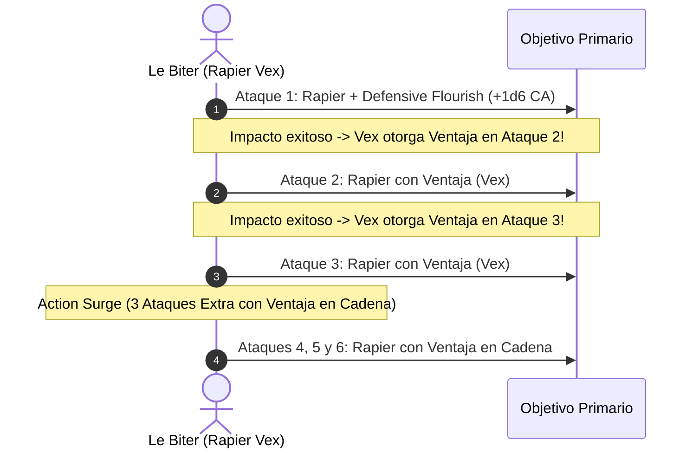

# Guía de Personaje — Le Biter (Edición 2024 / 5.5e Update)

## Datos Generales

* **System Standard:** D&D 5th Edition (2024 Ruleset - 5.5e Compatible)
* **Character Level:** 20 (Total)
* **Class Split:** Fighter (Battle Master) 17 / Bard (College of Swords) 3
* **Species:** Human (2024) [Dotes de Origen: *Alert* y *Tavern Brawler / Savage Attacker*]
* **Background:** Noble (Atributos: Destreza +2, Carisma +1)
* **Stats (Point Buy 2024 / Background):**
  * **FUER (STR):** 8 (-1)
  * **DES (DEX):** 20 (+5) *(15 Base + 2 Trasfondo + 2 ASI Nivel 4 + 1 Dote Nivel 6)*
  * **CON:** 14 (+2) *(14 Base)*
  * **INT:** 10 (+0) *(Standard Array)*
  * **SAB (WIS):** 10 (+0) *(Standard Array)*
  * **CAR (CHA):** 16 (+3) *(13 Base + 1 Trasfondo + 1 Fey Touched + 1 Dote)*

* **Enlaces de Documentación:**
  * [Bastión y Tiempo Muerto](file:///d:/repo-vault/Proyectos/Rol/DnDbuilds/builds/le%20biter/bastion%20and%20downtime.md)
  * [Lista de Conjuros y Recursos](file:///d:/repo-vault/Proyectos/Rol/DnDbuilds/builds/le%20biter/spell%20list.md)
  * [Objetos a Obtener](file:///d:/repo-vault/Proyectos/Rol/DnDbuilds/builds/le%20biter/item%20list%20to%20obtain.md)
  * [Hoja de Ruta 1-20](file:///d:/repo-vault/Proyectos/Rol/DnDbuilds/builds/le%20biter/roadmap.md)
  * [Inventario Actual](file:///d:/repo-vault/Proyectos/Rol/DnDbuilds/builds/le%20biter/actual%20inventory%20list.md)

---

## Combat Role: Vex Master Duelist, Riposte Counter-Striker & High AC Sentinel

Bajo las reglas oficiales de 2024 (5.5e), el estoque (*Rapier*) cuenta con la propiedad de maestría de armas **Vex**: al impactar a una criatura, obtienes ventaja automáticamente en tu siguiente tirada de ataque contra ella antes del final de tu siguiente turno. Esto crea un bucle autosostenido de ataques con ventaja en cada asalto.

---

## 1. Gestión de Recursos y Reglas de Inventario (Reglas 2024)

* **Maestría de Armas (Weapon Mastery — Rapier [Vex]):**
  * Cada impacto exitoso activa *Vex*, garantizando ventaja en el siguiente golpe sin necesidad de gastar recursos de derribo.
* **Economía de Maniobras de Battle Master 2024:**
  * Si inicias tu turno sin dados de superioridad, recuperas 1 de forma pasiva a partir de nivel 15 (*Relentless*).
  * Los dados escalan a 6d10 por descanso corto.
* **Economía de Bardo 2024:**
  * Preparación flexible de conjuros y floreos del *College of Swords* sin penalización de manos gracias a empuñar el estoque como foco musical/arcano.

---

## 2. Action Economy & Combat Loop (2024)

* **Preparación (Pre-Combate):**
  * Despliegue de *Mirror Image* (sin concentración).
* **Action:**
  * **Acción de Ataque:** 3 ataques con Estoque (+14 a impactar). El impacto 1 activa *Vex* (ventaja para el ataque 2) y *Defensive Flourish* (+1d6 al daño y +1d6 a la CA).
  * **Action Surge:** 3 ataques adicionales con ventaja continua gracias al bucle de *Vex*.
* **Bonus Action:**
  * *Second Wind (2024):* Se puede usar varias veces por descanso largo y permite moverte la mitad de tu velocidad sin provocar ataques de oportunidad (*Tactical Shift* 2024).
* **Reaction:**
  * *Riposte (Battle Master):* Contraataque inmediato si el enemigo falla contra tu CA de 30+.
  * *Shield / Silvery Barbs:* Protección reactiva y forzado de fallos críticos.

---

## 3. The META Combo 2024: Vex Chain + Defensive Flourish + Action Surge

### 🧮 Motor Matemático (2024 Ruleset)

$$\text{DPR Asalto Normal (3 Ataques Vex)} = 3 \times (1\text{d}8 + 5_{\text{DEX}} + 2_{\text{Dueling}}) + 1\text{d}6_{\text{Flourish}} = 3 \times 11.5 + 3.5 = \mathbf{38.0 \text{ daño}}$$

Con *Ascendant Dragon's Wrath Rapier (+3, +3d6)* y Action Surge (6 ataques):

$$\text{DPR Nova Action Surge 2024} = 6 \times (1\text{d}8 + 10 + 3\text{d}6) + 1\text{d}6_{\text{Flourish}} + 1\text{d}10_{\text{Maneuver}} = (6 \times 25.0) + 3.5 + 5.5 = \mathbf{159.0 \text{ daño}}$$

$$\text{Pico de CA Activa} = 27 (\text{Base}) + 3.5 (\text{Flourish}) + 5 (\text{Shield}) = \mathbf{35.5 \text{ CA Media}}$$