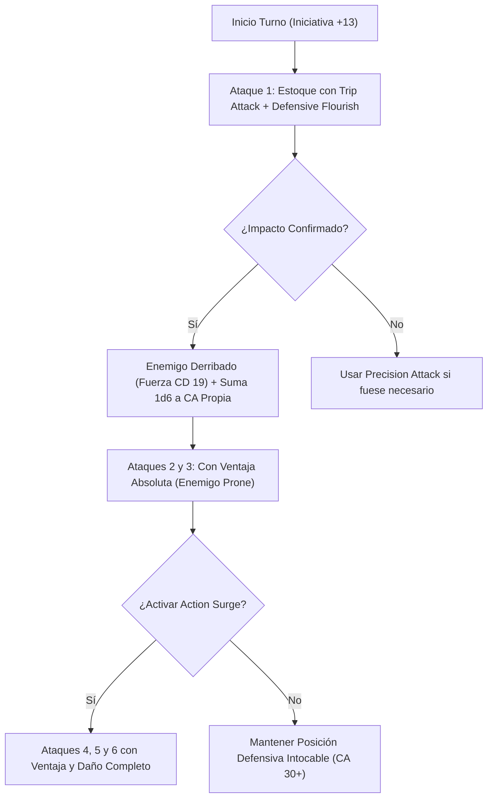

# Guía de Personaje — Le Biter (The Master Virtuoso Duelist)

## Datos Generales

* **System Standard:** D&D 5th Edition (2024 / 5.5e Update & 2014 Compatibility)
* **Character Level:** 20 (Fighter [Battle Master] 17 / Bard [College of Swords] 3)
* **Species:** Variant Human (Dote de Origen: *Alert* / *Savage Attacker*)
* **Background:** Noble / Gladiator (Atributos: Destreza +2, Carisma +1)
* **Stats (Point Buy + Racial + ASIs):**
  * **FUER (STR):** 8 (-1) *(Standard Array)*
  * **DES (DEX):** 20 (+5) *(15 Base + 1 Racial + 4 ASI Niveles 4 y 6)*
  * **CON:** 14 (+2) *(14 Base — Puntos de golpe y concentración)*
  * **INT:** 10 (+0) *(Standard Array)*
  * **SAB (WIS):** 10 (+0) *(Standard Array)*
  * **CAR (CHA):** 16 (+3) *(13 Base + 1 Racial + 1 Fey Touched + 1 ASI/Telekinetic)*

* **Enlaces de Documentación:**
  * [Bastión y Tiempo Muerto](file:///d:/repo-vault/Proyectos/Rol/DnDbuilds/builds/le%20biter/bastion%20and%20downtime.md)
  * [Lista de Conjuros y Recursos](file:///d:/repo-vault/Proyectos/Rol/DnDbuilds/builds/le%20biter/spell%20list.md)
  * [Objetos a Obtener](file:///d:/repo-vault/Proyectos/Rol/DnDbuilds/builds/le%20biter/item%20list%20to%20obtain.md)
  * [Hoja de Ruta 1-20](file:///d:/repo-vault/Proyectos/Rol/DnDbuilds/builds/le%20biter/roadmap.md)
  * [Inventario Actual](file:///d:/repo-vault/Proyectos/Rol/DnDbuilds/builds/le%20biter/actual%20inventory%20list.md)
  * [Guía de Personaje 2024](file:///d:/repo-vault/Proyectos/Rol/DnDbuilds/builds/le%20biter/character%20guide%202024.md)

---

## Combat Role: Frontline Gish Tank, Master Duelist & Battlefield Marshal

**Le Biter** combina la maestría táctica del **Battle Master (17)** con la gracia letal del **College of Swords (3)**. Es un esgrimista inalcanzable capaz de elevar su Clase de Armadura por encima de 30 mediante *Defensive Flourish* y *Shield*, controlar la iniciativa (+13 global) y descargar ráfagas de hasta 6 ataques por turno con *Action Surge* aplicando maniobras de derribo y floreos acumulativos.

---

## 1. Gestión de Recursos y Reglas de Inventario

* **Economía de Manos y Foco Universal:**
  * **Estoque Foco (*Sword Focus*):** El estoque cuenta como foco de lanzamiento de conjuros de Bardo gracias al rasgo de subclase *College of Swords*. Esto permite empuñar un estoque en la mano principal y un escudo (+2 base, +5 mágico) en la secundaria sin entorpecer los componentes somáticos o materiales de sus conjuros.
* **Economía de Ranuras y Dados de Superioridad:**
  * **Dados de Superioridad (6d10 por Descanso Corto):** Utilizados para maniobras críticas (*Trip Attack*, *Riposte*, *Precision Attack*, *Goading Attack*). Si inicia combate sin dados a nivel 15, recupera 1 automáticamente (*Relentless*).
  * **Dados de Inspiración Bárdica (3d6 por Descanso Largo):** Alimentan los *Blade Flourishes* (*Defensive*, *Slashing*, *Mobile*).
  * **Espacios de Conjuro:** 4 ranuras de Nivel 1 y 2 ranuras de Nivel 2 reservadas para *Mirror Image* (defensa sin concentración), *Hold Person* (críticos automáticos), *Silvery Barbs* y *Shield*.

---

## 2. Action Economy & Combat Loop

* **Preparación (Pre-Combate / Turno 0):**
  * Lanzamiento de *Mirror Image* (nivel 2, sin concentración) para desplegar 3 duplicados ilusorios. Postura de combate con CA pasiva 26.
* **Action:**
  * **Acción de Ataque (3 Ataques de Estoque con Extra Attack x2):**
    * **Ataque 1:** Estoque con Destreza (+14 a impactar). Al impactar, activa *Trip Attack* (daño +1d10, CD de Fuerza 19 para derribar al enemigo al suelo (*Prone*)) e incidentalmente *Defensive Flourish* (+1d6 al daño y +1d6 a la CA propia).
    * **Ataques 2 y 3:** Se realizan con **ventaja total** contra el objetivo derribado.
  * **Action Surge (2 usos por Descanso Corto a Nivel 17):** Ejecuta una segunda acción de ataque completa con otros 3 impactos a placer.
* **Bonus Action:**
  * **Second Wind:** Recupera $1\text{d}10 + 17$ puntos de golpe.
  * **Inspiración Bárdica:** Otorga un dado de apoyo a un aliado en momentos cruciales.
* **Reaction:**
  * 🔵 **Riposte (Battle Master):** Si un enemigo falla un ataque cuerpo a cuerpo contra él, gasta 1 dado de superioridad para realizar un ataque de estoque reactivo inmediato sumando el d10 al daño.
  * 🔵 **Shield / Silvery Barbs:** Eleva la CA en +5 reactivamente o anula un crítico hostil forzando un reroll.

---

## 3. The META Combo: La Vorágine del Duelista Intocable

El motor ofensivo-defensivo de **Le Biter** combina la caída del enemigo con el disparo de su propia armadura a niveles que anulan los bonificadores de ataque de jefes de rango mítico:

### 🧮 Motor Matemático (Mathematical Engine)

#### 1. Cálculo de Daño por Asalto (DPR Base — 3 Ataques de Estoque)

$$\text{Daño Impacto Base} = 1\text{d}8 (\text{Estoque}) + 5 (\text{DEX}) + 2 (\text{Dueling}) = 4.5 + 7 = 11.5$$

$$\text{Ataque 1 con Maniobra y Floreo} = 11.5 + 1\text{d}10 (5.5) + 1\text{d}6 (3.5) = 20.5$$

$$\text{DPR Asalto Estándar} = 20.5 + 11.5 + 11.5 = \mathbf{43.5 \text{ daño físico medio}}$$

#### 2. Cálculo Nova con Action Surge (6 Ataques + Ascendant Dragon's Wrath Rapier +3)

Con el *Ascendant Dragon's Wrath Rapier* (+3 y +3d6 elemental):

$$\text{Daño por Impacto Optimizado} = 1\text{d}8 + 5 (\text{DEX}) + 2 (\text{Dueling}) + 3 (\text{Mágico}) + 3\text{d}6 (\text{Dracónico}) = 4.5 + 10 + 10.5 = 25.0$$

$$\text{Nova Turno Completo (6 Impactos)} = (6 \times 25.0) + 5.5 (\text{Trip}) + 3.5 (\text{Flourish}) = 150 + 9 = \mathbf{159.0 \text{ daño medio}}$$

*Al ejecutarse con ventaja contra un enemigo derribado en el ataque 1, la probabilidad de impacto roza el 95%, garantizando una descarga brutal.*

#### 3. Proyección de Clase de Armadura Imposible

$$\text{CA Base Pasiva} = 18 (\text{Placas}) + 3 (\text{Mágica +3}) + 2 (\text{Escudo}) + 3 (\text{Escudo +3}) + 1 (\text{Estilo Defensa}) = \mathbf{27 \text{ CA Pasiva}}$$

Al aplicar *Defensive Flourish* ($1\text{d}6$, media 3.5) y el conjuro *Shield* (+5):

$$\text{CA Activa en Combate} = 27 + 3.5 + 5 = \mathbf{35.5 \text{ CA Media (Pico de CA: 38)}}$$

Combinado con la **Cloak of Displacement** (que impone desventaja constante a los atacantes), la probabilidad de que una criatura con bono mítico de +19 le impacte es inferior al 4%.

---

## 4. Tabla de Clasificación Táctica de Habilidades

| Habilidad / Recurso | Tipo | Coste | Evaluación | Justificación Táctica |
| :--- | :---: | :---: | :---: | :--- |
| **Action Surge (x2)** | Ofensiva | 1 Uso / SR | 🔵 | Duplica las acciones de ataque por turno (hasta 6 ataques completos); 2 usos por descanso corto. |
| **Defensive Flourish** | Defensiva/Ofensiva | 1 Inspiración | 🔵 | Suma 1d6 al daño y el mismo resultado a la CA hasta el siguiente turno, escalando la armadura a 30+. |
| **Trip Attack** | Control | 1 Dado Superioridad | 🔵 | Añade 1d10 al daño y derriba al objetivo al suelo (CD 19), otorgando ventaja a todos los ataques restantes. |
| **Riposte** | Reacción | 1 Dado Superioridad | 🟢 | Castiga cualquier ataque fallido del enemigo con un ataque de estoque adicional fuera de tu turno. |
| **Mirror Image** | Defensiva | Ranura Nivel 2 | 🟢 | Duplicados que desvían ataques sin requerir concentración. |
| **Hold Person** | Control | Ranura Nivel 2 | 🟢 | Paraliza a humanoides para asegurar impactos críticos automáticos con los 6 ataques de Action Surge. |
| **Indomitable (x3)** | Defensiva | 1 Uso / LR | 🔵 | Permite repetir hasta 3 salvaciones fallidas por descanso largo. |

---

## 5. Reglas de la Casa (Home Rules)

1. **Estoque como Foco Universal:** El estoque actúa como foco arcano y de bardo, permitiendo el uso simultáneo de escudo de acero sin incurrir en penalizaciones somáticas.
2. **Action Surge Híbrido:** Si se lanza un conjuro de acción completa, Action Surge permite realizar la acción de ataque con sus 3 ataques correspondientes sin restricciones adicionales.