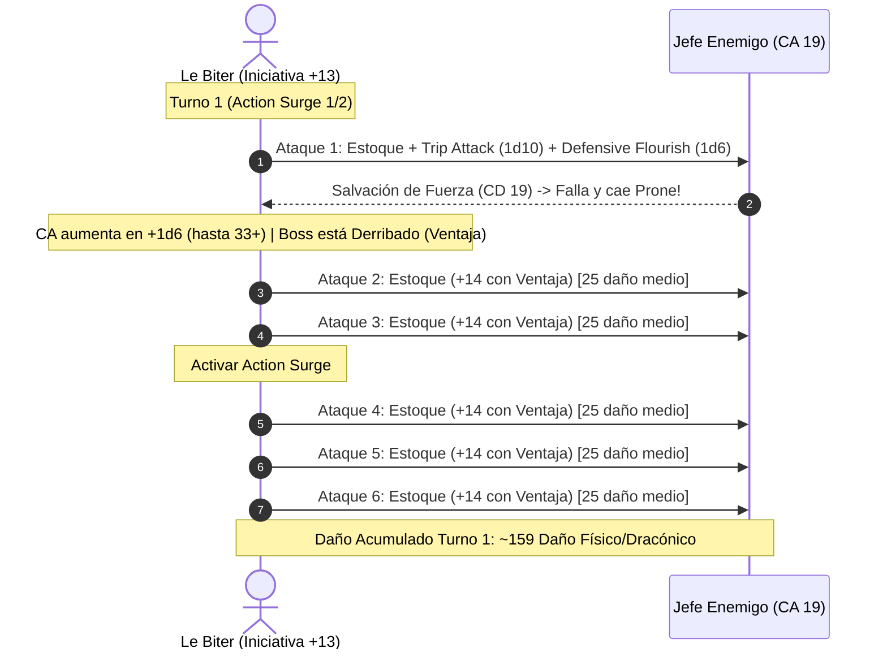

# 🌟 Lista de Conjuros y Recursos Tácticos — Le Biter

Este personaje fusiona la maestría marcial de un **Battle Master** con la magia auxiliar y los floreos letales de un **College of Swords Bard**.

> **Nota de Regla de Mesa:** El estoque de combate actúa como foco de lanzamiento de conjuros universal, permitiendo portar escudo de acero sin entorpecer componentes somáticos.

---

## 🔮 Matriz de Recursos y Salvaciones

* **Espacios de Conjuro:** 4 ranuras de Nivel 1, 2 ranuras de Nivel 2.
* **Dados de Superioridad:** 6d10 por Descanso Corto (CD de maniobras: $8 + \text{PB (6)} + \text{DES (5)} = \mathbf{19}$).
* **Dados de Inspiración Bárdica:** 3d6 por Descanso Largo (para *Blade Flourishes* o apoyo aliado).
* **CD de Salvación de Conjuros:** $8 + \text{PB (6)} + \text{CHA (3)} = \mathbf{17}$.
* **Turno 0 Pre-Buffs:**
  * Lanzamiento de *Mirror Image* (Nivel 2, sin concentración, dura 1 minuto).
  * Postura defensiva activa: CA 27 base.

---

## 🪄 Trucos (Cantrips)

| Conjuro | Escuela | Clasificación | Efecto y Justificación Táctica |
| :--- | :---: | :---: | :--- |
| **Minor Illusion** | Ilusión | 🟢 | Crea coberturas visuales de 5 pies o ruidos distractores para habilitar sigilo previo al asalto. |
| **Vicious Mockery** | Encantamiento | 🟡 | Inflige $4\text{d}4$ de daño psíquico e impone desventaja en el siguiente ataque del enemigo tras fallar salvación de Sabiduría (CD 17). |
| **Friends** | Encantamiento | 🟡 | Ventaja en pruebas de Carisma con criaturas no hostiles para interacciones diplomáticas rápidas en el bastión. |

---

## 🎒 Conjuros Preparados / Conocidos

*Organizados por el nivel de la ranura de conjuro.*

### Nivel 1 — 4 Ranuras

| Conjuro | Concentración | Clasificación | Efecto y Justificación Táctica |
| :--- | :---: | :---: | :--- |
| **Silvery Barbs** | No (Reacción) | 🔵 | Fuerza a un enemigo a repetir una tirada de éxito crítico o salvación exitosa y concede ventaja a un aliado. Vital para anular ataques letales contra tu grupo. |
| **Faerie Fire** | Sí | 🔵 | Cubre un área de 20 pies; todas las criaturas fallidas quedan iluminadas, anulando invisibilidad y otorgando ventaja grupal permanente en tiradas de ataque. |
| **Dissonant Whispers** | No | 🟢 | $3\text{d}6$ daño psíquico. Fuerza al objetivo a gastar su reacción para huir a toda velocidad, provocando ataques de oportunidad masivos para ti y tus aliados. |
| **Cure Wounds** | No | 🟢 | Restaura $1\text{d}8 + 3$ puntos de golpe como toque de emergencia cuando un aliado cae inconsciente. |

### Nivel 2 — 2 Ranuras

| Conjuro | Concentración | Clasificación | Efecto y Justificación Táctica |
| :--- | :---: | :---: | :--- |
| **Mirror Image** | No | 🔵 | Crea 3 duplicados ilusorios. Los ataques dirigidos contra ti tienen una probabilidad altísima de golpear y destruir una copia en lugar de impactarte, sin consumir concentración. |
| **Hold Person** | Sí | 🔵 | Paraliza a un objetivo humanoide que falle salvación de Sabiduría (CD 17). Todos los ataques realizados a menos de 5 pies contra la criatura son **críticos automáticos**, multiplicando la letalidad de Action Surge. |

---

## ⚔️ Maniobras de Battle Master (6d10 por Descanso Corto)

* **Trip Attack:** Suma 1d10 al daño de tu ataque y obliga al objetivo a superar una salvación de Fuerza (CD 19) o quedar derribado boca abajo (*Prone*), concediendo ventaja a todos tus ataques subsiguientes.
* **Riposte:** Si una criatura falla un ataque cuerpo a cuerpo contra tu CA (27-38), usas tu reacción para realizar un ataque de estoque sumando 1d10 al daño.
* **Precision Attack:** Añade 1d10 al resultado de una tirada de ataque que haya quedado corta para garantizar el impacto.
* **Goading Attack:** Suma 1d10 al daño e impone desventaja al enemigo al atacar a cualquier criatura distinta a ti hasta el final de tu siguiente turno.
* **Maneuvering Attack:** Añade 1d10 al daño y permite a un aliado alejarse la mitad de su velocidad sin provocar ataques de oportunidad.
* **Menacing Attack:** Añade 1d10 al daño e impone el estado Asustado (*Frightened*) al objetivo (CD 19) impidiéndole acercarse.

---

## 🤺 Floreos de College of Swords (3d6 por Descanso Largo)

* **Defensive Flourish:** Añade 1d6 al daño del impacto y suma el resultado de la tirada a tu Clase de Armadura hasta el comienzo de tu siguiente turno.
* **Slashing Flourish:** Añade 1d6 al daño y causa ese mismo daño a otra criatura a menos de 5 pies de ti.
* **Mobile Flourish:** Añade 1d6 al daño, empuja al objetivo $5 + 1\text{d}6$ pies y te permite teletransportarte/moverte inmediatamente junto a él sin consumir movimiento.

---

## 💥 Secuencia de Combate Nova (Action Surge x2 + Trip Attack + Flourish)

---

## 🩺 Curación en Segundo Plano y Mantenimiento Vital

1. **Second Wind (Guerrero):**
   * Acción adicional: Restaura instantáneamente $1\text{d}10 + 17$ puntos de golpe. Recuperable tras cada descanso corto.
2. **Song of Rest (Bardo Nivel 2):**
   * Durante un descanso corto, tú y todos tus aliados que gasten dados de golpe para curarse recuperan $1\text{d}6$ puntos de golpe adicionales sin coste de recursos.
3. **Cure Wounds:**
   * Disponible para estabilizar y levantar aliados caídos en emergencias con ranuras de nivel 1.
4. **Pociones de Bastión:**
   * La Armería y el Teatro del Bastión suministran 2 *Potions of Greater Healing* ($4\text{d}4 + 4$) y 1 *Potion of Speed* para despliegues prolongados.