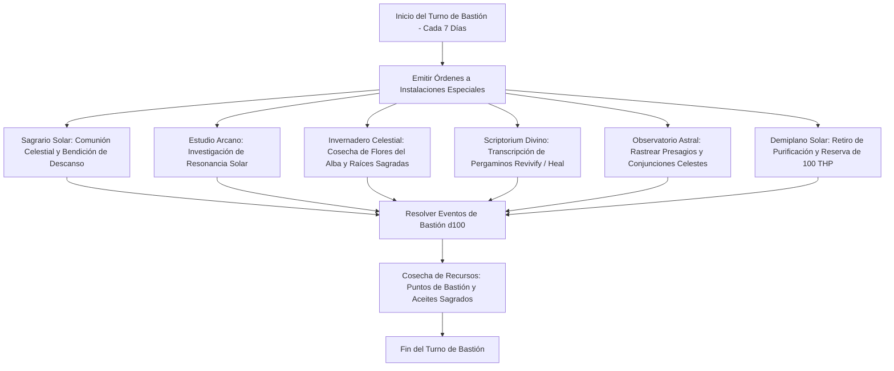

# 🏰 Bastión y Tiempo Muerto — Light of Tomorrow

## 🏰 Sistema de Bastiones (Reglas Oficiales DMG 2024 / D&D 5.5e)

* **Nombre del Bastión:** El Bastión de la Llama Inmortal (The Immortal Flame Bastion)
* **Nivel de Bastión:** 20 (Capacidad Máxima)
* **Puntos de Bastión (BP):** 100
* **Puntuación de Mando y Defensas (Defender Stats):**
  * STR 8 (-1), DEX 14 (+2), CON 16 (+3), INT 8 (-1), WIS 10 (+0), CHA 20 (+5)
  * **Bonificador de Defensa de Bastión:** $\mathbf{+11}$ (+6 Competencia + 5 Carisma)

---

## 🏛️ Registro de Instalaciones del Bastión (Nivel 20: 4 Roomy + 2 Vast)

### Instalaciones Básicas (Basic Facilities - Gratuitas e Ilimitadas)
1. **Dormitorio del Portador del Alba (Bedchambers):** Aposento orientado al este con ventanales de cristal prisma que bañan la estancia en luz dorada perpetua.
2. **Refectorio de la Luz (Dining Hall):** Comedor de mármol blanco para 16 personas donde se comparten alimentos consagrados y agua bendita purificada.
3. **Sala Capitular de Devotos (Common Room):** Espacio de reunión para paladines errantes, sacerdotes y peregrinos que buscan consuelo espiritual.
4. **Almacén Consagrado (Storage):** Sala blindada con sellos celestiales para proteger diamantes de resurrección, incienso sagrado y reliquias.

---

### Instalaciones Especiales (Special Facilities: Exactamente 6 al Nivel 20)

| Instalación | Tamaño (DMG 2024) | Nivel Mínimo | Estado | Orden Activa | Sinergia con el Build |
| :--- | :---: | :---: | :---: | :--- | :---: |
| **Sagrario Solar (Sanctuary)** | **Roomy** | Nivel 5 | Activa (Maintain) | *Communion:* Canaliza gracia divina; concede ventaja en tiradas de salvación de Muerte y cura aflicciones a los aliados. | 🔵 **Roto** |
| **Estudio Arcano de Luz (Arcane Study)** | **Roomy** | Nivel 5 | Activa (Maintain) | *Craft:* Fabricación de pergaminos de *Shield*, *Absorb Elements* y *Misty Step* a mitad de coste. | 🟢 **Excelente** |
| **Invernadero Celestial (Greenhouse)** | **Roomy** | Nivel 5 | Activa (Maintain) | *Harvest:* Cultiva lirios solares que sustituyen componentes materiales de curación de hasta 300 po semanales. | 🟢 **Excelente** |
| **Scriptorium Divino (Scriptorium)** | **Roomy** | Nivel 9 | Activa (Maintain) | *Transcribe:* Elaboración de pergaminos de alta graduación (*Revivify*, *Greater Restoration*, *Death Ward*). | 🔵 **Roto** |
| **Observatorio Astral (Observatory)** | **Vast** | Nivel 13 | Activa (Maintain) | *Divination:* Observa conjunciones del Monte Celestia; otorga un dado d4 de bendición a una tirada diaria para todo el grupo. | 🔵 **Roto** |
| **Demiplano Solar (Demiplane)** | **Vast** | Nivel 17 | Activa (Maintain) | *Sanctuary:* Retiro dimensional sagrado que suministra **100 THP de descanso prolongado** y forja diamantes sagrados sin coste. | 🔵 **Roto** |

---

## 👥 Guarnición y Personal de Mando (Staff & Garrison)

* **Mayordomo Mayor (Major Domo):** Hermana Clara de la Aurora (Clérigo veterana consagrada a la administración impecable del templo).
* **Guarnición Activa:**
  * 12 Cruzados Solares (Guerreros juramentados con armadura de placas dorada y escudos cometa).
  * 6 Ballesteros de Luz que emplean proyectiles consagrados.
* **Personal Especialista:**
  * 1 Maestro Herborista Celestial a cargo del invernadero.
  * 1 Escribano Sagrado especializado en sellos y tinta de oro celestial.
  * 2 Sanadores de Campo para atención a peregrinos.

---

## ⏳ Actividades de Tiempo Muerto (Downtime Priorities)

### Prioridad 1: Scriptorium de Resurrección (*Revivify* y *Death Ward*)
* **Objetivo:** Garantizar un stock perpetuo de pergaminos de *Revivify* y *Death Ward*.
* **Mecánica:** En el *Scriptorium Divino*, transcribir pergaminos sagrados empleando polvo de diamante cultivado en el *Invernadero* y *Demiplano*.
* **Ventaja Táctica:** Evita consumir ranuras de Hechicero en preparación previa, permitiendo reservar los espacios de nivel 3 y 4 para metamagia ofensiva y aceleración en combate.

### Prioridad 2: Destilación de Filtros de Purificación Solar
* **Objetivo:** Creación de pociones de restauración mayor y neutralización de venenos demoníacos.
* **Mecánica:** Trabajo en el *Invernadero Celestial* para sintetizar 2 Pociones de Vitalidad cada dos semanas.

### Prioridad 3: Diplomacia Celestial y Red de Peregrinaje
* **Objetivo:** Afianzar el prestigio del bastión como enclave de protección frente a incursiones infernales o abisales.
* **Mecánica:** Misiones benéficas coordinadas mediante tiradas de Carisma (Persuasión $+11$), generando alianzas con órdenes de caballería y devotos.