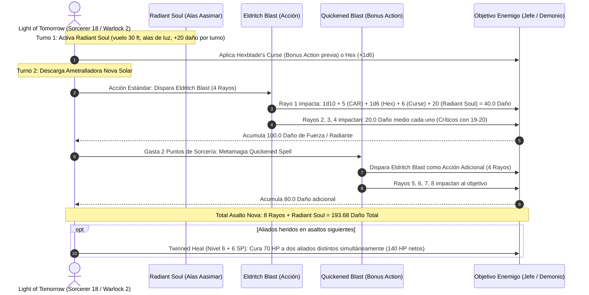

# 🌟 Lista de Conjuros Optimizada — Light of Tomorrow (Sorcerer 18 / Warlock 2)

**Arquetipo:** Alma Divina (*Divine Soul*) & El Filo Maldito (*Hexblade*)  
**CD de Salvación de Conjuros:** $8 + 6 \text{ (Prof)} + 5 \text{ (CAR)} = \mathbf{19}$ (Base) / $\mathbf{22}$ (Con *Bloodwell Vial +3*)  
**Modificador de Ataque Mágico:** $+11$ (Base) / $\mathbf{+14}$ (Con *Bloodwell Vial +3*)  
**Ventaja Única:** Acceso simultáneo e irrestricto a la lista completa de **Sorcerer** y **Cleric**.

---

## 🔮 Trucos (Cantrips)

### 🧙‍♂️ Sorcerer & Divine Magic (6 Conocidos)
1. **Guidance 🔵 [Excelente]:** $+1\text{d}4$ a pruebas de habilidad de cualquier aliado.
2. **Light 🟡 [Utilidad]:** Luz sagrada radiante en objetos portados.
3. **Mending 🟢 [Utilidad]:** Reparación de armaduras, escudos y símbolos sagrados.
4. **Message 🟡 [Comunicación]:** Envío de órdenes tácticas silenciosas a 120 pies.
5. **Sacred Flame 🟢 [Ataque Alternativo]:** $4\text{d}8$ de daño radiante ignorando cobertura (salvación de Destreza).
6. **Prestidigitation 🟡 [Utilidad]:** Efectos menores de ambientación e higiene mágica.

### 💀 Warlock (2 Conocidos)
1. **Eldritch Blast 🔵 [Ametralladora Ofensiva]:** 4 rayos de fuerza a nivel 20; suma $+5$ por rayo gracias a *Agonizing Blast*.
2. **Minor Illusion 🟢 [Control Táctico]:** Cobertura visual ilusoria y distracciones sonoras.

---

## 🎒 Conjuros de Warlock (Hexblade — 2 Ranuras de Nivel 1 en Descanso Corto)

1. **Shield 🔵 [Defensa Suprema]:** Reacción inmediata para ganar $+5$ a la CA hasta el inicio del siguiente turno.
2. **Hex 🟢 [Marcaje Ofensivo]:** $+1\text{d}6$ de daño necrótico por impacto de rayo; impone desventaja en pruebas de una característica seleccionada.

---

## 🎒 Matriz de Conjuros de Sorcerer (Divine Soul — 15 Conocidos)

### 9.º Nivel (1 Ranura)
* **Wish 🔵 [Omnipotencia Arcana]:** Permite duplicar cualquier conjuro de nivel 1-8 existente en el juego sin coste de componentes ni tiempo de lanzamiento.

### 8.º Nivel (1 Ranura)
* **Holy Aura 🔵 [Baluarte Divino Supremo]:** Otorga a todos los aliados a 30 pies **Ventaja en todas las tiradas de salvación**, impone **Desventaja a todos los atacantes hostiles**, y ciega a los fiends y no-muertos que conecten ataques cuerpo a cuerpo.

### 7.º Nivel (1 Ranura)
* **Conjure Celestial 🟢 [Invocación Superior]:** Invoca un Couatl u otra entidad celestial con acceso a curaciones, cambios de forma y venenos paralizantes.

### 6.º Nivel (1 Ranura)
* **Heal 🔵 [Curación Nuclear — Objetivo de Twinned Spell]:** Restaura **70 Puntos de Golpe fijos** a una criatura y elimina ceguera, sordera y enfermedades. Con *Twinned Spell* (6 SP), cura **140 HP** repartidos en dos aliados de forma instantánea.

### 5.º Nivel (2 Ranuras)
* **Greater Restoration 🟢 [Limpieza Vital]:** Elimina agotamiento, petrificación, maldiciones y reducciones permanentes de características.
* **Synaptic Static 🟢 [Bomba Psíquica]:** $8\text{d}6$ de daño psíquico en radio de 20 pies; resta $1\text{d}6$ a tiradas de ataque y salvación enemigas durante 1 minuto sin concentración.

### 4.º Nivel (3 Ranuras)
* **Death Ward 🔵 [Seguro de Vida — Twinned]:** Concede inmunidad ante muerte instantánea o caída a 0 HP durante 8 horas sin requerir concentración. Duplicable con *Twinned Spell* (4 SP) sobre dos aliados clave.
* **Banishment 🔵 [Control Extraplanar]:** Envía a amenazas singulares a otro plano (salvación de Carisma con CD 22).

### 3.ᵉʳ Nivel (3 Ranuras)
* **Counterspell 🔵 [Interrupción Arcana]:** Cancela hechizos hostiles a 60 pies como reacción.
* **Revivify 🔵 [Resurrección Inmediata]:** Devuelve a la vida a un aliado caído en el último minuto.
* **Haste 🟢 [Buff Ofensivo — Twinned]:** Otorga velocidad duplicada, $+2$ CA y un ataque extra a dos combatientes aliados simultáneamente.

### 2.º Nivel (3 Ranuras)
* **Aid 🔵 [Buffer Colectivo]:** Incrementa los HP máximos de 3 criaturas en $+5$ por nivel de ranura (upcast a Nivel 7: $+30$ HP máximos por 8 horas sin concentración).
* **Misty Step 🔵 [Movilidad Instantánea]:** Teletransporte de 30 pies como acción adicional para romper presas o evitar flanqueos.
* **Spiritual Weapon 🟢 [Daño Continuo]:** Ataque como acción adicional que inflige $1\text{d}8 + 5$ de daño de fuerza continuo sin concentración.

### 1.ᵉʳ Nivel (4 Ranuras)
* **Healing Word 🔵 [Rescate Táctico]:** Acción adicional a 60 pies para levantar instantáneamente a un aliado caído.
* **Absorb Elements 🔵 [Defensa Reactiva]:** Reacción que confiere resistencia a daño de fuego, frío, rayo, trueno o ácido.
* **Bless 🟢 [Buff de Precisión]:** $+1\text{d}4$ a ataques y salvaciones para 3 criaturas.

---

## ⚡ Diagrama de Secuencia del Asalto Nova Solar

---

## 🩺 Curación en Segundo Plano y Resurrección (Background Healing)

Light of Tomorrow maximiza la rentabilidad del tiempo y las ranuras empleando metamagia para no reducir su cadencia ofensiva:

1. **Curación Nuclear Duplicada (*Twinned Heal*):**
   * Al utilizar la metamagia *Twinned Spell* (6 Puntos de Hechicería), se selecciona a dos aliados heridos a 60 pies.
   * Ambos reciben **70 Puntos de Golpe fijos** de forma instantánea ($140 \text{ HP}$ totales), disipando de paso cualquier ceguera o sordera.
2. **Buffer Preventivo de Vida (*Aid* + *Death Ward*):**
   * Antes de emprender combate, se lanza *Aid* de nivel 7 u 8, aumentando permanentemente la vida máxima de los aliados principales en $+30$ a $+35$ puntos.
   * Se lanza *Death Ward* duplicado con metamagia sobre el frontline (Paladín / Bárbaro) y el propio Hechicero, garantizando que el primer golpe letal los deje a 1 HP sin consumir reacciones.
3. **Rescate en Acción Adicional (*Healing Word*):**
   * Si un combatiente cae inconsciente, una simple *Healing Word* de nivel 1 como Acción Adicional lo devuelve al combate a 60 pies, reservando la Acción principal para disparar 4 rayos de *Eldritch Blast* ofensivos.
4. **Banquete Divino (*Heroes' Feast* vía *Wish*):**
   * Empleando *Wish* al final del día anterior, se manifiesta un *Heroes' Feast* instantáneo sin consumir los 1,000 po de diamante ni tardar 1 hora en prepararlo, otorgando $+2\text{d}10$ de vida máxima y ventajas en salvaciones a todo el grupo.
5. **Recarga Continua de Puntos de Sorcería en Descanso Corto:**
   * En descansos cortos, las dos ranuras de Warlock de nivel 1 se convierten en 2 Puntos de Sorcería adicionales para seguir financiando *Twinned Spells* sin erosionar las ranuras de nivel alto.